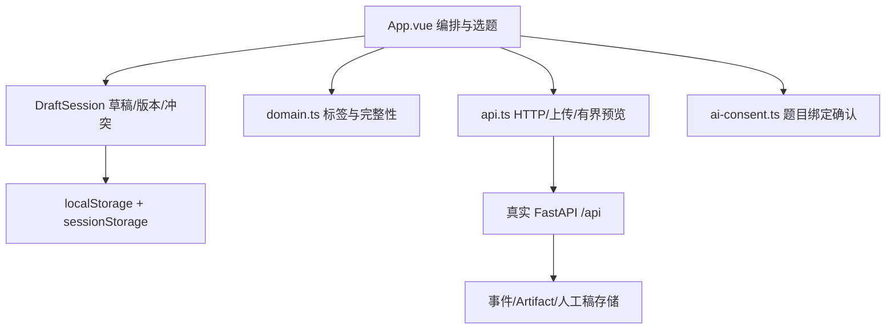

# 前端工作台审查与渐进迁移清单

审查日期：2026-11-09。基线：PR #9 `30eeed6dcc180ae21b5648f25047c5889e3c434a`。
本工作副本另集成已核验的跨题目确认补丁；未提交、未推送。本文是代码审查，不是完成重构或生产验收的声明。

## 1. 页面与入口

当前是单个 Vue App，无路由器和全局状态库。项目配置、题目创建和列表在 App 壳层；选中题目后通过 `tab` / `v-show` 展示六个面板。

| 入口 | 当前实现 | 后端关系 / 持久化 |
|---|---|---|
| 项目与比赛规则 | `loadProject`、`saveProject`、`sendFile('rules')` | GET/PUT `/api/project`；规则上传 `/api/project/rules` |
| 题目列表与创建 | `reload`、`createChallenge`、`select` | GET/POST `/api/challenges`；选中 ID 缓存在 localStorage |
| 题目与导入 | `sendFile('zip')`、拖放、导入列表 | POST `/challenges/{cid}/imports`；导入详情先检查 manifest_verified |
| 文件预览 | `showFile`、`importPath`、`clearFile` | `/imports/{id}/files/{path}`、`/artifacts/{id}/content`；有界读取和 Blob URL 回收 |
| 运行记录 | `record`、`copyCommand` | POST `/manual-operations`；只是人工补录，不启动进程 |
| 分类证据 | `sendFile('artifact')`、`evidence` 表单 | POST `/artifacts`；保留 evidence_kind / capture_time_claim |
| AI 解题 | `loadAIStatus`、`testAIConnection`、`askAI` | `/model/status`、`/model/test`、`/challenges/{cid}/ai/chat` |
| 事件时间线 | `refresh`、`eventLabel`、`verify` | GET `/events`、`/integrity`；按 sequence 展示，不将消息视为执行 |
| 人工笔记 | `addNote` | POST `/notes`；note 和 approach 区分 |
| Writeup | `generate`、`saveDraft`、`reloadDraft`、`discard` | GET `/writeup/preview`；GET/PUT `/writeup/draft` |
| 导出 | `downloadMarkdown`、`print`、`exportZip` | 浏览器 Markdown/打印；ZIP 必须 GET 后端 `/export` |

路径表省略共同前缀 `/api`；具体字段以同步生成的 OpenAPI 为准，不新增临时 API。

## 2. 状态归属及依赖

| 状态 | 当前归属 | 约束 |
|---|---|---|
| project / challenges / selected | App refs | Challenge ID 是所有题目请求和展示的边界 |
| events / artifacts / imports / integrity | App refs | 必须属于同一选中题目的同一刷新代次 |
| 表单、busy / error / notice | App refs/reactive | 全局状态会导致跨面板提示或异步完成互相覆盖 |
| AI question / consent / busy / history | App + `ai-consent.ts` | 确认不持久化；与题目绑定；AI 历史从事件恢复 |
| Writeup 内容、版本、冲突 | `DraftSession` in `drafts.ts` | 每题独立实例；不自动 PUT；409 保留编辑稿并显式选择 |
| 草稿缓存 | `createDraftCache` | sessionStorage 每窗口优先，localStorage 兼容旧稿；缓存服务器 base_version |
| 文件预览与 Blob URL | App + `api.ts` | 请求序号防过期预览；切换/卸载 revokeObjectURL |
| 事件标签、完整性、路径 | `domain.ts` 纯函数 | 复用现有测试；模型建议永远不升级为已验证执行 |

当前没有已拆分的业务 Vue 子组件；不要把建议目录树描述为现存组件。`aiAnswer` 被赋值，但显示历史主要依赖 `agent_message`；后续可去除冗余状态，但不在补丁集成中顺带重构。

## 3. 已核验补丁

原文件：`C:\Users\28746\Documents\Codex\CTF-PR9-30eeed6-changes.diff`。
SHA-256：`475702f29ee38a64b4a36451eb4cec48812f89acb92ab894f5fb5dcee248326e`。

- 对 `30eeed6` 执行 `git apply --check` 成功；只应用到独立 worktree。
- 切题清空确认和待发问题；A→B→A 不恢复旧确认。
- 确认保存 Challenge ID；发送前再次校验并固定 cid、问题和 URL。
- 后端要求 consent_challenge_id 与 URL 一致；缺少为 422，不一致为 409，拒绝前不调用模型。
- 收到模型响应时若已切题，不把答案应用到当前题目。
- 补丁新增的浏览器用例部分使用路由替身，仅证明 UI 行为；不是模型联网或真实服务端历史持久化验收。

本补丁增加一个必填 API 字段，旧前端不能与新后端混用。必须配套发布，不能只复制 App.vue。

## 4. 审查缺口与复现条件

| 编号 | 风险 / 静态复现条件 | 后续修复与测试 |
|---|---|---|
| FE-01 | `refresh` 固定请求路径后 await，但回写 events/artifacts/imports 未校验 cid/代次；A 慢请求可能覆盖 B 的结果 | useChallenge 使用请求代次或 AbortController；测试 A 慢/B 快、A→B→A、并行刷新；不能仅比较当前 cid |
| FE-02 | `exportZip` 多次 await 后重复读取 root/selectedId；导出中切题可能混用预览、稿件提示和文件名 | 一次捕获 cid 与显示名；整个链使用快照；测试延迟 draft/preview/export 后切题 |
| FE-03 | 补丁只在成功响应路径保护 AI；失败提示仍可进入当前题目的全局 error | AI 请求状态按 cid + request generation 归属；晚到失败不能污染新题 |
| FE-04 | AI 历史从事件恢复，近期 20 条通用事件会挤出对话；无分页和历史截断说明 | 后端定义历史窗口，前端显示截断状态；不宣称完整长期上下文 |
| FE-05 | A1/A2 目前同权；前端确认文案统一包含附件 | 后端落实已批准权限契约后，按服务端能力呈现；不能靠隐藏按钮授权 |
| FE-06 | `model_call` 当前归入一般 observation；无专门的目的、成功/失败和关联调用展示 | 新增审计展示组件前先冻结响应 schema；与工具执行卡片分开 |
| FE-07 | 普通 `npm run test:e2e` 使用已有 8000/5173，草稿测试还有停止其配置服务的逻辑 | 开发时禁止直接运行；先参数化测试地址与所有子窗口 origin，再配置专用服务、拒绝复用并只管理自建 PID |
| FE-08 | 项目规则填写、AI 权限、外发确认散落；无工具审批可信身份机制 | 先完成后端策略与审批身份设计；不提前创建可点击但无安全约束的执行入口 |
| FE-09 | 分析与记录侧栏仍有“工具执行、模型联网和 Flag 均未启用”的固定旧文案；开启模型后可能与状态面板冲突 | 与 AI-S02 披露修复协调，按实际能力/调用记录显示；工具禁用与模型联网分别表达 |

上述是静态风险，不冒称已逐项动态复现。尤其补丁通过不代表 FE-01/02 自动解决。

## 5. 渐进拆分顺序

1. 先处理 FE-01/02，请求代次和题目快照成为共用约束；保持 UI 外观和全部 API 不变。
2. 抽出 useAIChat / AIConsentPanel / AIChatPanel；保留原文字、确认绑定、刷新历史、超时错误和请求边界。
3. 抽出 WriteupEditor / WriteupPreview，直接复用 DraftSession；保留迁移、409、双窗口缓存、未保存 ZIP 提示。
4. 抽出 EvidencePanel、ChallengeList/Detail，保留 Manifest 验证和证据分类。
5. 工具 API 经审查后才加入 ToolApprovalPanel / ToolCallCard / ToolExecutionResult。显示实际服务端状态，不自行推导执行成功。
6. 最后整理工作台总览；待审批数量只能来自真实状态投影，没有接口时不显示伪造的零计数。

每步必须有独立 diff，先跑对应单元测试和隔离 HTTP/UI 测试，再跑前端全套和生产构建。禁止一次重写 App.vue，禁止删除旧草稿、降低证据校验或重新生成 Golden expected。

## 6. 验收门槛

覆盖桌面与 390px；切题/刷新恢复、长请求切题、人工稿首次保存/更新/冲突/离线恢复、双窗口草稿、导入篡改 409、incomplete 导出、ZIP 双稿及所有 SHA256SUMS。真实模型成功必须另列，Mock 不替代。当前重构未执行，真实题目验收仍为 NO-GO。
