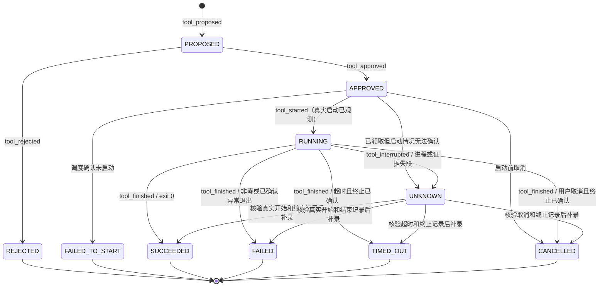
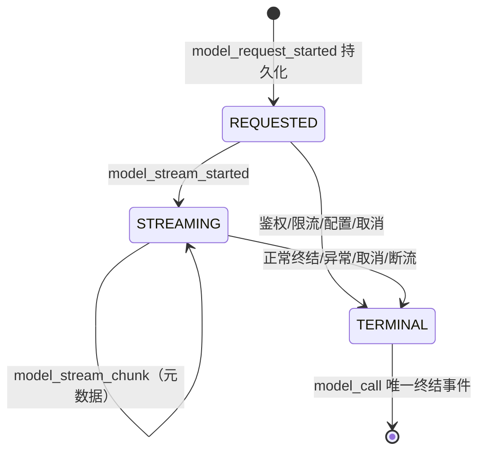

# P1-2 工具生命周期与审计接口设计

版本：0.1，2026-11-07。状态：设计提案，待独立审核；不是已实现能力说明。

本轮只新增本文。不得改变 PR #1/#2 的代码、执行真实工具或开放模型网络 API。后续实现必须在独立实现分支通过审查；本文的 HTTP 路由、内部方法与数据库对象均为建议，不得在本轮注册或应用。

## 1. 审查基线与结论

审查固定提交，避免用 main 的旧代码代替在审实现：

- P0.1：`ed4850dc17601a9e8177c12c95d1281e072cccd4`。
- P1-1：`778bad7c6db0f4412ce3c55bca0c24b78ad66905`，包含 P0.1 接口。
- 规范：WRITEUP_INTEGRITY_SPEC.md、P1_ARTIFACT_STORAGE.md、MODEL_PROVIDERS.md。

| 已核对对象 | 当前事实 | P1-2 设计决定 |
|---|---|---|
| ToolProposal | proposal_id、可空 call_id、challenge_id、tool_name、arguments、scope、proposed_at；没有持久化状态或模型请求 ID | 增加 request_id、origin、不可变批准摘要；单独存储状态投影 |
| ToolApproval | proposal_id、approving_user、approved、decided_at | 审批身份来自可信会话；关联确定的提案摘要，不能信任客户端提交的用户名 |
| ToolStarted | proposal_id、executable/version、argv、cwd、环境变量名称列表、started_at | 加 execution_id、实际启动凭据、call_id、challenge_id；不能由 Agent 或普通 HTTP 客户端上报 |
| ToolExecutionResult | 开始/完成 event_id、结束时间、exit_code、timed_out、两个输出 artifact_id 与哈希 | 加 outcome、termination_reason、输出完整性和 execution_id；允许真实未知值，禁止补造输出 |
| EventType | 已有 tool_proposed/approved/rejected/started/finished；另有 command_started/finished、model_call | 保留旧类型，不改写历史；新工具路径只用 tool_*；增加取消、调度失败、失联及模型流式事件 |
| events/event_heads | WAL；BEGIN IMMEDIATE；题目内 sequence 唯一；_append_event 在调用者事务追加与更新 head；触发器禁止更新/删除 | 生命周期状态、索引、幂等响应和事件必须同一事务提交；不得用多个 Store.append 拼接状态变更 |
| ArtifactStore | ingest(BinaryIO, filename=...) 返回 IngestedArtifact；blob 先落盘、SHA-256 内容寻址；read_verified 重算哈希 | 捕获原始二进制输出，不经文本编码往返；完成前校验字节与大小 |
| Store.add_artifact | 自有事务，返回 (Artifact, Event 或 None)；同题同哈希去重；新来源事件 actor=user | 保留上传接口；提取内部事务助手支持工具来源和原子完成，不能直接连调两次现有 public 方法后假称全局原子 |
| 002_artifacts.sql | UNIQUE(challenge_id,sha256)、source_event_id UNIQUE、同题来源外键；Artifact 不可改 | 来源是第一次摄入；tool_finished 另作使用关联，不能将多个输出改指同一个 source_event_id |
| ToolCall → proposals() | call_id 已保留，proposal_id 每次新生成 | 调用转换不是幂等持久化；以 request_id + call_id 去重，不能全局按 call_id 去重 |
| recorded_complete | success/ProviderError.code/internal_error/cancelled；finally 写一条 model_call | 保留兼容；尚无“请求已开始”持久记录；审计写入异常可能覆盖原调用异常，需定义失败优先级 |
| stream() | 无独立审计包装；SSE 文本/调用片段累积，遇 DONE 跳出；自然 EOF 也会 yield 最终 response | 缺少 DONE、异常 EOF、截断参数不得成为完整响应；必须加入显式终结判定 |
| DisabledBroker | 空 registry；批准后仍拒绝执行 | 本轮及默认运行继续禁用，设计通过不等于执行许可 |

## 2. 核心不变量与标识

Event 是审计事实来源；状态表是可校验投影，不能替代事件。API 不接受 actor、event_id、sequence、occurred_at 或执行结果等可伪造字段。服务统一生成 UTC 录入时间；实际工具时间另存 captured_started_at/captured_ended_at，不能回填或重排历史 sequence。

所有工具事件使用现有 Event envelope：event_id、challenge_id、sequence、occurred_at、actor、event_type、payload、artifact_ids、event_refs、previous_event_hash、event_hash。工具 payload 公共部分：

```json
{
  "schema_version": 1,
  "proposal_id": "server-uuid",
  "call_id": "provider-call-id-or-null",
  "request_id": "model-request-uuid-or-null",
  "execution_id": "server-uuid-or-null"
}
```

challenge_id、actor、timestamp(occurred_at)、event_id、artifact_ids 由 envelope 保留，不在 payload 重复。关联输出时同时保留 role 和 Artifact ID，不能依赖列表下标判断 stdout/stderr。没有证据时 artifact_ids=[]，不生成假证据 ID。

模型来源：request_id 与 call_id 必须同时非空；人工来源二者均为空并明确 origin=user。request_id 指向同题、完整成功的模型响应；call_id 在一次响应内唯一。proposal_id 始终由工作台生成，后续审批/执行沿它追溯 request_id/call_id。模型重复调用 ID 或不完整参数使整批转换失败，不产生部分提案。模型文本声称“已执行”只能是未验证 agent_message。

提案不可变：绑定 tool_name、registry_version、结构化 arguments、输入 Artifact ID/哈希、scope_snapshot、policy_version、超时/输出限额、环境变量名称 allowlist、sandbox_profile。用现有 canonical 规则生成 proposal_digest。环境变量值和凭证不得进入 argv、提案或批准摘要；工具需要凭证时只能引用安全存储句柄。摘要不是签名。

任何修改（包括作用域缩小、工具版本变化、输入哈希变化）均需新 proposal 和新审批。审批不能授权任意 shell；注册表只接受具名工具和参数 schema。网络默认关闭、禁止扫描/平台攻击/自动提交，XSWCTF 活动容器最多 3 个。工具允许与否需在提案、批准及调度前分别验证；后续策略变严时不得继续沿用旧授权。

## 3. 状态机和异常语义



说明：用户示意中的 APPROVED → APPROVED 是审批后的稳定状态，不是再次批准的状态变更；同一审批重试返回原事件。PROPOSED 可通过拒绝结束，避免另造“未审批取消”语义。

| 状态/动作 | 前置条件 | 事件与结果 |
|---|---|---|
| 提案 | 注册工具、schema、scope 合法；模型来源已完整 | tool_proposed；PROPOSED |
| 批准/拒绝 | 仅 PROPOSED，可信用户，摘要一致 | tool_approved 或 tool_rejected；一条决策 |
| 领取执行 | APPROVED，无既有 execution；功能开关与策略允许 | 仅内部 dispatch claim，尚未声称实际启动；拒绝自动重领 |
| 开始 | 已领取，隔离运行器证明真实启动，关联同一执行 ID | tool_started；RUNNING；审批和提案 event_refs |
| 完成 | 存在匹配 tool_started；捕获进程已退出与输出状态 | tool_finished；终态及开始 event_refs |
| 超时/取消 | 先记请求，再确认隔离进程已停止 | tool_cancel_requested（用户取消）或 tool_timeout_requested；状态仍 RUNNING，随后才 tool_finished |
| 运行异常 | 能确认退出，保留失败输出 | FAILED，reason=runtime_error/signal 等；exit_code 可空但不得伪造 0 |
| 失联/捕获失败 | 无法确认退出或完整落盘 | tool_interrupted；UNKNOWN；输出可保留已捕获前缀并标 partial，不伪装成功 |

STARTED 不是“打算启动”。调度前持久 claim（唯一 execution_id、owner、nonce、claimed_at、lease_deadline、dispatch_status=claimed）及私有运行器日志；拿到 OS/容器启动回执后才写 tool_started。启动调用抛错但不能确认“没有启动”时必须 UNKNOWN，不能 FAILED_TO_START。

领取后、启动回执前取消：先追加取消意图，内部 cancel_requested 标志与取消事件同事务提交。运行器 spawn 前须在事务中 CAS 领取一次性启动许可，检查该标志；取消先胜出则许可被拒绝，运行器确认未 spawn 后进入 CANCELLED，使用 tool_cancelled_before_start，无 started/finished。启动许可先胜出则取消只能请求终止；不能立即声称 CANCELLED。失去回执或无法确定是否 spawn 时为 UNKNOWN，禁止重领/重试执行。许可并非已启动事实，也不消除 SQLite 与 OS 间的崩溃窗口。

这是 at-most-once dispatch 设计，不声称跨 SQLite/OS 具备 exactly-once。领取后服务崩溃，重启只检查运行器日志/隔离实例，不重新 spawn。租约过期是失联信号，不是再次执行许可。无法恢复则 UNKNOWN + limitation，用户需明确创建新提案后才能尝试新执行。

恢复时有真实开始回执才能追加 tool_started，再追加真实 tool_finished；occurred_at 使用恢复录入时间，captured_* 标真实观测时间并带 recovered=true。若没有开始回执，不允许生成 tool_finished；UNKNOWN 可保持，不通过推测闭合历史。已完成的终态不可更改；新证据或更正用新 limitation/finding 事件，人工笔记不能改执行结果。

## 4. API 与内部接口契约（建议，当前不开放）

前缀 P=`/api/challenges/{challenge_id}/tool-proposals`。所有写请求需 Idempotency-Key（1–128 ASCII）、可信会话、JSON extra=forbid。请求摘要只用于本地去重，不包含 API Key。幂等键作用域为 challenge+principal+operation+key；request_digest 必须覆盖 HTTP method、规范化路由及其 challenge_id/proposal_id、canonical body。同键同目标和请求返回首次状态码/响应；同键跨目标或异 body 为 409 idempotency_conflict。拒绝请求不追加工具生命周期事件。跨题资源统一 404。

| API / 调用者 | 请求 | 响应 | 对应状态 |
|---|---|---|---|
| POST P / 用户或可信 Agent 编排服务 | ProposalCreate（下述） | 201 ProposalView；重试原响应 | PROPOSED |
| GET P?state=&cursor= / 用户 | 只读过滤、服务端游标 | 200 {items:ProposalView[], next_cursor} | 全部 |
| GET P/{pid} / 用户 | 无 body | 200 ProposalView | 全部 |
| POST P/{pid}/decision / 可信用户 | {decision:approve/reject, proposal_digest, reason_code?} | 200 DecisionView | APPROVED/REJECTED |
| POST P/{pid}/dispatch / 可信用户 | {proposal_digest}，仅排队意图 | 202 ExecutionView；本轮及禁用时 503 execution_disabled，无执行事件 | APPROVED（内部 claim） |
| POST P/{pid}/cancel / 可信用户 | {reason_code:user_cancelled} | 200 立即取消未领取提案；202 已领取或已运行取消意图，等待确认 | APPROVED/CANCELLED/RUNNING/UNKNOWN |
| GET P/{pid}/execution / 用户 | 无 body | 200 ExecutionView；从未领取则 404 | RUNNING/终态/UNKNOWN |
| 内部 broker.record_started / 隔离运行器 | StartedCapture | ExecutionView | RUNNING |
| 内部 broker.finalize / 隔离运行器 | FinishedCapture + 两个受信输出句柄 | ExecutionView | SUCCEEDED/FAILED/TIMED_OUT/CANCELLED |
| 内部 broker.interrupted / 恢复器 | reason_code + 实际捕获证据 | ExecutionView | UNKNOWN |

内部接口没有 HTTP 路由，普通客户端/Provider 不能构造调用。运行器身份由本地私有通道/持有者 nonce 验证，不是请求体中的 actor 字符串。尚无可信会话时 decision/dispatch/cancel 必须禁用；本地回环可达不等于用户批准。Agent 可以提案但不能批准。

ProposalCreate：{origin:user|model, tool_name, arguments, input_artifact_ids, requested_limits:{timeout_ms,max_output_bytes}, model_origin?:{request_id,call_id}}。scope/registry/policy/actor/timestamps 从服务端解析。模型来源请求必须匹配已保存的结构化调用，不能伪造 request_id 后提交不同参数。

ProposalView：{proposal_id,challenge_id,call_id,request_id,origin,tool_name,arguments,scope_snapshot,registry_version,policy_version,proposal_digest,state,proposed_at,proposed_event_id,decision_event_id?,execution_id?,latest_event_id,artifact_ids}。本地授权详情可见参数；通用日志和公开导出不得记录其完整内容。

DecisionView：{proposal_id,challenge_id,call_id,decision,approving_user_id,decided_at,event_id,artifact_ids:[]}。审批 identity 不是客户端自由文本。

ExecutionView：{execution_id,proposal_id,challenge_id,call_id,state,claimed_at,started_at?,ended_at?,started_event_id?,finished_event_id?,latest_event_id,artifact_ids,termination_reason?,exit_code?,timed_out,output_status}。只有 finished_event_id 非空且匹配 lifecycle 时才能显示“已结束”；UNKNOWN 不展示为完成。

StartedCapture：{execution_id,claim_nonce,actual_executable,executable_version?,argv,cwd,environment_allowlist,captured_started_at,runtime_receipt_ref}。路径和 argv 必须来自实际运行器而不是模型原始文本；无版本信息留空，不能虚构。nonce 不进入事件/导出。

FinishedCapture：{execution_id,captured_ended_at,exit_code?,termination_reason:normal|nonzero_exit|signal|runtime_error|timeout|user_cancelled,termination_confirmed,stdout_capture,stderr_capture}。capture 为受信字节句柄、captured_bytes、complete、truncated、capture_error_code，不能接受客户端填好的 stdout 文本或 SHA-256。结束事件 ID、哈希与结果状态均由服务派生。

错误统一 {error:{code,correlation_id}}，不回显参数/路径/输出/异常正文：400 请求格式；401/403 无可信用户/权限；404 不存在或跨题；409 invalid_transition/already_dispatched/digest_mismatch/idempotency_conflict/evidence_integrity_error；413 output_limit；422 schema/policy 校验；503 execution_disabled/audit_unavailable。业务拒绝不能伪造 tool_started/finished。

重复决策：同键重放原响应；不同键、同决定/同摘要/同用户可返回既有决策且不新增事件；冲突决定 409。dispatch 不同键若已有 execution，返回 409 already_dispatched（可附本题现有 execution_id），不得另起执行。finalize 同捕获摘要重试返回既有结果，不同结果 409。拒绝、终态和 UNKNOWN 不能重新 dispatch。

## 5. 事件 payload 明细

下表所有 payload 都加第 2 节公共关联字段，artifact_ids/event_refs 存 envelope。工具实际事件 actor=tool，用户决策与取消 actor=user，恢复中断 actor=system，模型提案 actor=agent。timestamp 使用服务端 occurred_at。

| event_type | 附加 payload | artifact_ids / event_refs |
|---|---|---|
| tool_proposed | tool_name、arguments、origin、registry_version、policy_version、scope_snapshot、input_artifact_hashes、limits、proposal_digest | 输入证据 / 完整模型响应终结事件（人工为 []） |
| tool_approved / tool_rejected | approving_user_id、proposal_digest、decision、reason_code | [] / proposed event |
| tool_started | actual_executable、executable_version?、argv、cwd、environment_allowlist（仅名称）、captured_started_at、runtime_instance_id、recovered | 输入证据 / proposed、approved events |
| tool_cancel_requested / tool_timeout_requested | reason_code、requested_at | [] / started 或 approved event |
| tool_dispatch_failed | reason_code、confirmed_not_started:true | [] / approved event；无 stdout 声称 |
| tool_interrupted | reason_code、last_observed_at、process_status:running/exited/unknown、termination_confirmed:true/false/null、evidence_status:partial/missing/failed、capture_status | 已确认前缀证据 / 已存在的 lifecycle events；null 表示未知，不把证据失败误记为进程未退出 |
| tool_output_captured | role、segment_sequence、capture_id、artifact_id、sha256、captured_bytes、complete、truncated、capture_reason | 本次捕获的 Artifact / 已有 started（若有）、首次摄入事件；actor=tool，恢复录入可为 system |
| tool_finished | outcome、termination_reason、captured_ended_at、exit_code?、timed_out、termination_confirmed:true、stdout:{artifact_id,sha256,size,complete,truncated}、stderr 同结构、capture_policy_version、recovered | 去重的 stdout/stderr IDs / started、approval、输出首次摄入事件及取消/超时请求事件 |

新增 tool_cancelled_before_start 用于尚未领取，或已领取但运行器明确确认未 spawn 的取消；前者 actor=user，后者确认事件 actor=system，payload.reason_code/confirmed_not_started，refs=approved 及已有取消请求，无 tool_finished。所有执行相关事件使用不可变 proposal 映射校验 challenge_id/call_id/request_id，不能在各阶段自由变更关联。

成功仅指进程 exit 0 且退出/捕获证据已完整持久化，不表示解题或 Flag 正确。输出截断/捕获异常不得标完整；本设计将其置 UNKNOWN（即使已知 exit 0），保留实际 exit_code 并产生 limitation，等待证据恢复；不能靠重新运行补造旧输出。超时/取消已确认终止且两路捕获状态可靠时可终结，结果必须保留失败输出。

## 6. SQLite 变更建议与原子边界

新增 `003_tool_lifecycle.sql`、`004_model_audit.sql`（建议名，不在本轮创建）。不改 001/002，不删除/更新历史 events 或 Artifact。保留 WAL、外键、recursive_triggers 和原 canonical 哈希。

建议表与约束：

| 表 | 主键/唯一键与关键列 | 约束 |
|---|---|---|
| tool_proposals | proposal_id PK；challenge_id、request_id?、call_id?、origin、immutable_body、proposal_digest、proposed_event_id | UNIQUE(challenge_id,proposal_id)；同题 proposed_event 联合 FK；模型 request/call 同时非空；人工同时空；部分唯一索引(challenge_id,request_id,call_id) WHERE request_id IS NOT NULL |
| tool_decisions | proposal_id PK/FK；decision、principal_id、proposal_digest、decision_event_id | 同题联合 FK；每提案至多一条决策；decision CHECK；不可变/不可删除 |
| tool_executions | execution_id PK；proposal_id UNIQUE、challenge_id、claim_nonce_hash、dispatch_status、claimed_at、lease_deadline | 同题 proposal 联合 FK；每提案至多一个执行；claim nonce 不以明文保存到审计 |
| tool_transitions | transition_id PK；execution_id?、proposal_id、event_id UNIQUE、from_state、to_state | 同题事件/提案/执行联合 FK；每阶段唯一索引防双 start/finish；只追加 |
| tool_state | proposal_id PK；state、revision、execution_id?、latest_event_id | 可变投影；CAS state/revision；只能通过受控事务推进；与 transitions 重放一致 |
| tool_capture_segments | capture_id PK；execution_id、role、segment_sequence、artifact_id、captured_bytes/hash、complete、truncated、capture_event_id | 追加式前缀/恢复版本；UNIQUE(execution_id,role,segment_sequence)；同题 FK；旧前缀不覆盖，新版本可引用更完整 Artifact |
| tool_output_links | (execution_id,role) PK；challenge_id、artifact_id、capture_size/hash、complete、truncated、finished_event_id | 仅最终完成事务写一次；role CHECK(stdout/stderr)；Artifact 和 event 同题联合 FK；允许两 role 指同一 Artifact；不可替换输出证据 |
| request_dedup | (challenge_id,principal_id,operation,idempotency_key) PK；request_digest、http_status、response_metadata、event_id? | 与变更同事务；不得保存敏感原请求；不自动清除已执行操作去重信息 |

为 Artifact 同题 FK 增加 `UNIQUE(challenge_id,artifact_id)` 索引；为 execution/proposal 关联设置对应联合唯一索引。模型来源还需 FK 到 model_requests(challenge_id,request_id)。原 Event JSON 字段不能靠普通 FK 检查：新增 tool_event_links(event_id PK,challenge_id,proposal_id,execution_id?,phase)，同题联合 FK，加 phase+proposal/execution 唯一索引；所有 lifecycle 事件必须同时建立索引。事件 payload 与关系列一致由事务服务验证，集成测试检测直写绕过，不能声称 SQLite 对任意 JSON 自动保证语义。

数据库触发器（建议）：禁止提案、决策、转换、capture segments、输出关联、事件链接的 UPDATE/DELETE；禁止 REPLACE 绕过；领取必须已有 approve 决策且 tool_state=APPROVED；start 必须唯一 claim；finish 必须已有 started link；reject 禁止 execution；state 迁移边触发器阻断非法跳转。投影更新 CAS 匹配 from_state 与 revision（受影响行数必须为 1），与事件插入/头推进同事务。phase 唯一索引仅用于 proposed/decision/start/finish 等一次性阶段；cancel/timeout 请求用其操作幂等键去重，interrupted 按 occurrence_id 唯一，允许不同时间的多条真实失联观察。

输出缺失时不能为满足 NOT NULL 而填假 ID。tool_output_links 仅在最终完成事务两 role 均已持久化、Artifact 大小/哈希匹配且引用同题后同时插入。UNKNOWN 仅保存 tool_capture_segments（可为零、一路或多版本），没有最终输出 links 和 finished_event。恢复选择经验证的完整捕获版本建立最终 links，不修改任何旧前缀。模型终结事件、幂等记录应采用同样一次性约束。

tool_capture_segments.capture_event_id 专门引用 tool_output_captured，不能引用 artifact_added 作为本次捕获事实。新 capture 即使去重复用旧 Artifact，也追加一次独立捕获事件（同一 capture_id 重放除外）。段行与该事件同事务写入；其唯一约束是 execution_id+role+segment_sequence，不能以 proposal+phase 唯一阻止多段。最终事务引用所选 capture_id 与捕获事件；未持久化的 spool 只存在恢复日志，不能宣称是已提交 Artifact。

事务模板：BEGIN IMMEDIATE → 校验当前状态/幂等/审批摘要/策略 → 预生成提案/执行/证据 ID → _append_event 插入事件并推进 event_heads → 插入引用该事件的不可变关联与转换 → 更新 tool_state → 保存去重响应 → COMMIT。先插事件再插有 FK 的关系行，无需依赖延迟外键；事件 JSON 的这些 ID 不形成反向 SQL FK，提交前由服务验证双向一致。内部 _append_event 扩展 event_refs 参数，并由事务服务校验引用归属；公共 append 不授予任意调用者写工具事件的权限。

不能在事务中调用会自行 BEGIN 的 Store.add_artifact/append；拆出 `_add_artifact_in_tx(db,...,actor)` 内部助手，保持 public add_artifact 的原签名、返回和上传 user 来源行为。所有涉及 stdout/stderr 的新 Artifact 行、artifact_added 事件、输出 links、tool_finished 和状态必须在同一完成事务写入。事件发生顺序为新输出 artifact_added（0–2 条）→ tool_finished；全部推进同一 event_heads，无中间可见状态。

## 7. 原始 stdout/stderr 与 P1-1 集成

隔离运行器独占二进制捕获通道；捕获来源绑定 execution_id 与私有 nonce，Agent/Provider 没有获取该通道的接口。stdout、stderr 分开保存，禁止 decode/re-encode、换行转换或在哈希前脱敏。Python 异常文本不冒充 stderr；捕获器自身错误只写 reason_code。

1. 调度前检查明确的本地敏感输出留存策略（raw retention、访问权限、限额、导出规则）。未配置策略拒绝 dispatch；不能执行后再决定是否允许保存秘密。
2. 持续读取两路输出到受限 spool，独立算 SHA-256 与 byte count；必须同时消费，防单一路缓冲阻塞。输出限额包含两路总量，也记录各路大小。
3. 达到输出限额请求终止、继续排空至安全终止边界；若只保留前缀，标 truncated=true/complete=false，哈希仅对应保存前缀，并记 observed_bytes（未知留空）与 captured_bytes，不声称是完整输出。P1-1 单 Artifact 50MB 上限仍需满足。
4. 退出确认后，在与现有上传共享的进程级 artifact_lock 下，将捕获二进制句柄交 ArtifactStore.ingest(stream,filename='stdout.bin'/'stderr.bin')，再 read_verified；校验 hash/size 与捕获计数一致。相同字节复用 blob，不覆盖或重写元数据。
5. 使用上一节事务助手查重与插入。新建 Artifact 的 source_event_id 仍是独立 artifact_added，actor=tool；已存在 Artifact 维持原 source_event_id（可能是 user 上传）。tool_output_links 与 tool_finished 说明本次输出使用关系，不能把去重后的旧来源误读成新执行来源。
6. 两路都是空输出时 SHA-256 相同，只有一个 Artifact 和一个来源事件，但 stdout/stderr role 各有一条关联。tool_finished.artifact_ids 去重，不将两个角色强制成两个不同 ID。
7. SQLite 完成失败整体回滚；真实进程不会因回滚而“未运行”。保留运行器私有日志和捕获 spool 以便恢复，不直接重新执行。文件已落盘而无元数据时可留下 orphan；只在确认无任何引用且无活跃 capture/恢复任务时清理，不能沿用上传的失败即删除逻辑误删恢复所需证据。

锁顺序固定 artifact_lock → SQLite 写事务；上传与工具终结共用协调器，避免与上传去重/清理竞态。延续 P1-1 单进程假设，多 worker 不支持。持有 SQLite 写锁期间禁止联网、等进程退出或写大文件；hash/ingest 在事务前完成，引用计数清理必须在同一协调锁范围。

失败/nonzero/timeout/取消的输出一律同等摄入；无输出也需真实空字节捕获，不能缺失时补空文件。raw 证据只在受控本地存储，不默认回显浏览器/普通日志/公开 Writeup。导出是独立派生视图，记录 redaction_policy_version 和原 Artifact/event 引用；若生成脱敏 Artifact 则是新 digest、新事件、显式派生关系，原证据永不原地脱敏。没有可靠脱敏策略时禁止公开输出正文，仅展示 IDs/状态及缺口。

## 8. 流式模型审计设计

新增 recorded_stream 管理异步上下文，调用者必须 async with 生命周期管理器，退出时显式 aclose；不依赖 GC finalizer 或 async generator 被遗忘后仍及时审计。API 不对外开放该入口。本轮不改现有 Provider 代码。

每次调用生成 request_id，关联 provider_id、model_id、challenge_id、stream_requested、effective_mode（stream/buffered）、capabilities_snapshot；禁止请求正文、Key、响应正文与私有推理内容进入默认审计。模型请求开始先落盘；审计不可用就不发送模型请求。



| 阶段 | EventType / payload（加 request_id、provider_id、model_id） | 完整性规则 |
|---|---|---|
| 请求开始 | model_request_started / requested_at、effective_mode | 在模型 I/O 前提交 |
| 响应开始 | model_stream_started / received_at、HTTP status class、protocol | 仅真实响应已被接收，不等于内容完整 |
| 内容块 | model_stream_chunk / chunk_sequence、received_at、text_bytes_delta、tool_delta_count | 只记元数据，不存 token 文本/工具参数；序号递增；heartbeat 单独计数，不当内容 |
| 正常结束 | model_call / response_status=success、complete=true、finish_reason、chunk_count、content_bytes、tool_call_count、ended_at | 必须协议终结、可接受 finish_reason、工具参数完整且校验通过 |
| Provider 错误 | model_call / response_status=ProviderError.code、complete=false、ended_at、partial_received | 包括 timeout/rate_limited/authentication 等，错误正文不存 |
| 用户取消/消费端提前退出 | model_call / response_status=cancelled、complete=false、cancel_origin=user|consumer、ended_at | 关闭上游流，不将已有部分文本提升完整 |
| 网络中断/不完整 EOF | model_call / response_status=connection_interrupted、complete=false、ended_at | 缺 DONE/终结帧，不生成最终成功 response |
| 内部异常 | model_call / response_status=internal_error、complete=false | 异常原样向上传递 |
| 服务崩溃恢复 | model_call / response_status=interrupted、complete=false、recovered=true | 只能关闭审计请求，不能猜测网络侧完成 |

建议 model_requests(request_id PK,challenge_id,provider_id,model_id,requested_at,mode,start_event_id UNIQUE) 不可变，model_stream_progress(request_id,chunk_sequence PK,event_id UNIQUE) 不可变，model_terminals(request_id PK,terminal_event_id UNIQUE,status,complete) 不可变；model_state 为可恢复投影。所有记录与各自事件同事务；终结表唯一约束保证成功/错误/取消竞态只有一个 winner。调用方收到最终完整响应必须晚于其成功终结审计提交。

Chat Completions SSE：必须观察 [DONE]，且已看到 stop/tool_calls 等支持的结束原因；finish_reason=length/content_filter 等记 incomplete（明确原因），不能以合法 JSON 自动推导完整。只有 DONE 没有 choice/finish_reason，同样 invalid_response。其他协议由 Adapter 提供等价终结证明，不硬套 SSE DONE。明确区分 httpx timeout、transport disconnect、正常 TCP EOF，Adapter 不得先把断流转成成功 ModelResponse 后再交给 wrapper 审计。

工具调用片段按 choice/index 累积，最终校验 call_id 非空且唯一、tool_name 注册、arguments 为完整 JSON object 并通过参数 schema。只有 complete=true 的最终响应可以在新的事务里创建 ToolProposal，且按 request_id/call_id 去重。片段、截断 JSON、流式文本、任何私有推理均不得进入 tool_started/finished；审批与执行仍是分离流程。

默认不保存完整模型输入/响应；为了以后从 request_id 校验提案，需要在用户明确授权的情况下保存“最终结构化工具调用”到本地受限模型结果表/Artifact（非 stdout，source_kind=model_output），包含参数，视为敏感。未授权保存则不自动持久化模型提案，要求人工新提案且 origin=user，不伪称有原模型调用证据。

若支持 allow_degrade 且无 streaming 能力，审计 effective_mode=buffered，不伪造 stream_started/chunk；终结仍一条 model_call。recorded_complete 后续复用同一审计协调器，防嵌套包装产生双终结事件。

取消必须进入受界定时间的审计收尾区，并关闭底层 HTTP；保留 asyncio.CancelledError 原实例。原调用异常和审计异常并存时，原调用异常优先向上传递，另用不含敏感文本的诊断码报告 audit_write_failed；正常响应遇审计失败应抛审计错误且不返回已审计成功。SQLite 不可用时不承诺终结已持久化，已有 REQUESTED 记录用于恢复时追加 interrupted；整个系统断电/磁盘损毁仍可能丢失审计，不制造记录。

## 9. 测试用例清单（待后续实现，非已通过报告）

全部使用合成字节、FakeRunner、MockTransport 和临时数据库；真实工具默认禁用。不用比赛题目附件、真实目标或 Flag。

| ID | 用例/故障注入 | 必须断言 |
|---|---|---|
| L01 | 用户/完整模型各提案 | 标识、摘要、同题来源；准确一条 proposed |
| L02 | approve/reject；Agent 冒充用户 | 合法单决策；伪身份拒绝 |
| L03 | 未批准/拒绝后 dispatch | 无 claim、start、finish，无真实执行 |
| L04 | 并发重复 dispatch、不同幂等键 | 至多一个 claim/运行器调度；第二个不执行 |
| L05 | 同键重试/异 body/重启重放 | 原响应、409、无新生命周期事件 |
| L06 | 未开始 finish/双 start/双 finish | DB 和服务均阻断；相同完成重放原结果 |
| L07 | exit0/nonzero/runtime_error/signal | outcome 正确；失败输出不丢；不改 solve 状态 |
| L08 | timeout 后进程尚活/已停止 | 前者 UNKNOWN 或待终止，后者 TIMED_OUT，不能提前成功 |
| L09 | 取消与启动/结束同时发生 | 唯一终结；先提交终结后取消为冲突或幂等返回，无双 finished |
| L09b | claim 后、spawn 许可前后并发取消 | 取消先胜出禁止 spawn；许可先胜出等待实际终止；无回执 UNKNOWN |
| L09c | 同题不同 proposal 使用同幂等键与相同 body | request_digest 含目标资源，409，不返回另一提案响应 |
| L10 | claim 后崩溃、spawn 后 start 入库前崩溃 | 不重启执行；UNKNOWN；回执恢复或可见缺口 |
| L11 | start 后崩溃/捕获器断连 | interrupted；不补造 exit/stdout |
| L12 | scope/tool/input/hash/limits 改变 | 旧摘要审批失效，必须新提案 |
| L13 | 同 call_id 不同 request/同请求重复 call_id | 前者可区分，后者拒绝；转换重试不新增 |
| L14 | 跨题 artifact/proposal/event | 404/约束失败，零部分提交 |
| A13 | 二进制、非 UTF8、CRLF、NUL、空输出 | 保存字节=捕获字节=SHA256；无编码往返 |
| A14 | 两路相同/等同旧附件/跨题相同 | 正确 dedup；source 不改，两 role 都关联本次 finish |
| A15 | 输出超限、捕获失败、缺一路 | prefix 明示、不补空，不声称完整或成功 |
| A16 | blob 篡改、大小不符、DB 完成失败 | 不提交 finished；保留恢复证据与失败缺口 |
| A16b | UNKNOWN 前缀保存后恢复完整输出 | 追加 capture 版本；不更新旧证据；最终 links 仅写一次 |
| A16c | 已知退出但输出保存失败 | process_status=exited、termination_confirmed=true；evidence_status=failed，不能误记仍在运行 |
| A17 | 完成事务中途 SQL 故障 | Artifact/事件/head/state/幂等全部回滚 |
| A18 | 上传并发同 digest + 工具完成失败 | 共享证据不误删；锁顺序无死锁 |
| A19 | 敏感合成 sentinel | 默认日志/错误/导出无泄漏；raw 哈希不因脱敏改变 |
| S01 | 正常 SSE 多 chunk + DONE + finish_reason | 请求开始/响应开始/块/唯一 success terminal |
| S02 | 首帧前 ProviderError/RuntimeError/取消 | 正确失败状态，无 success，异常实例原样 |
| S03 | 中途 timeout/断连/自然 EOF 无 DONE | complete=false，部分内容不自动生成提案 |
| S04 | DONE 无 finish_reason、length、截断 arguments | incomplete/invalid_response，禁止提案 |
| S05 | tool delta 分片/重复 ID/多 choice | 仅完整合法单一选择可转；歧义拒绝 |
| S06 | async with 提前 break/aclose、重复 cancel | 关闭 HTTP；一次 cancelled terminal |
| S07 | 终结审计失败、双终结竞态、重启恢复 | 不返回已审计成功；唯一终结；可见 audit gap |
| S08 | buffered 降级与 complete 嵌套 | 不伪造 stream chunk，不产生双 model_call |
| C01 | 001/002 升级、旧 call_id=null、历史事件 | 哈希不变、下载/去重/原测试仍通过 |
| C02 | SQL UPDATE/DELETE/REPLACE、状态/JSON 错配 | 触发器/业务验证拒绝；重放检测不一致 |
| C03 | W07/W08 联动、模型声称成功但无运行记录 | 模型输出不是操作事实；证据缺口不补造 |
| C04 | registry 为空、execution_enabled=false、容器上限 | 无执行；禁止 scan/自动 submit；计数仅未来隔离管理器授权 |

## 10. 兼容性、风险和待审核决定

P0.1 call_id 可空继续可读；新增 request_id 只要求新模型来源提案，旧记录标 legacy/unlinked，绝不猜测关联。旧 ToolStarted/Result 保留读取 DTO；新版本使用 ToolLifecycleV1 payload 与扩展结果，不能给旧记录补造 execution_id/输出。command_* 只显示历史类型，不自动认定为 broker 记录。solve/writeup 状态不与工具 exit code 联动。

P1-1 public add_artifact/ingest/下载/去重契约不变。新增内部事务助手是后续实现修改点，需单独审核；当前 branch 不修改源代码。migration 003/004 只添加表/索引/新记录约束，旧数据不回填生命周期，事件哈希链 canonical 不变；升级失败回滚并停止，不静默部分迁移。

必须经独立审核的决定：

1. 采用 at-most-once dispatch + UNKNOWN，接受崩溃后需人工复核的可用性代价；不承诺 exactly-once。
2. 允许原始敏感输出仅在明确的本地留存策略下保存；默认公开导出只含安全元数据，脱敏模块未完成前禁止正文公开。
3. 建立可信本地用户审批机制后才允许 decision/dispatch；现有无认证回环服务不能安全地证明批准身份。
4. stdout/stderr 来源事件与执行引用分离，保持 P1-1 的同题内容去重；是否接受未完成执行的恢复 spool 留存时限需定策略。
5. 默认 chunk 逐个记录仅元数据可能造成 SQLite 写放大；必须设置请求时长、块数/最小块合并限额。若后续改批次，应明确 batch 范围和遗漏语义，不能悄悄丢块。
6. 提案参数/argv/cwd/目标本身也可能敏感，必须本地存储与日志隔离；是否将其进一步加密留给本地密钥管理方案，不能以 base64 当加密。
7. 完整流式协议兼容：不同提供商 finish_reason/终结信号能力需显式声明；不支持时降级或拒绝，不能猜成功。
8. 原始输出内容寻址不证明运行器可信；私有通道认证、隔离日志与 capture provenance 是后续安全边界。拥有本机文件系统权限者仍可重写全链，需外部检查点才能强化。
9. P1-1 的单进程锁、只读 best-effort 和 TOCTOU 限制仍在。后续隔离执行不可仅依赖路径 resolve；多进程/远程运行器属于另一轮设计。

审核完成后再将明确边界的实现任务下发 DeepSeek：先做契约/迁移/合成运行器/审计测试，保持 DisabledBroker 默认；真实工具接入、sandbox 和网络策略另开任务。本轮不下发或启动实现任务。

## 11. 独立设计复核记录

独立审查代理进行了只读复核，未修改代码或调用真实模型/工具。首次发现并在本文修正：UNKNOWN 前缀与最终输出不可变关联冲突；进程终止状态与证据状态混淆；claim 后启动前取消竞态；幂等摘要未绑定目标；事件 FK 插入顺序；重复中断不能套用一次性 phase 唯一约束。已补充 L09b/L09c/A16b/A16c 验收点。

二次复核结论：上述六项在设计层闭合，无阻止提交设计 PR 的剩余 blocker。其非阻塞建议也已采纳：定义 tool_output_captured，明确 capture_event_id 关联，保证复用同内容 Artifact 时仍保留本次捕获来源。

该复核是架构文档审核，不是实现验收或运行安全批准；仍需用户指定审核人确认后再下发实现任务。

