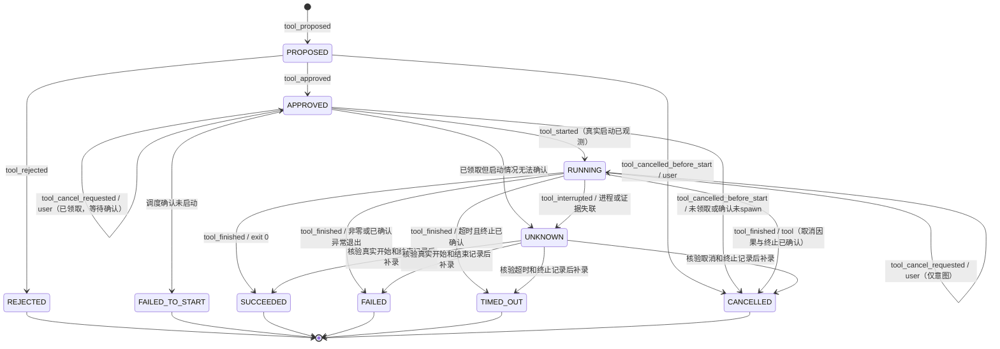
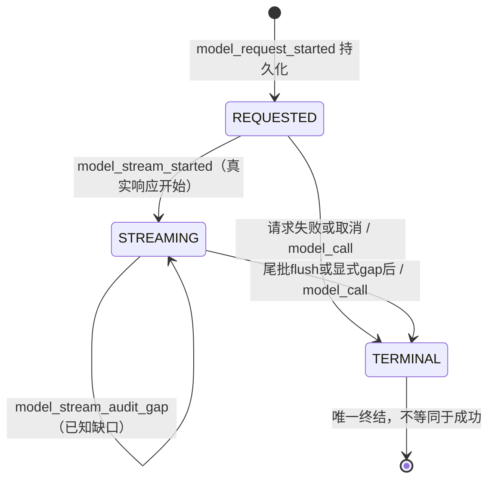

# P1-2 工具生命周期与审计接口设计

版本：0.2，2026-11-07；收敛基线：8c4073975bc25c2b50ad2a18ee768ce6547080c8。状态：设计提案，待独立审核；不是已实现能力说明。

本轮只修改设计文档。本文为统一规范正文；[Review 补充文档](P1_TOOL_LIFECYCLE_REVIEW_ADDENDUM.md) 仅保留 R1–R4 的索引与检查记录，不另设覆盖正文的规则。不得改变 PR #1/#2 的代码、执行真实工具或开放模型网络 API。后续实现必须在独立实现分支通过审查；本文的 HTTP 路由、内部方法与数据库对象均为建议，不得在本轮注册或应用。

## 1. 审查基线与结论

审查固定提交，避免用 main 的旧代码代替在审实现：

- P0.1：`ed4850dc17601a9e8177c12c95d1281e072cccd4`。
- P1-1：`778bad7c6db0f4412ce3c55bca0c24b78ad66905`，包含 P0.1 接口。
- 规范：WRITEUP_INTEGRITY_SPEC.md、P1_ARTIFACT_STORAGE.md、MODEL_PROVIDERS.md。

| 已核对对象 | 当前事实 | P1-2 设计决定 |
|---|---|---|
| ToolProposal | proposal_id、可空 call_id、challenge_id、tool_name、arguments、scope、proposed_at；没有持久化状态或模型请求 ID | 增加 request_id、origin、不可变批准摘要；单独存储状态投影 |
| ToolApproval | proposal_id、approving_user、approved、decided_at | 审批身份来自可信会话；关联确定的提案摘要，不能信任客户端提交的用户名 |
| ToolStarted | proposal_id、executable/version、argv、cwd、环境变量名称列表、started_at | 加 execution_id、实际启动凭据、call_id、challenge_id；不能由 Agent 或普通 HTTP 客户端上报 |
| ToolExecutionResult | 开始/完成 event_id、结束时间、exit_code、timed_out、两个输出 artifact_id 与哈希 | 加 outcome、termination_reason、输出完整性和 execution_id；允许真实未知值，禁止补造输出 |
| EventType | 已有 tool_proposed/approved/rejected/started/finished；另有 command_started/finished、model_call | 保留旧类型，不改写历史；新工具路径只用 tool_*；增加取消、调度失败、失联及模型流式事件 |
| events/event_heads | WAL；BEGIN IMMEDIATE；题目内 sequence 唯一；_append_event 在调用者事务追加与更新 head；触发器禁止更新/删除 | 生命周期状态、索引、幂等响应和事件必须同一事务提交；不得用多个 Store.append 拼接状态变更 |
| ArtifactStore | ingest(BinaryIO, filename=...) 返回 IngestedArtifact；blob 先落盘、SHA-256 内容寻址；read_verified 重算哈希 | 捕获原始二进制输出，不经文本编码往返；完成前校验字节与大小 |
| Store.add_artifact | 自有事务，返回 (Artifact, Event 或 None)；同题同哈希去重；新来源事件 actor=user | 保留上传接口；提取内部事务助手支持工具来源和原子完成，不能直接连调两次现有 public 方法后假称全局原子 |
| 002_artifacts.sql | UNIQUE(challenge_id,sha256)、source_event_id UNIQUE、同题来源外键；Artifact 不可改 | 来源是第一次摄入；tool_finished 另作使用关联，不能将多个输出改指同一个 source_event_id |
| ToolCall → proposals() | call_id 已保留，proposal_id 每次新生成 | 调用转换不是幂等持久化；以 request_id + call_id 去重，不能全局按 call_id 去重 |
| recorded_complete | success/ProviderError.code/internal_error/cancelled；finally 写一条 model_call | 保留兼容；尚无“请求已开始”持久记录；审计写入异常可能覆盖原调用异常，需定义失败优先级 |
| stream() | 无独立审计包装；SSE 文本/调用片段累积，遇 DONE 跳出；自然 EOF 也会 yield 最终 response | 缺少 DONE、异常 EOF、截断参数不得成为完整响应；必须加入显式终结判定 |
| DisabledBroker | 空 registry；批准后仍拒绝执行 | 本轮及默认运行继续禁用，设计通过不等于执行许可 |

## 2. 核心不变量与标识

Event 是审计事实来源；状态表是可校验投影，不能替代事件。API 不接受 actor、event_id、sequence、occurred_at 或执行结果等可伪造字段。服务统一生成 UTC 录入时间；实际工具时间另存 captured_started_at/captured_ended_at，不能回填或重排历史 sequence。

所有工具事件使用现有 Event envelope：event_id、challenge_id、sequence、occurred_at、actor、event_type、payload、artifact_ids、event_refs、previous_event_hash、event_hash。工具 payload 公共部分：

```json
{
  "schema_version": 1,
  "proposal_id": "server-uuid",
  "call_id": "provider-call-id-or-null",
  "request_id": "model-request-uuid-or-null",
  "execution_id": "server-uuid-or-null"
}
```

challenge_id、actor、timestamp(occurred_at)、event_id、artifact_ids 由 envelope 保留，不在 payload 重复。关联输出时同时保留 role 和 Artifact ID，不能依赖列表下标判断 stdout/stderr。没有证据时 artifact_ids=[]，不生成假证据 ID。

模型来源：request_id 与 call_id 必须同时非空；人工来源二者均为空并明确 origin=user。request_id 指向同题、完整成功的模型响应；call_id 在一次响应内唯一。proposal_id 始终由工作台生成，后续审批/执行沿它追溯 request_id/call_id。模型重复调用 ID 或不完整参数使整批转换失败，不产生部分提案。模型文本声称“已执行”只能是未验证 agent_message。

提案不可变：绑定 tool_name、registry_version、结构化 arguments、输入 Artifact ID/哈希、scope_snapshot、policy_version、超时/输出限额、环境变量名称 allowlist、sandbox_profile。用现有 canonical 规则生成 proposal_digest。环境变量值和凭证不得进入 argv、提案或批准摘要；工具需要凭证时只能引用安全存储句柄。摘要不是签名。

任何修改（包括作用域缩小、工具版本变化、输入哈希变化）均需新 proposal 和新审批。审批不能授权任意 shell；注册表只接受具名工具和参数 schema。网络默认关闭、禁止扫描/平台攻击/自动提交，XSWCTF 活动容器最多 3 个。工具允许与否需在提案、批准及调度前分别验证；后续策略变严时不得继续沿用旧授权。

## 3. 状态机和异常语义



说明：图中的 APPROVED/RUNNING 自环表达取消意图已记录但状态尚未确认改变，不代表再次批准或启动。同一审批重试返回原事件。PROPOSED 明确允许用户取消，直接转 CANCELLED，与拒绝转 REJECTED 是两种独立语义；不伪造审批或执行。取消的唯一对照矩阵如下，同时约束本节状态图、§4 API 和 §5 payload。

| 状态/动作 | 前置条件 | 事件与结果 |
|---|---|---|
| 提案 | 注册工具、schema、scope 合法；模型来源已完整 | tool_proposed；PROPOSED |
| 批准/拒绝 | 仅 PROPOSED，可信用户，摘要一致 | tool_approved 或 tool_rejected；一条决策 |
| 领取执行 | APPROVED，无既有 execution；功能开关与策略允许 | 仅内部 dispatch claim，尚未声称实际启动；拒绝自动重领 |
| 开始 | 已领取，隔离运行器证明真实启动，关联同一执行 ID | tool_started；RUNNING；审批和提案 event_refs |
| 完成 | 存在匹配 tool_started；捕获进程已退出与输出状态 | tool_finished；终态及开始 event_refs |
| 取消 | 按 §3.1 逐阶段处理；仅可信用户 | PROPOSED/APPROVED 未领取直接取消；已领取只记意图，状态图与 HTTP 均以 §3.1 为准 |
| 超时 | 已启动；运行器 deadline 到达且仍在运行 | tool_timeout_requested；仍 RUNNING，真实终止和可靠输出后才 tool_finished/TIMED_OUT |
| 运行异常 | 能确认退出，保留失败输出 | FAILED，reason=runtime_error/signal 等；exit_code 可空但不得伪造 0 |
| 失联/捕获失败 | 无法确认退出或完整落盘 | tool_interrupted；UNKNOWN；输出可保留已捕获前缀并标 partial，不伪装成功 |

### 3.1 取消状态、事件与 HTTP 的统一矩阵（R1）

所有取消请求仅由可信用户发起，actor=user；运行器确认事件 actor=tool，服务确认“未启动取消”actor=system。HTTP 接收响应不代替执行事实。

| 请求时状态/内部阶段 | 同事务动作与状态 | 事件与 actor | HTTP / 取消响应 |
|---|---|---|---|
| PROPOSED | 直接 CANCELLED，无 execution/decision | tool_cancelled_before_start，user | 200，cancel_status=confirmed |
| APPROVED，未领取 | 直接 CANCELLED，无 execution | tool_cancelled_before_start，user | 200，confirmed |
| APPROVED，已领取、尚无启动许可 | CAS 设置 cancel_requested；阻断后续许可，仍 APPROVED；等运行器确认未 spawn 后 CANCELLED | tool_cancel_requested，user；随后 tool_cancelled_before_start，system | 初次 202，pending；确认后 GET 显示 confirmed |
| APPROVED，启动许可已取得、尚无 started 回执 | 记录意图并要求停止；不立即 CANCELLED；有真实启动回执先记 RUNNING | tool_cancel_requested，user；确认未 spawn 则 tool_cancelled_before_start，system；实际启动则 tool_started，tool，再按真实结果 tool_finished，tool | 202，pending；无法确认则 tool_interrupted，system，UNKNOWN |
| RUNNING | 仍 RUNNING；请求终止并保留真实结果 | tool_cancel_requested，user；取消确实导致终止且输出可靠才 tool_finished，tool，CANCELLED；自然退出则 SUCCEEDED/FAILED；证据不足则 tool_interrupted，system，UNKNOWN | 202，pending |
| UNKNOWN，无已有取消请求 | 拒绝新取消；只能内部恢复核对，不声称可控进程 | 无 | 409 invalid_transition |
| CANCELLED，或已有相同用户的取消意图/取消完成记录 | 返回已有取消操作，不改状态或追加事件 | 无新事件 | 相同键重放首次 200/202；不同键但同用户同资源同请求也重放首次响应 |
| REJECTED、FAILED_TO_START、SUCCEEDED、FAILED、TIMED_OUT 且无已有取消操作 | 不再取消 | 无 | 409 invalid_transition |

优先级：先校验身份/资源与幂等摘要；已有同一取消操作则重放原 HTTP 响应（即使后来已自然结束或 UNKNOWN），查询当前状态使用 GET，不把原 202 改成 200。没有原操作时才按当前状态行判定；不同用户不得复用他人的取消操作，冲突返回 409。幂等键相同但目标/请求不同始终 409。一个提案最多一条有效用户取消意图或直接取消事件（互斥）；运行器确认可以再追加一条 before_start 或 finished，但不能再次追加 user 意图。

CancelView={proposal_id,challenge_id,call_id,execution_id?,cancel_status:pending|confirmed,accepted_state,event_id,artifact_ids:[]}，event_id 指首次接收该取消操作的事件。异步确认不会改写该响应；GET ProposalView/ExecutionView 返回最新事件和状态。PROPOSED/APPROVED 直接取消引用 proposed/approved event，不要求不存在的 execution。

GET 的 ProposalView/ExecutionView 增加 cancellation:{cancel_operation_id,requested_event_id,confirmation_event_id?,status:pending|confirmed|not_effective} 或 null。cancel_status 是首次响应快照，cancellation.status 是当前投影；自然退出而取消未生效为 not_effective，UNKNOWN 为 pending，不把已接收意图说成取消成功。

STARTED 不是“打算启动”。调度前持久 claim（唯一 execution_id、owner、nonce、claimed_at、lease_deadline、dispatch_status=claimed）及私有运行器日志；拿到 OS/容器启动回执后才写 tool_started。启动调用抛错但不能确认“没有启动”时必须 UNKNOWN，不能 FAILED_TO_START。

领取后、启动回执前取消：先追加取消意图，内部 cancel_requested 标志与取消事件同事务提交。运行器 spawn 前须在事务中 CAS 领取一次性启动许可，检查该标志；取消先胜出则许可被拒绝，运行器确认未 spawn 后由 system 记录进入 CANCELLED，使用 tool_cancelled_before_start，无 started/finished。启动许可先胜出则取消只能请求终止；不能立即声称 CANCELLED。失去回执或无法确定是否 spawn 时为 UNKNOWN，禁止重领/重试执行。许可并非已启动事实，也不消除 SQLite 与 OS 间的崩溃窗口。

这是 at-most-once dispatch 设计，不声称跨 SQLite/OS 具备 exactly-once。领取后服务崩溃，重启只检查运行器日志/隔离实例，不重新 spawn。租约过期是失联信号，不是再次执行许可。无法恢复则 UNKNOWN + limitation，用户需明确创建新提案后才能尝试新执行。

恢复时有真实开始回执才能追加 tool_started，再追加真实 tool_finished；occurred_at 使用恢复录入时间，captured_* 标真实观测时间并带 recovered=true。若没有开始回执，不允许生成 tool_finished；UNKNOWN 可保持，不通过推测闭合历史。已完成的终态不可更改；新证据或更正用新 limitation/finding 事件，人工笔记不能改执行结果。

### 3.2 调度失败与终止竞争的统一规则（R2/R3）

tool_dispatch_failed 只适用于已有 claim、无 tool_started、运行器可信确认 confirmed_not_started=true；actor=system，结果唯一为 FAILED_TO_START。claim 之前功能禁用/队列不可用/策略拒绝不创建 execution 或该事件，保持 APPROVED，返回 503 或 422。spawn 异常但无法证明未启动为 UNKNOWN/tool_interrupted；已有 started 的执行异常只能走运行结果，不能 FAILED_TO_START。

outcome 依据同一受信运行器的单调时间、实际退出和终止因果回执派生，不按服务接收事件的先后覆盖：

- deadline 前退出，或终止动作生效前自然退出，按 exit code 为 SUCCEEDED/FAILED；后到的取消/超时意图仍保留。
- deadline 到达时进程仍在运行，超时终止已确认且证据可靠，才 TIMED_OUT。
- 取消被运行器接受、执行终止动作且回执证明取消导致终止，才 CANCELLED。
- 超时与取消都已请求时，以实际生效的终止因果为准；无法区分因果、时间顺序或证据不全为 UNKNOWN，不能任选一个原因。
- timed_out=true 当且仅当最终 outcome=TIMED_OUT；termination_reason=timeout 仅用于该终态。自然非零退出不能仅因曾有取消请求就记 CANCELLED。

完成通过唯一终结事务/CAS 提交，迟到回执只可幂等返回或 409，不改写终态、不新增第二条 tool_finished。

## 4. API 与内部接口契约（建议，当前不开放）

前缀 P=`/api/challenges/{challenge_id}/tool-proposals`。所有写请求需 Idempotency-Key（1–128 ASCII）、可信会话、JSON extra=forbid。请求摘要只用于本地去重，不包含 API Key。幂等键作用域为 challenge+principal+operation+key；request_digest 必须覆盖 HTTP method、规范化路由及其 challenge_id/proposal_id、canonical body。同键同目标和请求返回首次状态码/响应；同键跨目标或异 body 为 409 idempotency_conflict。拒绝请求不追加工具生命周期事件。跨题资源统一 404。

| API / 调用者 | 请求 | 响应 | 对应状态 |
|---|---|---|---|
| POST P / 用户或可信 Agent 编排服务 | ProposalCreate（下述） | 201 ProposalView；重试原响应 | PROPOSED |
| GET P?state=&cursor= / 用户 | 只读过滤、服务端游标 | 200 {items:ProposalView[], next_cursor} | 全部 |
| GET P/{pid} / 用户 | 无 body | 200 ProposalView | 全部 |
| POST P/{pid}/decision / 可信用户 | {decision:approve/reject, proposal_digest, reason_code?} | 200 DecisionView | APPROVED/REJECTED |
| POST P/{pid}/dispatch / 可信用户 | {proposal_digest}，仅排队意图 | 202 ExecutionView；本轮及禁用时 503 execution_disabled，无执行事件 | APPROVED（内部 claim） |
| POST P/{pid}/cancel / 可信用户 | {reason_code:user_cancelled} | CancelView；200 直接未启动取消，202 等确认；重试原响应；非法状态 409，完整矩阵见 §3.1 | PROPOSED/APPROVED/RUNNING；终态或 UNKNOWN 只允许原取消操作重放 |
| GET P/{pid}/execution / 用户 | 无 body | 200 ExecutionView；从未领取则 404 | RUNNING/终态/UNKNOWN |
| 内部 broker.record_started / 隔离运行器 | StartedCapture | ExecutionView | RUNNING |
| 内部 broker.finalize / 隔离运行器 | FinishedCapture + 两个受信输出句柄 | ExecutionView | SUCCEEDED/FAILED/TIMED_OUT/CANCELLED |
| 内部 broker.interrupted / 恢复器 | reason_code + 实际捕获证据 | ExecutionView | UNKNOWN |

内部接口没有 HTTP 路由，普通客户端/Provider 不能构造调用。运行器身份由本地私有通道/持有者 nonce 验证，不是请求体中的 actor 字符串。尚无可信会话时 decision/dispatch/cancel 必须禁用；本地回环可达不等于用户批准。Agent 可以提案但不能批准。

ProposalCreate：{origin:user|model, tool_name, arguments, input_artifact_ids, requested_limits:{timeout_ms,max_output_bytes}, model_origin?:{request_id,call_id}}。scope/registry/policy/actor/timestamps 从服务端解析。模型来源请求必须匹配已保存的结构化调用，不能伪造 request_id 后提交不同参数。

ProposalView：{proposal_id,challenge_id,call_id,request_id,origin,tool_name,arguments,scope_snapshot,registry_version,policy_version,proposal_digest,state,proposed_at,proposed_event_id,decision_event_id?,execution_id?,latest_event_id,artifact_ids}。本地授权详情可见参数；通用日志和公开导出不得记录其完整内容。

DecisionView：{proposal_id,challenge_id,call_id,decision,approving_user_id,decided_at,event_id,artifact_ids:[]}。审批 identity 不是客户端自由文本。

ExecutionView：{execution_id,proposal_id,challenge_id,call_id,state,claimed_at,started_at?,ended_at?,started_event_id?,finished_event_id?,latest_event_id,artifact_ids,termination_reason?,exit_code?,timed_out,output_status}。只有 finished_event_id 非空且匹配 lifecycle 时才能显示“已结束”；UNKNOWN 不展示为完成。

StartedCapture：{execution_id,claim_nonce,actual_executable,executable_version?,argv,cwd,environment_allowlist,captured_started_at,runtime_receipt_ref}。路径和 argv 必须来自实际运行器而不是模型原始文本；无版本信息留空，不能虚构。nonce 不进入事件/导出。

FinishedCapture：{execution_id,captured_ended_at,exit_code?,termination_reason:normal|nonzero_exit|signal|runtime_error|timeout|user_cancelled,termination_confirmed,stdout_capture,stderr_capture}。capture 为受信字节句柄、captured_bytes、complete、truncated、capture_error_code，不能接受客户端填好的 stdout 文本或 SHA-256。结束事件 ID、哈希与结果状态均由服务派生。

错误统一 {error:{code,correlation_id}}，不回显参数/路径/输出/异常正文：400 请求格式；401/403 无可信用户/权限；404 不存在或跨题；409 invalid_transition/already_dispatched/digest_mismatch/idempotency_conflict/evidence_integrity_error；413 output_limit；422 schema/policy 校验；503 execution_disabled/audit_unavailable。业务拒绝不能伪造 tool_started/finished。

重复决策：同键重放原响应；不同键、同决定/同摘要/同用户可返回既有决策且不新增事件；冲突决定 409。dispatch 不同键若已有 execution，返回 409 already_dispatched（可附本题现有 execution_id），不得另起执行。finalize 同捕获摘要重试返回既有结果，不同结果 409。拒绝、终态和 UNKNOWN 不能重新 dispatch。

## 5. 事件 payload 明细

下表所有 payload 都加第 2 节公共关联字段，artifact_ids/event_refs 存 envelope。工具实际启动/完成 actor=tool；用户决策与取消请求 actor=user；调度失败、失联/恢复和领取后的未启动取消确认 actor=system；未领取的直接取消 actor=user；模型提案 actor=agent。timestamp 使用服务端 occurred_at。

| event_type | 附加 payload | artifact_ids / event_refs |
|---|---|---|
| tool_proposed | tool_name、arguments、origin、registry_version、policy_version、scope_snapshot、input_artifact_hashes、limits、proposal_digest | 输入证据 / 完整模型响应终结事件（人工为 []） |
| tool_approved / tool_rejected | approving_user_id、proposal_digest、decision、reason_code | [] / proposed event |
| tool_started | actual_executable、executable_version?、argv、cwd、environment_allowlist（仅名称）、captured_started_at、runtime_instance_id、recovered | 输入证据 / proposed、approved events |
| tool_cancel_requested | reason_code:user_cancelled、requested_at、requesting_user_id、dispatch_stage、cancel_operation_id | [] / approved 或 started；已领取/运行才有，actor=user，最多一条有效意图 |
| tool_timeout_requested | reason_code:deadline_exceeded、requested_at、runtime_monotonic_deadline | [] / started；actor=tool，deadline 到达且仍运行才有 |
| tool_cancelled_before_start | reason_code:user_cancelled、confirmed_not_started:true、cancel_operation_id、requesting_user_id、dispatch_stage | [] / PROPOSED 引用 proposed；APPROVED 引用 approved；已领取再引用 cancel_requested；actor 和 HTTP 严格按 §3.1 |
| tool_dispatch_failed | reason_code、confirmed_not_started:true | [] / approved event；无 stdout 声称 |
| tool_interrupted | reason_code、last_observed_at、process_status:running/exited/unknown、termination_confirmed:true/false/null、evidence_status:partial/missing/failed、capture_status | 已确认前缀证据 / 已存在的 lifecycle events；null 表示未知，不把证据失败误记为进程未退出 |
| tool_output_captured | role、segment_sequence、capture_id、artifact_id、sha256、captured_bytes、complete、truncated、capture_reason | 本次捕获的 Artifact / 已有 started（若有）、首次摄入事件；actor=tool，恢复录入可为 system |
| tool_finished | outcome、termination_reason、captured_ended_at、exit_code?、timed_out、termination_confirmed:true、stdout:{artifact_id,sha256,size,complete,truncated}、stderr 同结构、capture_policy_version、recovered | 去重的 stdout/stderr IDs / started、approval、输出首次摄入事件及取消/超时请求事件 |

tool_cancelled_before_start 包含 PROPOSED 直接取消、APPROVED 未领取直接取消及已领取确认未 spawn 的取消；均无 tool_finished。运行器已启动则必须有真实 tool_started 后走 tool_finished 或 tool_interrupted，不能用 before_start 绕过生命周期。所有执行相关事件使用不可变 proposal 映射校验 challenge_id/call_id/request_id，不能在各阶段自由变更关联。

成功仅指进程 exit 0 且退出/捕获证据已完整持久化，不表示解题或 Flag 正确。输出截断/捕获异常不得标完整；本设计将其置 UNKNOWN（即使已知 exit 0），保留实际 exit_code 并产生 limitation，等待证据恢复；不能靠重新运行补造旧输出。超时/取消已确认终止且两路捕获状态可靠时可终结，结果必须保留失败输出。

## 6. SQLite 变更建议与原子边界

新增 `003_tool_lifecycle.sql`、`004_model_audit.sql`（建议名，不在本轮创建）。不改 001/002，不删除/更新历史 events 或 Artifact。保留 WAL、外键、recursive_triggers 和原 canonical 哈希。

建议表与约束：

| 表 | 主键/唯一键与关键列 | 约束 |
|---|---|---|
| tool_proposals | proposal_id PK；challenge_id、request_id?、call_id?、origin、immutable_body、proposal_digest、proposed_event_id | UNIQUE(challenge_id,proposal_id)；同题 proposed_event 联合 FK；模型 request/call 同时非空；人工同时空；部分唯一索引(challenge_id,request_id,call_id) WHERE request_id IS NOT NULL |
| tool_decisions | proposal_id PK/FK；decision、principal_id、proposal_digest、decision_event_id | 同题联合 FK；每提案至多一条决策；decision CHECK；不可变/不可删除 |
| tool_cancel_operations | proposal_id PK/FK；cancel_operation_id UNIQUE、principal_id、request_digest、accepted_event_id UNIQUE、首次 HTTP/CancelView | 同题 FK；每提案一个 user 取消操作（直接取消/请求意图互斥）；不可变；确认事件经 transitions 关联，不覆写首次响应 |
| tool_executions | execution_id PK；proposal_id UNIQUE、challenge_id、claim_nonce_hash、dispatch_status、claimed_at、lease_deadline | 同题 proposal 联合 FK；每提案至多一个执行；claim nonce 不以明文保存到审计 |
| tool_transitions | transition_id PK；execution_id?、proposal_id、event_id UNIQUE、from_state、to_state | 同题事件/提案/执行联合 FK；每阶段唯一索引防双 start/finish；只追加 |
| tool_state | proposal_id PK；state、revision、execution_id?、latest_event_id | 可变投影；CAS state/revision；只能通过受控事务推进；与 transitions 重放一致 |
| tool_capture_segments | capture_id PK；execution_id、role、segment_sequence、artifact_id、captured_bytes/hash、complete、truncated、capture_event_id | 追加式前缀/恢复版本；UNIQUE(execution_id,role,segment_sequence)；同题 FK；旧前缀不覆盖，新版本可引用更完整 Artifact |
| tool_output_links | (execution_id,role) PK；challenge_id、artifact_id、capture_size/hash、complete、truncated、finished_event_id | 仅最终完成事务写一次；role CHECK(stdout/stderr)；Artifact 和 event 同题联合 FK；允许两 role 指同一 Artifact；不可替换输出证据 |
| request_dedup | (challenge_id,principal_id,operation,idempotency_key) PK；request_digest、http_status、response_metadata、event_id? | 与变更同事务；不得保存敏感原请求；不自动清除已执行操作去重信息 |

为 Artifact 同题 FK 增加 `UNIQUE(challenge_id,artifact_id)` 索引；为 execution/proposal 关联设置对应联合唯一索引。模型来源还需 FK 到 model_requests(challenge_id,request_id)。原 Event JSON 字段不能靠普通 FK 检查：新增 tool_event_links(event_id PK,challenge_id,proposal_id,execution_id?,phase)，同题联合 FK，加 phase+proposal/execution 唯一索引；所有 lifecycle 事件必须同时建立索引。事件 payload 与关系列一致由事务服务验证，集成测试检测直写绕过，不能声称 SQLite 对任意 JSON 自动保证语义。

数据库触发器（建议）：禁止提案、决策、转换、capture segments、输出关联、事件链接的 UPDATE/DELETE；禁止 REPLACE 绕过；领取必须已有 approve 决策且 tool_state=APPROVED；start 必须唯一 claim；finish 必须已有 started link；reject 禁止 execution；state 迁移边触发器阻断非法跳转。投影更新 CAS 匹配 from_state 与 revision（受影响行数必须为 1），与事件插入/头推进同事务。phase 唯一索引仅用于 proposed/decision/start/finish 等一次性阶段；取消采用 §3.1 每提案唯一 user 操作约束及 request_dedup；timeout 请求用其操作幂等键去重，interrupted 按 occurrence_id 唯一，允许不同时间的多条真实失联观察。

输出缺失时不能为满足 NOT NULL 而填假 ID。tool_output_links 仅在最终完成事务两 role 均已持久化、Artifact 大小/哈希匹配且引用同题后同时插入。UNKNOWN 仅保存 tool_capture_segments（可为零、一路或多版本），没有最终输出 links 和 finished_event。恢复选择经验证的完整捕获版本建立最终 links，不修改任何旧前缀。模型终结事件、幂等记录应采用同样一次性约束。

tool_capture_segments.capture_event_id 专门引用 tool_output_captured，不能引用 artifact_added 作为本次捕获事实。新 capture 即使去重复用旧 Artifact，也追加一次独立捕获事件（同一 capture_id 重放除外）。段行与该事件同事务写入；其唯一约束是 execution_id+role+segment_sequence，不能以 proposal+phase 唯一阻止多段。最终事务引用所选 capture_id 与捕获事件；未持久化的 spool 只存在恢复日志，不能宣称是已提交 Artifact。

事务模板：BEGIN IMMEDIATE → 校验当前状态/幂等/审批摘要/策略 → 预生成提案/执行/证据 ID → _append_event 插入事件并推进 event_heads → 插入引用该事件的不可变关联与转换 → 更新 tool_state → 保存去重响应 → COMMIT。先插事件再插有 FK 的关系行，无需依赖延迟外键；事件 JSON 的这些 ID 不形成反向 SQL FK，提交前由服务验证双向一致。内部 _append_event 扩展 event_refs 参数，并由事务服务校验引用归属；公共 append 不授予任意调用者写工具事件的权限。

不能在事务中调用会自行 BEGIN 的 Store.add_artifact/append；拆出 `_add_artifact_in_tx(db,...,actor)` 内部助手，保持 public add_artifact 的原签名、返回和上传 user 来源行为。所有涉及 stdout/stderr 的新 Artifact 行、artifact_added 事件、输出 links、tool_finished 和状态必须在同一完成事务写入。事件发生顺序为新输出 artifact_added（0–2 条）→ tool_finished；全部推进同一 event_heads，无中间可见状态。

## 7. 原始 stdout/stderr 与 P1-1 集成

隔离运行器独占二进制捕获通道；捕获来源绑定 execution_id 与私有 nonce，Agent/Provider 没有获取该通道的接口。stdout、stderr 分开保存，禁止 decode/re-encode、换行转换或在哈希前脱敏。Python 异常文本不冒充 stderr；捕获器自身错误只写 reason_code。

1. 调度前检查明确的本地敏感输出留存策略（raw retention、访问权限、限额、导出规则）。未配置策略拒绝 dispatch；不能执行后再决定是否允许保存秘密。
2. 持续读取两路输出到受限 spool，独立算 SHA-256 与 byte count；必须同时消费，防单一路缓冲阻塞。输出限额包含两路总量，也记录各路大小。
3. 达到输出限额请求终止、继续排空至安全终止边界；若只保留前缀，标 truncated=true/complete=false，哈希仅对应保存前缀，并记 observed_bytes（未知留空）与 captured_bytes，不声称是完整输出。P1-1 单 Artifact 50MB 上限仍需满足。
4. 退出确认后，在与现有上传共享的进程级 artifact_lock 下，将捕获二进制句柄交 ArtifactStore.ingest(stream,filename='stdout.bin'/'stderr.bin')，再 read_verified；校验 hash/size 与捕获计数一致。相同字节复用 blob，不覆盖或重写元数据。
5. 使用上一节事务助手查重与插入。新建 Artifact 的 source_event_id 仍是独立 artifact_added，actor=tool；已存在 Artifact 维持原 source_event_id（可能是 user 上传）。tool_output_links 与 tool_finished 说明本次输出使用关系，不能把去重后的旧来源误读成新执行来源。
6. 两路都是空输出时 SHA-256 相同，只有一个 Artifact 和一个来源事件，但 stdout/stderr role 各有一条关联。tool_finished.artifact_ids 去重，不将两个角色强制成两个不同 ID。
7. SQLite 完成失败整体回滚；真实进程不会因回滚而“未运行”。保留运行器私有日志和捕获 spool 以便恢复，不直接重新执行。文件已落盘而无元数据时可留下 orphan；只在确认无任何引用且无活跃 capture/恢复任务时清理，不能沿用上传的失败即删除逻辑误删恢复所需证据。

锁顺序固定 artifact_lock → SQLite 写事务；上传与工具终结共用协调器，避免与上传去重/清理竞态。延续 P1-1 单进程假设，多 worker 不支持。持有 SQLite 写锁期间禁止联网、等进程退出或写大文件；hash/ingest 在事务前完成，引用计数清理必须在同一协调锁范围。

失败/nonzero/timeout/取消的输出一律同等摄入；无输出也需真实空字节捕获，不能缺失时补空文件。raw 证据只在受控本地存储，不默认回显浏览器/普通日志/公开 Writeup。导出是独立派生视图，记录 redaction_policy_version 和原 Artifact/event 引用；若生成脱敏 Artifact 则是新 digest、新事件、显式派生关系，原证据永不原地脱敏。没有可靠脱敏策略时禁止公开输出正文，仅展示 IDs/状态及缺口。

## 8. 流式模型审计设计（R4 唯一规范）

新增 recorded_stream 管理异步上下文，调用者必须 async with，退出时显式 aclose，不依赖 GC finalizer。这里只设计，不开放 API。每请求生成 request_id，关联 challenge_id、provider_id、model_id、stream_requested、effective_mode、capabilities_snapshot 和实际生效 limits。默认审计不保存请求/响应正文、Key、工具参数或私有推理内容。请求开始先持久化；失败则不发送模型请求。

### 8.1 接收层与持久化层分离

内部接收层每收到一个“内容 chunk”即分配 request 内从 1 开始单调递增的 chunk_sequence；一个协议内容帧包含公开文本或结构化 tool delta 即计一次，同时含两者也只计一次。不按 token、文本长度或 tool call 个数计数。heartbeat、仅 finish_reason/usage 的控制帧、DONE 和无公开内容的帧不占内容序号；私有推理不进入正文/参数审计，也不作为公开内容 chunk。收到内容即计数，不能只统计已交付 UI 或已写库的内容。

持久化层只产生 **model_stream_progress** 批事件；**不新增逐 chunk 的 model_stream_chunk 事件或表**。内部 chunk_sequence 不作为数据库行主键。每批仅覆盖一个连续区间，生成一次不可变 batch_id；不以重试生成新 batch_id。

批 payload 字段：batch_id、first_sequence、last_sequence、chunk_count、content_bytes_delta、tool_delta_count、first_received_at、last_received_at，另含公共 request_id/provider_id/model_id。batch_first_sequence 只是 first_sequence 的同义描述，数据库和 JSON 正式字段统一叫 first_sequence，禁止两套字段/计数并存。

公式：1 <= first_sequence <= last_sequence；batch.chunk_count = last_sequence - first_sequence + 1。批次内容序号不得重叠，不得跨 gap 合并。content_bytes_delta 按本批公开文本及 tool function name/argument 字符串片段的 UTF-8 字节数之和计算（不含协议 framing、call id、私有推理）；tool_delta_count 按结构化工具增量项计数，独立于 chunk_count。一帧可以含多个工具增量项。

flush 在达到 max_batch_chunks 或从本批首块起 max_batch_wait_ms（单调时钟）时触发，空批不写。结束/取消/异常前 flush 尾批；审计失败立即停止继续消费并关闭上游，限时重试同批，不能无限积压。批数 <= 接收内容块数 <= max_content_chunks，禁止 heartbeat 单独写进度导致无界事件。开始/终结/gap 事件不计入批数。

建议服务端默认/硬上限（待实现配置，非实测性能）：max_batch_chunks=64/256，max_batch_wait_ms=250/1000，max_request_duration_ms=120000/300000，max_content_chunks=8192/65536，max_content_bytes=4MiB/16MiB。各值必须正数且不超过硬上限；客户端只能缩小。达到任一请求限额时关闭上游，response_status=limit_exceeded，complete=false，不生成提案；计数包含触发限额的已收到块，不把它隐藏，内存缓冲仍有硬限制。生效值记录在请求事件，恢复不使用新配置推断旧请求。



### 8.2 事件、累计统计和缺口

所有模型事件 actor=system，timestamp 使用 Event.occurred_at，artifact_ids 默认 []；event_refs 关联请求开始、已持久化进度或 gap 事件。批元数据不证明真实工具执行。

| 阶段 | event_type 与附加 payload | 判定 |
|---|---|---|
| 请求开始 | model_request_started：requested_at、effective_mode、limits、capabilities_snapshot | I/O 前同事务落盘 |
| 响应开始 | model_stream_started：received_at、HTTP status class、protocol | 不代表收到内容或完整响应 |
| 批进度 | model_stream_progress：§8.1 的批 payload | 每 batch 一事件，区间连续、无正文 |
| 审计缺口 | model_stream_audit_gap：gap_id、reason_code、first_sequence、last_sequence?、extent_known、detected_at | 已知缺口闭区间；未知尾部 last_sequence=null、extent_known=false |
| 唯一终结 | model_call：response_status、complete、protocol_complete、audit_complete、finish_reason?、requested_at、ended_at、partial_received、recovered、下述累计统计 | 成功必须协议与审计双完整 |

所有 stream 终结（成功/失败/取消/恢复）使用同一组累计字段：

statistics_scope=stream；buffered 降级使用 §8.4 的 not_applicable，不能混用统计。

- received_chunk_count：实际已接收的内容块总数，正常有界收尾时为整数。terminal.chunk_count 明确为它的兼容别名，必须同值；**不是批数或已持久化数**。崩溃无法恢复接收总数时二者均为 null，不能以持久化数替代。
- received_chunk_count_lower_bound：能够证明的已接收总数下界；已知时等于 received_chunk_count，未知时不少于已持久化最大 last_sequence。
- persisted_chunk_count：成功提交批区间的并集大小；不重叠时等于 SUM(batch.chunk_count)。persisted_batch_count 是批行数量，二者不能混用。
- persisted_ranges：按序归并的闭区间覆盖，例如 [[1,64],[66,80]]；这是从实际批记录计算的视图，不会吞并缺号。
- missing_ranges：已知已接收但没有持久化进度的闭区间；例如接收 80 块、覆盖如上则 [[65,65]]。没有证据不能断言缺失块的内容。
- unknown_tail：null 或 {first_sequence, last_sequence:null, reason_code}。若崩溃只知覆盖至 64、之后接收数量未知，则 unknown_tail 从 65 起；不是声称 65 确已收到。gap 事件明确 extent_known=false。
- received_content_bytes、received_tool_delta_count：按接收层同口径累计，恢复不知则 null；persisted_content_bytes、persisted_tool_delta_count：仅对已提交批累加。即使数值相同也需分别命名。
- tool_call_count：完整校验的最终工具调用数量；未完成的响应为 null，不用工具片段数推断。audit_gap_event_ids 引用已提交 gap，gap 状态不可省略。

完整性示例：接收 80、覆盖 1–64 和 66–80，为 received=80、persisted=79、batch_count=2、missing=[[65,65]]、audit_complete=false。没有内容的合法流：received=persisted=0、ranges=[]，只有协议完整证明才可能 complete。收到 3 块后取消且全部 flush：audit_complete=true 但 protocol_complete=false、complete=false，不能把审计完整当响应完整。

发现批间缺号时不得以 next first_sequence 推断缺号已持久化；在同事务写 gap 记录和 model_stream_audit_gap。已知范围取已观测序号证据；未知丢失尾部只记录 unknown_tail。gap 不能用虚构 chunk 补齐。进度批按序提交，遇缺号可提交后续真实批但必须保留 gap；审计存储故障停止消费，不以“后续可能写入”推断完整。

成功终结前 flush 尾批，计算覆盖必须恰为 [1,received_chunk_count]（0 对应空集），无 missing_ranges/unknown_tail，才 audit_complete=true。protocol_complete=true 还要求协议终结和可接受 finish_reason、完整参数校验；complete = protocol_complete AND audit_complete。协议已完整而审计缺失时 response_status=audit_incomplete，不返回可执行完整 response；协议失败维持 ProviderError.code/connection_interrupted/cancelled/internal_error/incomplete/limit_exceeded 等准确原因，同时独立记录 audit_complete=false。

gap 一旦提交就保留不可变；本设计不在同一请求里事后补齐该范围再提升成功。需恢复时只追加恢复说明/终结（如尚无终结），不得改旧终态或推断未观测内容。SQLite 全不可用时连 gap 也可能写不成，立即报告 audit_write_failed，不能声称 gap 已持久化；恢复根据已有 REQUESTED/批记录追加 interrupted 与未知尾部。

### 8.3 SQLite 唯一设计与批幂等

以下为唯一的新流式审计 schema 建议，撤销原草稿逐 chunk 主键：

| 表 | 主键和字段 | 约束 |
|---|---|---|
| model_requests | request_id PK；challenge_id、provider_id、model_id、requested_at、effective_mode、limits、start_event_id UNIQUE | UNIQUE(challenge_id,request_id)；开始事件同题 FK；不可变 |
| model_stream_progress | batch_id PK；challenge_id、request_id、first_sequence、last_sequence、chunk_count、content_bytes_delta、tool_delta_count、first_received_at、last_received_at、batch_digest、event_id UNIQUE | UNIQUE(request_id,first_sequence)；CHECK first>=1、last>=first、chunk_count=last-first+1、计数非负；同题 request/event FK；不可变 |
| model_stream_gaps | gap_id PK；challenge_id、request_id、first_sequence、last_sequence?、extent_known、reason_code、event_id UNIQUE | UNIQUE(request_id,first_sequence)；已知区间 last>=first；未知尾部 last IS NULL；同题 request/event FK；不可变 |
| model_terminals | request_id PK；challenge_id、terminal_event_id UNIQUE、status、complete、protocol_complete、audit_complete、累计字段 | 同题 request/event FK；所有状态至多一行终结；不可变 |
| model_state | request_id PK；revision、phase、last_committed_sequence、observed_lower_bound | 可变投影；CAS，与相关事件/关系行同事务；不能代表未观测的上界 |

批事件、批行、model_state 和 event_heads 同一 BEGIN IMMEDIATE 事务；先插 Event 再引用它。overlap 需 INSERT 触发器/同事务查询阻断：同请求存在 old.first <= new.last AND old.last >= new.first 即冲突，不只依赖 UNIQUE(first_sequence)。不能向已声明 gap 的区间补插批。终结前按实际批/缺口行重新校验累计量，之后禁止新批/gap。request 结束后的恢复说明作为 limitation，不插第二终结或篡改已冻结覆盖。

gap 不得与既有批或其他 gap 重叠（未知尾部按无界上端检查），不同 gap_id 的重复范围拒绝，重试必须使用原 gap_id。terminal 约束 chunk_count IS received_chunk_count（允许两者同为 null），已知 received 不得小于持久化最大 last_sequence；persisted_chunk_count 等于区间并集大小；complete=true 必须同时 protocol_complete/audit_complete=true，response_status=success 仅允许 complete=true。这些跨行累计校验需同事务服务/触发器实现，当前只规定设计，不声称 SQL 已验证。

batch_digest 覆盖 request_id、batch_id、区间和全部批元数据（不含敏感正文）。重试用同 batch_id/同 digest 返回原 event_id，不重复追加事件或累计；同 ID 异载荷 409。不同 ID 同 first 或区间重叠也拒绝，不新增计数。事件提交成功但应答丢失后从 DB 查回，不生成替代批。gap_id 同样幂等；终结唯一 request_id 及 CAS 防止成功/取消双 winner。schema 不定义 chunk_sequence PK，也不把 batch_first_sequence 另列成第二主键。

### 8.4 协议终结、错误与工具边界

Chat Completions SSE 必须观察 [DONE] 且已看到支持的 stop/tool_calls 等 finish_reason；只有 DONE、无 finish_reason 为 invalid_response；length/content_filter 等为 incomplete。正常 TCP EOF 不能自动成功，缺终结帧为 connection_interrupted。其他协议由 Adapter 提供显式等价证明，不硬套 SSE DONE。

工具片段按 choice/index 累积，最终 call_id 非空唯一、注册工具、完整 JSON object 与参数 schema 均通过。只有 complete=true 最终响应才可在另一事务转换提案，并按 request_id/call_id 去重。私有推理、片段和模型文本不产生 started/finished。

默认不存请求/响应正文；自动持久化模型提案需用户明确授权保存最终结构化调用到受限本地模型结果表/Artifact（source_kind=model_output，不是 stdout）。未授权则只能人工新提案 origin=user，不伪称有原模型调用证据。

buffered 降级沿用同一请求审计协调器，但无 stream_started/progress，不生成假的 chunk_sequence；stream 专用累计字段统一 null，statistics_scope=not_applicable。真实 stream 的统计字段才按 §8.2，避免把未启用流式误计为“0 块完整流”。recorded_complete 不嵌套生成双 model_call。

取消/消费端提前退出须有界 flush、关闭 HTTP、记录 cancelled 并保持原 CancelledError 实例。ProviderError 用其 code，其他 Exception 为 internal_error。原调用异常与审计异常并存时原异常优先，另报不含敏感文本的 audit_write_failed；正常响应遇审计失败不返回已审计成功。请求审计终结先于对调用者暴露最终完整响应。崩溃恢复总数未知必须使用 null/下界/unknown_tail，不制造终结证明。

## 9. 测试用例清单（待后续实现，非已通过报告）

全部使用合成字节、FakeRunner、MockTransport 和临时数据库；真实工具默认禁用。不用比赛题目附件、真实目标或 Flag。

| ID | 用例/故障注入 | 必须断言 |
|---|---|---|
| L01 | 用户/完整模型各提案 | 标识、摘要、同题来源；准确一条 proposed |
| L02 | approve/reject；Agent 冒充用户 | 合法单决策；伪身份拒绝 |
| L03 | 未批准/拒绝后 dispatch | 无 claim、start、finish，无真实执行 |
| L04 | 并发重复 dispatch、不同幂等键 | 至多一个 claim/运行器调度；第二个不执行 |
| L05 | 同键重试/异 body/重启重放 | 原响应、409、无新生命周期事件 |
| L06 | 未开始 finish/双 start/双 finish | DB 和服务均阻断；相同完成重放原结果 |
| L07 | exit0/nonzero/runtime_error/signal | outcome 正确；失败输出不丢；不改 solve 状态 |
| L08 | timeout 后进程尚活/已停止 | 前者 UNKNOWN 或待终止，后者 TIMED_OUT，不能提前成功 |
| L09 | 取消与启动/结束同时发生 | 唯一终结；先提交终结后取消为冲突或幂等返回，无双 finished |
| L09b | claim 后、spawn 许可前后并发取消 | 取消先胜出禁止 spawn；许可先胜出等待实际终止；无回执 UNKNOWN |
| L09c | 同题不同 proposal 使用同幂等键与相同 body | request_digest 含目标资源，409，不返回另一提案响应 |
| L10 | claim 后崩溃、spawn 后 start 入库前崩溃 | 不重启执行；UNKNOWN；回执恢复或可见缺口 |
| L11 | start 后崩溃/捕获器断连 | interrupted；不补造 exit/stdout |
| L12 | scope/tool/input/hash/limits 改变 | 旧摘要审批失效，必须新提案 |
| L13 | 同 call_id 不同 request/同请求重复 call_id | 前者可区分，后者拒绝；转换重试不新增 |
| L14 | 跨题 artifact/proposal/event | 404/约束失败，零部分提交 |
| A13 | 二进制、非 UTF8、CRLF、NUL、空输出 | 保存字节=捕获字节=SHA256；无编码往返 |
| A14 | 两路相同/等同旧附件/跨题相同 | 正确 dedup；source 不改，两 role 都关联本次 finish |
| A15 | 输出超限、捕获失败、缺一路 | prefix 明示、不补空，不声称完整或成功 |
| A16 | blob 篡改、大小不符、DB 完成失败 | 不提交 finished；保留恢复证据与失败缺口 |
| A16b | UNKNOWN 前缀保存后恢复完整输出 | 追加 capture 版本；不更新旧证据；最终 links 仅写一次 |
| A16c | 已知退出但输出保存失败 | process_status=exited、termination_confirmed=true；evidence_status=failed，不能误记仍在运行 |
| A17 | 完成事务中途 SQL 故障 | Artifact/事件/head/state/幂等全部回滚 |
| A18 | 上传并发同 digest + 工具完成失败 | 共享证据不误删；锁顺序无死锁 |
| A19 | 敏感合成 sentinel | 默认日志/错误/导出无泄漏；raw 哈希不因脱敏改变 |
| S01 | 正常 SSE、多批次、批量上限/250ms 刷新、尾批 flush、DONE/finish_reason | 只有 model_stream_progress 批事件；连续区间及 batch_id 唯一；terminal received=persisted=chunk_count；complete 需协议与审计都完整 |
| S02 | 首帧前 ProviderError/RuntimeError/取消 | received_chunk_count=0、persisted=0、ranges=[]；一次正确失败终结，无 success；异常实例原样 |
| S03 | 中途 timeout/断连/EOF 无 DONE | flush 已知尾批；累计接收/持久覆盖及 gap 准确；complete=false，不产生提案 |
| S04 | DONE 无 finish_reason、length、截断 arguments；时长/chunk/字节上限边界 | incomplete/invalid_response 或 limit_exceeded；即使覆盖全也不 complete；关闭上游，无提案 |
| S05 | tool delta 分片跨批、重复 ID、多 choice、heartbeat/finish 控制帧 | chunk 计数按内容帧一次，非按 token/工具数；控制帧不占号；完整且无审计缺口才可转提案 |
| S06 | async with 提前 break/aclose、重复 cancel、取消时尾批 flush | 关闭 HTTP；批重放无重复计数；一次 cancelled terminal；flush 失败显式 gap |
| S07 | 批提交应答丢失、batch ID 重放/异载荷、重叠/缺号、写库失败、重启未知尾部、双终结竞态 | 唯一 PK/区间/内容摘要约束；显式有界 gap 或未知尾部；received 未知不可猜；不返回已审计成功；唯一终结 |
| S08 | buffered 降级、complete 嵌套与空流 | 不伪造 progress/chunk 序号；stream 统计 not_applicable；无双 model_call；真正空流按协议证明与零内容统计判定 |
| C01 | 001/002 升级、旧 call_id=null、历史事件 | 哈希不变、下载/去重/原测试仍通过 |
| C02 | SQL UPDATE/DELETE/REPLACE、状态/JSON 错配 | 触发器/业务验证拒绝；重放检测不一致 |
| C03 | W07/W08 联动、模型声称成功但无运行记录 | 模型输出不是操作事实；证据缺口不补造 |
| C04 | registry 为空、execution_enabled=false、容器上限 | 无执行；禁止 scan/自动 submit；计数仅未来隔离管理器授权 |

## 10. 兼容性、风险和待审核决定

P0.1 call_id 可空继续可读；新增 request_id 只要求新模型来源提案，旧记录标 legacy/unlinked，绝不猜测关联。旧 ToolStarted/Result 保留读取 DTO；新版本使用 ToolLifecycleV1 payload 与扩展结果，不能给旧记录补造 execution_id/输出。command_* 只显示历史类型，不自动认定为 broker 记录。solve/writeup 状态不与工具 exit code 联动。

草稿兼容：本轮未发布迁移；旧草稿的 model_stream_chunk 持久化事件和 (request_id,chunk_sequence) 主键不再作为实现契约。若有人自行实现过旧草稿，必须另行设计显式迁移并保留旧事件类型可读，不能重写历史为批次或与新表同时收新数据。

P1-1 public add_artifact/ingest/下载/去重契约不变。新增内部事务助手是后续实现修改点，需单独审核；当前 branch 不修改源代码。migration 003/004 只添加表/索引/新记录约束，旧数据不回填生命周期，事件哈希链 canonical 不变；升级失败回滚并停止，不静默部分迁移。

必须经独立审核的决定：

1. 采用 at-most-once dispatch + UNKNOWN，接受崩溃后需人工复核的可用性代价；不承诺 exactly-once。
2. 允许原始敏感输出仅在明确的本地留存策略下保存；默认公开导出只含安全元数据，脱敏模块未完成前禁止正文公开。
3. 建立可信本地用户审批机制后才允许 decision/dispatch；现有无认证回环服务不能安全地证明批准身份。
4. stdout/stderr 来源事件与执行引用分离，保持 P1-1 的同题内容去重；是否接受未完成执行的恢复 spool 留存时限需定策略。
5. 流式审计已统一为 §8 的有界批次；逐 chunk 持久化与旧主键方案均撤销。批大小/等待/请求限额须按服务器配置验证，不因批次而省略缺口。
6. 提案参数/argv/cwd/目标本身也可能敏感，必须本地存储与日志隔离；是否将其进一步加密留给本地密钥管理方案，不能以 base64 当加密。
7. 完整流式协议兼容：不同提供商 finish_reason/终结信号能力需显式声明；不支持时降级或拒绝，不能猜成功。
8. 原始输出内容寻址不证明运行器可信；私有通道认证、隔离日志与 capture provenance 是后续安全边界。拥有本机文件系统权限者仍可重写全链，需外部检查点才能强化。
9. P1-1 的单进程锁、只读 best-effort 和 TOCTOU 限制仍在。后续隔离执行不可仅依赖路径 resolve；多进程/远程运行器属于另一轮设计。

审核完成后再将明确边界的实现任务下发 DeepSeek：先做契约/迁移/合成运行器/审计测试，保持 DisabledBroker 默认；真实工具接入、sandbox 和网络策略另开任务。本轮不下发或启动实现任务。

## 11. 独立设计复核记录

独立审查代理进行了只读复核，未修改代码或调用真实模型/工具。首次发现并在本文修正：UNKNOWN 前缀与最终输出不可变关联冲突；进程终止状态与证据状态混淆；claim 后启动前取消竞态；幂等摘要未绑定目标；事件 FK 插入顺序；重复中断不能套用一次性 phase 唯一约束。已补充 L09b/L09c/A16b/A16c 验收点。

二次复核结论：上述六项在设计层闭合，无阻止提交设计 PR 的剩余 blocker。其非阻塞建议也已采纳：定义 tool_output_captured，明确 capture_event_id 关联，保证复用同内容 Artifact 时仍保留本次捕获来源。

该复核是架构文档审核，不是实现验收或运行安全批准；仍需用户指定审核人确认后再下发实现任务。


