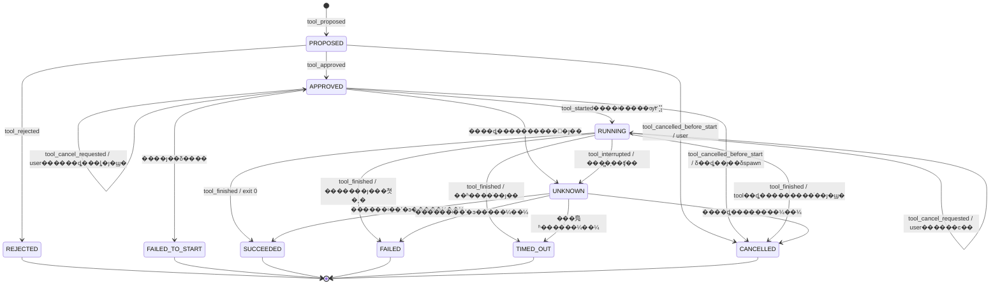
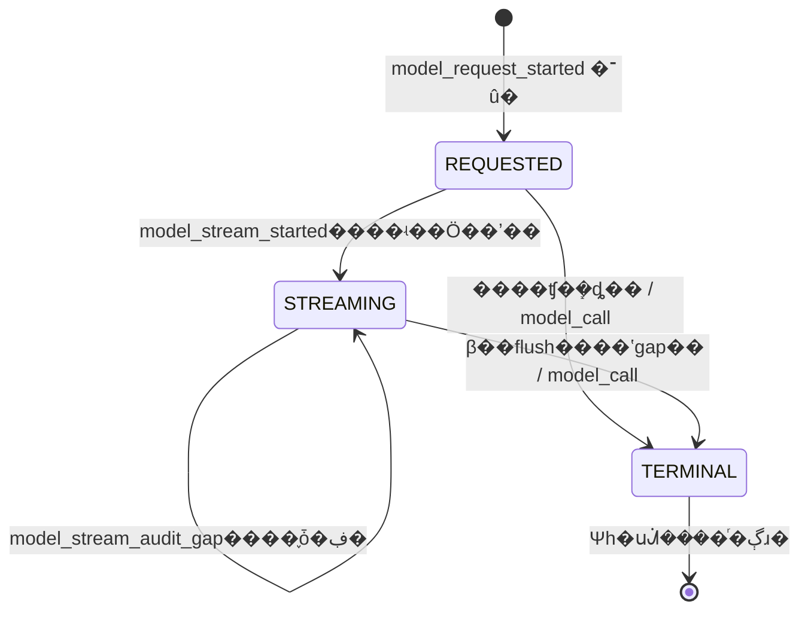

# P1-2 ����������������ƽӿ����

�汾��0.2��2026-11-07���������ߣ�8c4073975bc25c2b50ad2a18ee768ce6547080c8��״̬������᰸����������ˣ�������ʵ������˵����

����ֻ�޸�����ĵ�������Ϊͳһ�淶���ģ�[Review �����ĵ�](P1_TOOL_LIFECYCLE_REVIEW_ADDENDUM.md) ������ R1�CR4 �����������¼�������踲�����ĵĹ��򡣲��øı� PR #1/#2 �Ĵ��롢ִ����ʵ���߻򿪷�ģ������ API������ʵ�ֱ����ڶ���ʵ�ַ�֧ͨ����飻���ĵ� HTTP ·�ɡ��ڲ����������ݿ�����Ϊ���飬�����ڱ���ע���Ӧ�á�

## 1. �����������

���̶��ύ�������� main �ľɴ����������ʵ�֣�

- P0.1��`ed4850dc17601a9e8177c12c95d1281e072cccd4`��
- P1-1��`778bad7c6db0f4412ce3c55bca0c24b78ad66905`������ P0.1 �ӿڡ�
- �淶��WRITEUP_INTEGRITY_SPEC.md��P1_ARTIFACT_STORAGE.md��MODEL_PROVIDERS.md��

| �Ѻ˶Զ��� | ��ǰ��ʵ | P1-2 ��ƾ��� |
|---|---|---|
| ToolProposal | proposal_id���ɿ� call_id��challenge_id��tool_name��arguments��scope��proposed_at��û�г־û�״̬��ģ������ ID | ���� request_id��origin�����ɱ���׼ժҪ�������洢״̬ͶӰ |
| ToolApproval | proposal_id��approving_user��approved��decided_at | �����������Կ��ŻỰ������ȷ�����᰸ժҪ���������οͻ����ύ���û��� |
| ToolStarted | proposal_id��executable/version��argv��cwd���������������б���started_at | �� execution_id��ʵ������ƾ�ݡ�call_id��challenge_id�������� Agent ����ͨ HTTP �ͻ����ϱ� |
| ToolExecutionResult | ��ʼ/��� event_id������ʱ�䡢exit_code��timed_out��������� artifact_id ���ϣ | �� outcome��termination_reason����������Ժ� execution_id��������ʵδֵ֪����ֹ������� |
| EventType | ���� tool_proposed/approved/rejected/started/finished������ command_started/finished��model_call | ���������ͣ�����д��ʷ���¹���·��ֻ�� tool_*������ȡ��������ʧ�ܡ�ʧ����ģ����ʽ�¼� |
| events/event_heads | WAL��BEGIN IMMEDIATE����Ŀ�� sequence Ψһ��_append_event �ڵ���������׷������� head����������ֹ����/ɾ�� | ��������״̬���������ݵ���Ӧ���¼�����ͬһ�����ύ�������ö�� Store.append ƴ��״̬��� |
| ArtifactStore | ingest(BinaryIO, filename=...) ���� IngestedArtifact��blob �����̡�SHA-256 ����Ѱַ��read_verified �����ϣ | ����ԭʼ����������������ı��������������ǰУ���ֽ����С |
| Store.add_artifact | �������񣬷��� (Artifact, Event �� None)��ͬ��ͬ��ϣȥ�أ�����Դ�¼� actor=user | �����ϴ��ӿڣ���ȡ�ڲ���������֧�ֹ�����Դ��ԭ����ɣ�����ֱ�������������� public ������ٳ�ȫ��ԭ�� |
| 002_artifacts.sql | UNIQUE(challenge_id,sha256)��source_event_id UNIQUE��ͬ����Դ�����Artifact ���ɸ� | ��Դ�ǵ�һ�����룻tool_finished ����ʹ�ù��������ܽ���������ָͬһ�� source_event_id |
| ToolCall �� proposals() | call_id �ѱ�����proposal_id ÿ�������� | ����ת�������ݵȳ־û����� request_id + call_id ȥ�أ�����ȫ�ְ� call_id ȥ�� |
| recorded_complete | success/ProviderError.code/internal_error/cancelled��finally дһ�� model_call | �������ݣ����ޡ������ѿ�ʼ���־ü�¼�����д���쳣���ܸ���ԭ�����쳣���趨��ʧ�����ȼ� |
| stream() | �޶�����ư�װ��SSE �ı�/����Ƭ���ۻ����� DONE ��������Ȼ EOF Ҳ�� yield ���� response | ȱ�� DONE���쳣 EOF���ضϲ������ó�Ϊ������Ӧ�����������ʽ�ս��ж� |
| DisabledBroker | �� registry����׼���Ծܾ�ִ�� | ���ּ�Ĭ�����м������ã����ͨ��������ִ������ |

## 2. ���IJ��������ʶ

Event �������ʵ��Դ��״̬���ǿ�У��ͶӰ����������¼���API ������ actor��event_id��sequence��occurred_at ��ִ�н���ȿ�α���ֶΡ�����ͳһ���� UTC ¼��ʱ�䣻ʵ�ʹ���ʱ������ captured_started_at/captured_ended_at�����ܻ����������ʷ sequence��

���й����¼�ʹ������ Event envelope��event_id��challenge_id��sequence��occurred_at��actor��event_type��payload��artifact_ids��event_refs��previous_event_hash��event_hash������ payload �������֣�

```json
{
  "schema_version": 1,
  "proposal_id": "server-uuid",
  "call_id": "provider-call-id-or-null",
  "request_id": "model-request-uuid-or-null",
  "execution_id": "server-uuid-or-null"
}
```

challenge_id��actor��timestamp(occurred_at)��event_id��artifact_ids �� envelope ���������� payload �ظ����������ʱͬʱ���� role �� Artifact ID�����������б��±��ж� stdout/stderr��û��֤��ʱ artifact_ids=[]�������ɼ�֤�� ID��

ģ����Դ��request_id �� call_id ����ͬʱ�ǿգ��˹���Դ���߾�Ϊ�ղ���ȷ origin=user��request_id ָ��ͬ�⡢�����ɹ���ģ����Ӧ��call_id ��һ����Ӧ��Ψһ��proposal_id ʼ���ɹ���̨���ɣ���������/ִ������׷�� request_id/call_id��ģ���ظ����� ID ����������ʹ����ת��ʧ�ܣ������������᰸��ģ���ı����ơ���ִ�С�ֻ����δ��֤ agent_message��

�᰸���ɱ䣺�� tool_name��registry_version���ṹ�� arguments������ Artifact ID/��ϣ��scope_snapshot��policy_version����ʱ/����޶������������ allowlist��sandbox_profile�������� canonical �������� proposal_digest����������ֵ��ƾ֤���ý��� argv���᰸����׼ժҪ��������Ҫƾ֤ʱֻ�����ð�ȫ�洢�����ժҪ����ǩ����

�κ��޸ģ�������������С�����߰汾�仯�������ϣ�仯�������� proposal ��������������������Ȩ���� shell��ע���ֻ���ܾ������ߺͲ��� schema������Ĭ�Ϲرա���ֹɨ��/ƽ̨����/�Զ��ύ��XSWCTF �������� 3 ��������������������᰸����׼������ǰ�ֱ���֤���������Ա���ʱ���ü������þ���Ȩ��

## 3. ״̬�����쳣����



˵����ͼ�е� APPROVED/RUNNING �Ի�����ȡ����ͼ�Ѽ�¼��״̬��δȷ�ϸı䣬�������ٴ���׼��������ͬһ�������Է���ԭ�¼���PROPOSED ��ȷ�����û�ȡ����ֱ��ת CANCELLED����ܾ�ת REJECTED �����ֶ������壻��α��������ִ�С�ȡ����Ψһ���վ������£�ͬʱԼ������״̬ͼ����4 API �� ��5 payload��

| ״̬/���� | ǰ������ | �¼����� |
|---|---|---|
| �᰸ | ע�Ṥ�ߡ�schema��scope �Ϸ���ģ����Դ������ | tool_proposed��PROPOSED |
| ��׼/�ܾ� | �� PROPOSED�������û���ժҪһ�� | tool_approved �� tool_rejected��һ������ |
| ��ȡִ�� | APPROVED���޼��� execution�����ܿ������������ | ���ڲ� dispatch claim����δ����ʵ���������ܾ��Զ����� |
| ��ʼ | ����ȡ������������֤����ʵ����������ͬһִ�� ID | tool_started��RUNNING���������᰸ event_refs |
| ��� | ����ƥ�� tool_started������������˳������״̬ | tool_finished����̬����ʼ event_refs |
| ȡ�� | �� ��3.1 ��׶δ������������û� | PROPOSED/APPROVED δ��ȡֱ��ȡ��������ȡֻ����ͼ��״̬ͼ�� HTTP ���� ��3.1 Ϊ׼ |
| ��ʱ | �������������� deadline �������������� | tool_timeout_requested���� RUNNING����ʵ��ֹ�Ϳɿ������� tool_finished/TIMED_OUT |
| �����쳣 | ��ȷ���˳�������ʧ����� | FAILED��reason=runtime_error/signal �ȣ�exit_code �ɿյ�����α�� 0 |
| ʧ��/����ʧ�� | �޷�ȷ���˳����������� | tool_interrupted��UNKNOWN������ɱ����Ѳ���ǰ׺���� partial����αװ�ɹ� |

### 3.1 ȡ��״̬���¼��� HTTP ��ͳһ����R1��

����ȡ��������ɿ����û�����actor=user��������ȷ���¼� actor=tool������ȷ�ϡ�δ����ȡ����actor=system��HTTP ������Ӧ������ִ����ʵ��

| ����ʱ״̬/�ڲ��׶� | ͬ��������״̬ | �¼��� actor | HTTP / ȡ����Ӧ |
|---|---|---|---|
| PROPOSED | ֱ�� CANCELLED���� execution/decision | tool_cancelled_before_start��user | 200��cancel_status=confirmed |
| APPROVED��δ��ȡ | ֱ�� CANCELLED���� execution | tool_cancelled_before_start��user | 200��confirmed |
| APPROVED������ȡ�������������� | CAS ���� cancel_requested����Ϻ������ɣ��� APPROVED����������ȷ��δ spawn �� CANCELLED | tool_cancel_requested��user����� tool_cancelled_before_start��system | ���� 202��pending��ȷ�Ϻ� GET ��ʾ confirmed |
| APPROVED������������ȡ�á����� started ��ִ | ��¼��ͼ��Ҫ��ֹͣ�������� CANCELLED������ʵ������ִ�ȼ� RUNNING | tool_cancel_requested��user��ȷ��δ spawn �� tool_cancelled_before_start��system��ʵ�������� tool_started��tool���ٰ���ʵ��� tool_finished��tool | 202��pending���޷�ȷ���� tool_interrupted��system��UNKNOWN |
| RUNNING | �� RUNNING��������ֹ��������ʵ��� | tool_cancel_requested��user��ȡ��ȷʵ������ֹ������ɿ��� tool_finished��tool��CANCELLED����Ȼ�˳��� SUCCEEDED/FAILED��֤�ݲ����� tool_interrupted��system��UNKNOWN | 202��pending |
| UNKNOWN��������ȡ������ | �ܾ���ȡ����ֻ���ڲ��ָ��˶ԣ������ƿɿؽ��� | �� | 409 invalid_transition |
| CANCELLED����������ͬ�û���ȡ����ͼ/ȡ����ɼ�¼ | ��������ȡ������������״̬��׷���¼� | �����¼� | ��ͬ���ط��״� 200/202����ͬ����ͬ�û�ͬ��Դͬ����Ҳ�ط��״���Ӧ |
| REJECTED��FAILED_TO_START��SUCCEEDED��FAILED��TIMED_OUT ��������ȡ������ | ����ȡ�� | �� | 409 invalid_transition |

���ȼ�����У������/��Դ���ݵ�ժҪ������ͬһȡ���������ط�ԭ HTTP ��Ӧ����ʹ��������Ȼ������ UNKNOWN������ѯ��ǰ״̬ʹ�� GET������ԭ 202 �ij� 200��û��ԭ����ʱ�Ű���ǰ״̬���ж�����ͬ�û����ø������˵�ȡ����������ͻ���� 409���ݵȼ���ͬ��Ŀ��/����ͬʼ�� 409��һ���᰸���һ����Ч�û�ȡ����ͼ��ֱ��ȡ���¼������⣩��������ȷ�Ͽ�����׷��һ�� before_start �� finished���������ٴ�׷�� user ��ͼ��

CancelView={proposal_id,challenge_id,call_id,execution_id?,cancel_status:pending|confirmed,accepted_state,event_id,artifact_ids:[]}��event_id ָ�״ν��ո�ȡ���������¼����첽ȷ�ϲ����д����Ӧ��GET ProposalView/ExecutionView ���������¼���״̬��PROPOSED/APPROVED ֱ��ȡ������ proposed/approved event����Ҫ�󲻴��ڵ� execution��

GET �� ProposalView/ExecutionView ���� cancellation:{cancel_operation_id,requested_event_id,confirmation_event_id?,status:pending|confirmed|not_effective} �� null��cancel_status ���״���Ӧ���գ�cancellation.status �ǵ�ǰͶӰ����Ȼ�˳���ȡ��δ��ЧΪ not_effective��UNKNOWN Ϊ pending�������ѽ�����ͼ˵��ȡ���ɹ���

STARTED ���ǡ�����������������ǰ�־� claim��Ψһ execution_id��owner��nonce��claimed_at��lease_deadline��dispatch_status=claimed����˽����������־���õ� OS/����������ִ���д tool_started�����������״�������ȷ�ϡ�û��������ʱ���� UNKNOWN������ FAILED_TO_START��

��ȡ��������ִǰȡ������׷��ȡ����ͼ���ڲ� cancel_requested ��־��ȡ���¼�ͬ�����ύ�������� spawn ǰ���������� CAS ��ȡһ�����������ɣ����ñ�־��ȡ����ʤ�������ɱ��ܾ���������ȷ��δ spawn ���� system ��¼���� CANCELLED��ʹ�� tool_cancelled_before_start���� started/finished������������ʤ����ȡ��ֻ��������ֹ�������������� CANCELLED��ʧȥ��ִ���޷�ȷ���Ƿ� spawn ʱΪ UNKNOWN����ֹ����/����ִ�С����ɲ�����������ʵ��Ҳ������ SQLite �� OS ��ı������ڡ�

���� at-most-once dispatch ��ƣ������ƿ� SQLite/OS �߱� exactly-once����ȡ��������������ֻ�����������־/����ʵ���������� spawn����Լ������ʧ���źţ������ٴ�ִ�����ɡ��޷��ָ��� UNKNOWN + limitation���û�����ȷ�������᰸����ܳ�����ִ�С�

�ָ�ʱ����ʵ��ʼ��ִ����׷�� tool_started����׷����ʵ tool_finished��occurred_at ʹ�ûָ�¼��ʱ�䣬captured_* ����ʵ�۲�ʱ�䲢�� recovered=true����û�п�ʼ��ִ������������ tool_finished��UNKNOWN �ɱ��֣���ͨ���Ʋ�պ���ʷ������ɵ���̬���ɸ��ģ���֤�ݻ�������� limitation/finding �¼����˹��ʼDz��ܸ�ִ�н����

### 3.2 ����ʧ������ֹ������ͳһ����R2/R3��

tool_dispatch_failed ֻ���������� claim���� tool_started������������ȷ�� confirmed_not_started=true��actor=system�����ΨһΪ FAILED_TO_START��claim ֮ǰ���ܽ���/���в�����/���Ծܾ������� execution ����¼������� APPROVED������ 503 �� 422��spawn �쳣���޷�֤��δ����Ϊ UNKNOWN/tool_interrupted������ started ��ִ���쳣ֻ�������н�������� FAILED_TO_START��

outcome ����ͬһ�����������ĵ���ʱ�䡢ʵ���˳�����ֹ�����ִ������������������¼����Ⱥ󸲸ǣ�

- deadline ǰ�˳�������ֹ������Чǰ��Ȼ�˳����� exit code Ϊ SUCCEEDED/FAILED���󵽵�ȡ��/��ʱ��ͼ�Ա�����
- deadline ����ʱ�����������У���ʱ��ֹ��ȷ����֤�ݿɿ����� TIMED_OUT��
- ȡ�������������ܡ�ִ����ֹ�����һ�ִ֤��ȡ��������ֹ���� CANCELLED��
- ��ʱ��ȡ����������ʱ����ʵ����Ч����ֹ���Ϊ׼���޷����������ʱ��˳���֤�ݲ�ȫΪ UNKNOWN��������ѡһ��ԭ��
- timed_out=true ���ҽ������� outcome=TIMED_OUT��termination_reason=timeout �����ڸ���̬����Ȼ�����˳����ܽ�������ȡ������ͼ� CANCELLED��

���ͨ��Ψһ�ս�����/CAS �ύ���ٵ���ִֻ���ݵȷ��ػ� 409������д��̬���������ڶ��� tool_finished��

## 4. API ���ڲ��ӿ���Լ�����飬��ǰ�����ţ�

ǰ׺ P=`/api/challenges/{challenge_id}/tool-proposals`������д������ Idempotency-Key��1�C128 ASCII�������ŻỰ��JSON extra=forbid������ժҪֻ���ڱ���ȥ�أ������� API Key���ݵȼ�������Ϊ challenge+principal+operation+key��request_digest ���븲�� HTTP method���淶��·�ɼ��� challenge_id/proposal_id��canonical body��ͬ��ͬĿ������󷵻��״�״̬��/��Ӧ��ͬ����Ŀ����� body Ϊ 409 idempotency_conflict���ܾ�����׷�ӹ������������¼���������Դͳһ 404��

| API / ������ | ���� | ��Ӧ | ��Ӧ״̬ |
|---|---|---|---|
| POST P / �û������ Agent ���ŷ��� | ProposalCreate�������� | 201 ProposalView������ԭ��Ӧ | PROPOSED |
| GET P?state=&cursor= / �û� | ֻ�����ˡ�������α� | 200 {items:ProposalView[], next_cursor} | ȫ�� |
| GET P/{pid} / �û� | �� body | 200 ProposalView | ȫ�� |
| POST P/{pid}/decision / �����û� | {decision:approve/reject, proposal_digest, reason_code?} | 200 DecisionView | APPROVED/REJECTED |
| POST P/{pid}/dispatch / �����û� | {proposal_digest}�����Ŷ���ͼ | 202 ExecutionView�����ּ�����ʱ 503 execution_disabled����ִ���¼� | APPROVED���ڲ� claim�� |
| POST P/{pid}/cancel / �����û� | {reason_code:user_cancelled} | CancelView��200 ֱ��δ����ȡ����202 ��ȷ�ϣ�����ԭ��Ӧ���Ƿ�״̬ 409����������� ��3.1 | PROPOSED/APPROVED/RUNNING����̬�� UNKNOWN ֻ����ԭȡ�������ط� |
| GET P/{pid}/execution / �û� | �� body | 200 ExecutionView����δ��ȡ�� 404 | RUNNING/��̬/UNKNOWN |
| �ڲ� broker.record_started / ���������� | StartedCapture | ExecutionView | RUNNING |
| �ڲ� broker.finalize / ���������� | FinishedCapture + �������������� | ExecutionView | SUCCEEDED/FAILED/TIMED_OUT/CANCELLED |
| �ڲ� broker.interrupted / �ָ��� | reason_code + ʵ�ʲ���֤�� | ExecutionView | UNKNOWN |

�ڲ��ӿ�û�� HTTP ·�ɣ���ͨ�ͻ���/Provider ���ܹ�����á������������ɱ���˽��ͨ��/������ nonce ��֤�������������е� actor �ַ��������޿��ŻỰʱ decision/dispatch/cancel ������ã����ػػ��ɴﲻ�����û���׼��Agent �����᰸��������׼��

ProposalCreate��{origin:user|model, tool_name, arguments, input_artifact_ids, requested_limits:{timeout_ms,max_output_bytes}, model_origin?:{request_id,call_id}}��scope/registry/policy/actor/timestamps �ӷ���˽�����ģ����Դ�������ƥ���ѱ���Ľṹ�����ã�����α�� request_id ���ύ��ͬ������

ProposalView��{proposal_id,challenge_id,call_id,request_id,origin,tool_name,arguments,scope_snapshot,registry_version,policy_version,proposal_digest,state,proposed_at,proposed_event_id,decision_event_id?,execution_id?,latest_event_id,artifact_ids}��������Ȩ����ɼ�������ͨ����־�͹����������ü�¼���������ݡ�

DecisionView��{proposal_id,challenge_id,call_id,decision,approving_user_id,decided_at,event_id,artifact_ids:[]}������ identity ���ǿͻ��������ı���

ExecutionView��{execution_id,proposal_id,challenge_id,call_id,state,claimed_at,started_at?,ended_at?,started_event_id?,finished_event_id?,latest_event_id,artifact_ids,termination_reason?,exit_code?,timed_out,output_status}��ֻ�� finished_event_id �ǿ���ƥ�� lifecycle ʱ������ʾ���ѽ�������UNKNOWN ��չʾΪ��ɡ�

StartedCapture��{execution_id,claim_nonce,actual_executable,executable_version?,argv,cwd,environment_allowlist,captured_started_at,runtime_receipt_ref}��·���� argv ��������ʵ��������������ģ��ԭʼ�ı����ް汾��Ϣ���գ������鹹��nonce �������¼�/������

FinishedCapture��{execution_id,captured_ended_at,exit_code?,termination_reason:normal|nonzero_exit|signal|runtime_error|timeout|user_cancelled,termination_confirmed,stdout_capture,stderr_capture}��capture Ϊ�����ֽھ����captured_bytes��complete��truncated��capture_error_code�����ܽ��ܿͻ�����õ� stdout �ı��� SHA-256�������¼� ID����ϣ����״̬���ɷ���������

����ͳһ {error:{code,correlation_id}}�������Բ���/·��/���/�쳣���ģ�400 �����ʽ��401/403 �޿����û�/Ȩ�ޣ�404 �����ڻ���⣻409 invalid_transition/already_dispatched/digest_mismatch/idempotency_conflict/evidence_integrity_error��413 output_limit��422 schema/policy У�飻503 execution_disabled/audit_unavailable��ҵ��ܾ�����α�� tool_started/finished��

�ظ����ߣ�ͬ���ط�ԭ��Ӧ����ͬ����ͬ����/ͬժҪ/ͬ�û��ɷ��ؼ��о����Ҳ������¼�����ͻ���� 409��dispatch ��ͬ�������� execution������ 409 already_dispatched���ɸ��������� execution_id������������ִ�С�finalize ͬ����ժҪ���Է��ؼ��н������ͬ��� 409���ܾ�����̬�� UNKNOWN �������� dispatch��

## 5. �¼� payload ��ϸ

�±����� payload ���ӵ� 2 �ڹ��������ֶΣ�artifact_ids/event_refs �� envelope������ʵ������/��� actor=tool���û�������ȡ������ actor=user������ʧ�ܡ�ʧ��/�ָ�����ȡ���δ����ȡ��ȷ�� actor=system��δ��ȡ��ֱ��ȡ�� actor=user��ģ���᰸ actor=agent��timestamp ʹ�÷���� occurred_at��

| event_type | ���� payload | artifact_ids / event_refs |
|---|---|---|
| tool_proposed | tool_name��arguments��origin��registry_version��policy_version��scope_snapshot��input_artifact_hashes��limits��proposal_digest | ����֤�� / ����ģ����Ӧ�ս��¼����˹�Ϊ []�� |
| tool_approved / tool_rejected | approving_user_id��proposal_digest��decision��reason_code | [] / proposed event |
| tool_started | actual_executable��executable_version?��argv��cwd��environment_allowlist�������ƣ���captured_started_at��runtime_instance_id��recovered | ����֤�� / proposed��approved events |
| tool_cancel_requested | reason_code:user_cancelled��requested_at��requesting_user_id��dispatch_stage��cancel_operation_id | [] / approved �� started������ȡ/���в��У�actor=user�����һ����Ч��ͼ |
| tool_timeout_requested | reason_code:deadline_exceeded��requested_at��runtime_monotonic_deadline | [] / started��actor=tool��deadline ������������� |
| tool_cancelled_before_start | reason_code:user_cancelled��confirmed_not_started:true��cancel_operation_id��requesting_user_id��dispatch_stage | [] / PROPOSED ���� proposed��APPROVED ���� approved������ȡ������ cancel_requested��actor �� HTTP �ϸ� ��3.1 |
| tool_dispatch_failed | reason_code��confirmed_not_started:true | [] / approved event���� stdout ���� |
| tool_interrupted | reason_code��last_observed_at��process_status:running/exited/unknown��termination_confirmed:true/false/null��evidence_status:partial/missing/failed��capture_status | ��ȷ��ǰ׺֤�� / �Ѵ��ڵ� lifecycle events��null ��ʾδ֪������֤��ʧ�����Ϊ����δ�˳� |
| tool_output_captured | role��segment_sequence��capture_id��artifact_id��sha256��captured_bytes��complete��truncated��capture_reason | ���β���� Artifact / ���� started�����У����״������¼���actor=tool���ָ�¼���Ϊ system |
| tool_finished | outcome��termination_reason��captured_ended_at��exit_code?��timed_out��termination_confirmed:true��stdout:{artifact_id,sha256,size,complete,truncated}��stderr ͬ�ṹ��capture_policy_version��recovered | ȥ�ص� stdout/stderr IDs / started��approval������״������¼���ȡ��/��ʱ�����¼� |

tool_cancelled_before_start ���� PROPOSED ֱ��ȡ����APPROVED δ��ȡֱ��ȡ��������ȡȷ��δ spawn ��ȡ�������� tool_finished�����������������������ʵ tool_started ���� tool_finished �� tool_interrupted�������� before_start �ƹ��������ڡ�����ִ������¼�ʹ�ò��ɱ� proposal ӳ��У�� challenge_id/call_id/request_id�������ڸ��׶����ɱ��������

�ɹ���ָ���� exit 0 ���˳�/����֤���������־û�������ʾ����� Flag ��ȷ������ض�/�����쳣���ñ�����������ƽ����� UNKNOWN����ʹ��֪ exit 0��������ʵ�� exit_code ������ limitation���ȴ�֤�ݻָ������ܿ��������в�����������ʱ/ȡ����ȷ����ֹ����·����״̬�ɿ�ʱ���սᣬ������뱣��ʧ�������

## 6. SQLite ���������ԭ�ӱ߽�

���� `003_tool_lifecycle.sql`��`004_model_audit.sql`�������������ڱ��ִ����������� 001/002����ɾ��/������ʷ events �� Artifact������ WAL�������recursive_triggers ��ԭ canonical ��ϣ��

�������Լ����

| �� | ����/Ψһ����ؼ��� | Լ�� |
|---|---|---|
| tool_proposals | proposal_id PK��challenge_id��request_id?��call_id?��origin��immutable_body��proposal_digest��proposed_event_id | UNIQUE(challenge_id,proposal_id)��ͬ�� proposed_event ���� FK��ģ�� request/call ͬʱ�ǿգ��˹�ͬʱ�գ�����Ψһ����(challenge_id,request_id,call_id) WHERE request_id IS NOT NULL |
| tool_decisions | proposal_id PK/FK��decision��principal_id��proposal_digest��decision_event_id | ͬ������ FK��ÿ�᰸����һ�����ߣ�decision CHECK�����ɱ�/����ɾ�� |
| tool_cancel_operations | proposal_id PK/FK��cancel_operation_id UNIQUE��principal_id��request_digest��accepted_event_id UNIQUE���״� HTTP/CancelView | ͬ�� FK��ÿ�᰸һ�� user ȡ��������ֱ��ȡ��/������ͼ���⣩�����ɱ䣻ȷ���¼��� transitions ����������д�״���Ӧ |
| tool_executions | execution_id PK��proposal_id UNIQUE��challenge_id��claim_nonce_hash��dispatch_status��claimed_at��lease_deadline | ͬ�� proposal ���� FK��ÿ�᰸����һ��ִ�У�claim nonce �������ı��浽��� |
| tool_transitions | transition_id PK��execution_id?��proposal_id��event_id UNIQUE��from_state��to_state | ͬ���¼�/�᰸/ִ������ FK��ÿ�׶�Ψһ������˫ start/finish��ֻ׷�� |
| tool_state | proposal_id PK��state��revision��execution_id?��latest_event_id | �ɱ�ͶӰ��CAS state/revision��ֻ��ͨ���ܿ������ƽ����� transitions �ط�һ�� |
| tool_capture_segments | capture_id PK��execution_id��role��segment_sequence��artifact_id��captured_bytes/hash��complete��truncated��capture_event_id | ׷��ʽǰ׺/�ָ��汾��UNIQUE(execution_id,role,segment_sequence)��ͬ�� FK����ǰ׺�����ǣ��°汾�����ø����� Artifact |
| tool_output_links | (execution_id,role) PK��challenge_id��artifact_id��capture_size/hash��complete��truncated��finished_event_id | �������������дһ�Σ�role CHECK(stdout/stderr)��Artifact �� event ͬ������ FK�������� role ָͬһ Artifact�������滻���֤�� |
| request_dedup | (challenge_id,principal_id,operation,idempotency_key) PK��request_digest��http_status��response_metadata��event_id? | ����ͬ���񣻲��ñ�������ԭ���󣻲��Զ������ִ�в���ȥ����Ϣ |

Ϊ Artifact ͬ�� FK ���� `UNIQUE(challenge_id,artifact_id)` ������Ϊ execution/proposal �������ö�Ӧ����Ψһ������ģ����Դ���� FK �� model_requests(challenge_id,request_id)��ԭ Event JSON �ֶβ��ܿ���ͨ FK ��飺���� tool_event_links(event_id PK,challenge_id,proposal_id,execution_id?,phase)��ͬ������ FK���� phase+proposal/execution Ψһ���������� lifecycle �¼�����ͬʱ�����������¼� payload ���ϵ��һ�������������֤�����ɲ��Լ��ֱд�ƹ����������� SQLite ������ JSON �Զ���֤���塣

���ݿⴥ���������飩����ֹ�᰸�����ߡ�ת����capture segments������������¼����ӵ� UPDATE/DELETE����ֹ REPLACE �ƹ�����ȡ�������� approve ������ tool_state=APPROVED��start ����Ψһ claim��finish �������� started link��reject ��ֹ execution��state Ǩ�Ʊߴ�������ϷǷ���ת��ͶӰ���� CAS ƥ�� from_state �� revision����Ӱ����������Ϊ 1�������¼�����/ͷ�ƽ�ͬ����phase Ψһ���������� proposed/decision/start/finish ��һ���Խ׶Σ�ȡ������ ��3.1 ÿ�᰸Ψһ user ����Լ���� request_dedup��timeout ������������ݵȼ�ȥ�أ�interrupted �� occurrence_id Ψһ��������ͬʱ��Ķ�����ʵʧ���۲졣

���ȱʧʱ����Ϊ���� NOT NULL ����� ID��tool_output_links ����������������� role ���ѳ־û���Artifact ��С/��ϣƥ��������ͬ���ͬʱ���롣UNKNOWN ������ tool_capture_segments����Ϊ�㡢һ·���汾����û��������� links �� finished_event���ָ�ѡ����֤����������汾�������� links�����޸��κξ�ǰ׺��ģ���ս��¼����ݵȼ�¼Ӧ����ͬ��һ����Լ����

tool_capture_segments.capture_event_id ר������ tool_output_captured���������� artifact_added ��Ϊ���β�����ʵ���� capture ��ʹȥ�ظ��þ� Artifact��Ҳ׷��һ�ζ��������¼���ͬһ capture_id �طų��⣩����������¼�ͬ����д�룻��ΨһԼ���� execution_id+role+segment_sequence�������� proposal+phase Ψһ��ֹ��Ρ���������������ѡ capture_id �벶���¼���δ�־û��� spool ֻ���ڻָ���־���������������ύ Artifact��

����ģ�壺BEGIN IMMEDIATE �� У�鵱ǰ״̬/�ݵ�/����ժҪ/���� �� Ԥ�����᰸/ִ��/֤�� ID �� _append_event �����¼����ƽ� event_heads �� �������ø��¼��IJ��ɱ������ת�� �� ���� tool_state �� ����ȥ����Ӧ �� COMMIT���Ȳ��¼��ٲ��� FK �Ĺ�ϵ�У����������ӳ�������¼� JSON ����Щ ID ���γɷ��� SQL FK���ύǰ�ɷ�����֤˫��һ�¡��ڲ� _append_event ��չ event_refs �����������������У�����ù��������� append ���������������д�����¼���Ȩ�ޡ�

�����������е��û����� BEGIN �� Store.add_artifact/append����� `_add_artifact_in_tx(db,...,actor)` �ڲ����֣����� public add_artifact ��ԭǩ�������غ��ϴ� user ��Դ��Ϊ�������漰 stdout/stderr ���� Artifact �С�artifact_added �¼������ links��tool_finished ��״̬������ͬһ�������д�롣�¼�����˳��Ϊ����� artifact_added��0�C2 ������ tool_finished��ȫ���ƽ�ͬһ event_heads�����м�ɼ�״̬��

## 7. ԭʼ stdout/stderr �� P1-1 ����

������������ռ�����Ʋ���ͨ����������Դ�� execution_id ��˽�� nonce��Agent/Provider û�л�ȡ��ͨ���Ľӿڡ�stdout��stderr �ֿ����棬��ֹ decode/re-encode������ת�����ڹ�ϣǰ������Python �쳣�ı���ð�� stderr����������������ֻд reason_code��

1. ����ǰ�����ȷ�ı����������������ԣ�raw retention������Ȩ�ޡ��޶�������򣩡�δ���ò��Ծܾ� dispatch������ִ�к��پ����Ƿ������������ܡ�
2. ������ȡ��·��������� spool�������� SHA-256 �� byte count������ͬʱ���ѣ�����һ·��������������޶������·������Ҳ��¼��·��С��
3. �ﵽ����޶�������ֹ�������ſ�����ȫ��ֹ�߽磻��ֻ����ǰ׺���� truncated=true/complete=false����ϣ����Ӧ����ǰ׺������ observed_bytes��δ֪���գ��� captured_bytes�������������������P1-1 �� Artifact 50MB �����������㡣
4. �˳�ȷ�Ϻ����������ϴ������Ľ��̼� artifact_lock �£�����������ƾ���� ArtifactStore.ingest(stream,filename='stdout.bin'/'stderr.bin')���� read_verified��У�� hash/size �벶�����һ�¡���ͬ�ֽڸ��� blob�������ǻ���дԪ���ݡ�
5. ʹ����һ���������ֲ�������롣�½� Artifact �� source_event_id ���Ƕ��� artifact_added��actor=tool���Ѵ��� Artifact ά��ԭ source_event_id�������� user �ϴ�����tool_output_links �� tool_finished ˵���������ʹ�ù�ϵ�����ܰ�ȥ�غ�ľ���Դ�������ִ����Դ��
6. ��·���ǿ����ʱ SHA-256 ��ͬ��ֻ��һ�� Artifact ��һ����Դ�¼����� stdout/stderr role ����һ��������tool_finished.artifact_ids ȥ�أ�����������ɫǿ�Ƴ�������ͬ ID��
7. SQLite ���ʧ������ع�����ʵ���̲�����ع�����δ���С�������������˽����־�Ͳ��� spool �Ա�ָ�����ֱ������ִ�С��ļ������̶���Ԫ����ʱ������ orphan��ֻ��ȷ�����κ��������޻�Ծ capture/�ָ�����ʱ���������������ϴ���ʧ�ܼ�ɾ���߼���ɾ�ָ�����֤�ݡ�

��˳��̶� artifact_lock �� SQLite д�����ϴ��빤���սṲ��Э�������������ϴ�ȥ��/������̬������ P1-1 �����̼��裬�� worker ��֧�֡����� SQLite д���ڼ��ֹ�������Ƚ����˳���д���ļ���hash/ingest ������ǰ��ɣ����ü�������������ͬһЭ������Χ��

ʧ��/nonzero/timeout/ȡ�������һ��ͬ�����룻�����Ҳ����ʵ���ֽڲ��񣬲���ȱʧʱ�����ļ���raw ֤��ֻ���ܿر��ش洢����Ĭ�ϻ��������/��ͨ��־/���� Writeup�������Ƕ���������ͼ����¼ redaction_policy_version ��ԭ Artifact/event ���ã����������� Artifact ������ digest�����¼�����ʽ������ϵ��ԭ֤������ԭ��������û�пɿ���������ʱ��ֹ����������ģ���չʾ IDs/״̬��ȱ�ڡ�

## 8. ��ʽģ�������ƣ�R4 Ψһ�淶��

���� recorded_stream �����첽�����ģ������߱��� async with���˳�ʱ��ʽ aclose�������� GC finalizer������ֻ��ƣ������� API��ÿ�������� request_id������ challenge_id��provider_id��model_id��stream_requested��effective_mode��capabilities_snapshot ��ʵ����Ч limits��Ĭ����Ʋ���������/��Ӧ���ġ�Key�����߲�����˽���������ݡ�����ʼ�ȳ־û���ʧ���򲻷���ģ������

### 8.1 ���ղ���־û������

�ڲ����ղ�ÿ�յ�һ�������� chunk�������� request �ڴ� 1 ��ʼ���������� chunk_sequence��һ��Э������֡���������ı���ṹ�� tool delta ����һ�Σ�ͬʱ������Ҳֻ��һ�Ρ����� token���ı����Ȼ� tool call ����������heartbeat���� finish_reason/usage �Ŀ���֡��DONE ���޹������ݵ�֡��ռ������ţ�˽����������������/������ƣ�Ҳ����Ϊ�������� chunk���յ����ݼ�����������ֻͳ���ѽ��� UI ����д������ݡ�

�־û���ֻ���� **model_stream_progress** ���¼���**�������� chunk �� model_stream_chunk �¼����**���ڲ� chunk_sequence ����Ϊ���ݿ���������ÿ��������һ���������䣬����һ�β��ɱ� batch_id���������������� batch_id��

�� payload �ֶΣ�batch_id��first_sequence��last_sequence��chunk_count��content_bytes_delta��tool_delta_count��first_received_at��last_received_at���������� request_id/provider_id/model_id��batch_first_sequence ֻ�� first_sequence ��ͬ�����������ݿ�� JSON ��ʽ�ֶ�ͳһ�� first_sequence����ֹ�����ֶ�/�������档

��ʽ��1 <= first_sequence <= last_sequence��batch.chunk_count = last_sequence - first_sequence + 1������������Ų����ص������ÿ� gap �ϲ���content_bytes_delta �����������ı��� tool function name/argument �ַ���Ƭ�ε� UTF-8 �ֽ���֮�ͼ��㣨����Э�� framing��call id��˽����������tool_delta_count ���ṹ����������������������� chunk_count��һ֡���Ժ�������������

flush �ڴﵽ max_batch_chunks ��ӱ����׿��� max_batch_wait_ms������ʱ�ӣ�ʱ������������д������/ȡ��/�쳣ǰ flush β�������ʧ������ֹͣ�������Ѳ��ر����Σ���ʱ����ͬ�����������޻�ѹ������ <= �������ݿ��� <= max_content_chunks����ֹ heartbeat ����д���ȵ����޽��¼�����ʼ/�ս�/gap �¼�������������

��������Ĭ��/Ӳ���ޣ���ʵ�����ã���ʵ�����ܣ���max_batch_chunks=64/256��max_batch_wait_ms=250/1000��max_request_duration_ms=120000/300000��max_content_chunks=8192/65536��max_content_bytes=4MiB/16MiB����ֵ���������Ҳ�����Ӳ���ޣ��ͻ���ֻ����С���ﵽ��һ�����޶�ʱ�ر����Σ�response_status=limit_exceeded��complete=false���������᰸���������������޶�����յ��飬���������أ��ڴ滺������Ӳ���ơ���Чֵ��¼�������¼����ָ���ʹ���������ƶϾ�����



### 8.2 �¼����ۼ�ͳ�ƺ�ȱ��

����ģ���¼� actor=system��timestamp ʹ�� Event.occurred_at��artifact_ids Ĭ�� []��event_refs ��������ʼ���ѳ־û����Ȼ� gap �¼�����Ԫ���ݲ�֤����ʵ����ִ�С�

| �׶� | event_type �븽�� payload | �ж� |
|---|---|---|
| ����ʼ | model_request_started��requested_at��effective_mode��limits��capabilities_snapshot | I/O ǰͬ�������� |
| ��Ӧ��ʼ | model_stream_started��received_at��HTTP status class��protocol | �������յ����ݻ�������Ӧ |
| ������ | model_stream_progress����8.1 ���� payload | ÿ batch һ�¼������������������� |
| ���ȱ�� | model_stream_audit_gap��gap_id��reason_code��first_sequence��last_sequence?��extent_known��detected_at | ��֪ȱ�ڱ����䣻δ֪β�� last_sequence=null��extent_known=false |
| Ψһ�ս� | model_call��response_status��complete��protocol_complete��audit_complete��finish_reason?��requested_at��ended_at��partial_received��recovered�������ۼ�ͳ�� | �ɹ�����Э�������˫���� |

���� stream �սᣨ�ɹ�/ʧ��/ȡ��/�ָ���ʹ��ͬһ���ۼ��ֶΣ�

statistics_scope=stream��buffered ����ʹ�� ��8.4 �� not_applicable�����ܻ���ͳ�ơ�

- received_chunk_count��ʵ���ѽ��յ����ݿ������������н���βʱΪ������terminal.chunk_count ��ȷΪ���ļ��ݱ���������ֵͬ��**�����������ѳ־û���**�������޷��ָ���������ʱ���߾�Ϊ null�������Գ־û��������
- received_chunk_count_lower_bound���ܹ�֤�����ѽ��������½磻��֪ʱ���� received_chunk_count��δ֪ʱ�������ѳ־û���� last_sequence��
- persisted_chunk_count���ɹ��ύ������IJ�����С�����ص�ʱ���� SUM(batch.chunk_count)��persisted_batch_count ���������������߲��ܻ��á�
- persisted_ranges������鲢�ı����串�ǣ����� [[1,64],[66,80]]�����Ǵ�ʵ������¼�������ͼ�������̲�ȱ�š�
- missing_ranges����֪�ѽ��յ�û�г־û����ȵı����䣻������� 80 �顢���������� [[65,65]]��û��֤�ݲ��ܶ���ȱʧ������ݡ�
- unknown_tail��null �� {first_sequence, last_sequence:null, reason_code}��������ֻ֪������ 64��֮���������δ֪���� unknown_tail �� 65 �𣻲������� 65 ȷ���յ���gap �¼���ȷ extent_known=false��
- received_content_bytes��received_tool_delta_count�������ղ�ͬ�ھ��ۼƣ��ָ���֪�� null��persisted_content_bytes��persisted_tool_delta_count���������ύ���ۼӡ���ʹ��ֵ��ͬҲ��ֱ�������
- tool_call_count������У������չ��ߵ���������δ��ɵ���ӦΪ null�����ù���Ƭ�����ƶϡ�audit_gap_event_ids �������ύ gap��gap ״̬����ʡ�ԡ�

������ʾ�������� 80������ 1�C64 �� 66�C80��Ϊ received=80��persisted=79��batch_count=2��missing=[[65,65]]��audit_complete=false��û�����ݵĺϷ�����received=persisted=0��ranges=[]��ֻ��Э������֤���ſ��� complete���յ� 3 ���ȡ����ȫ�� flush��audit_complete=true �� protocol_complete=false��complete=false�����ܰ������������Ӧ������

��������ȱ��ʱ������ next first_sequence �ƶ�ȱ���ѳ־û�����ͬ����д gap ��¼�� model_stream_audit_gap����֪��Χȡ�ѹ۲����֤�ݣ�δ֪��ʧβ��ֻ��¼ unknown_tail��gap �������鹹 chunk ���롣�����������ύ����ȱ�ſ��ύ������ʵ�������뱣�� gap����ƴ洢����ֹͣ���ѣ����ԡ���������д�롱�ƶ�������

�ɹ��ս�ǰ flush β�������㸲�DZ���ǡΪ [1,received_chunk_count]��0 ��Ӧ�ռ������� missing_ranges/unknown_tail���� audit_complete=true��protocol_complete=true ��Ҫ��Э���ս�Ϳɽ��� finish_reason����������У�飻complete = protocol_complete AND audit_complete��Э�������������ȱʧʱ response_status=audit_incomplete�������ؿ�ִ������ response��Э��ʧ��ά�� ProviderError.code/connection_interrupted/cancelled/internal_error/incomplete/limit_exceeded ��׼ȷԭ��ͬʱ������¼ audit_complete=false��

gap һ���ύ�ͱ������ɱ䣻����Ʋ���ͬһ�������º���÷�Χ�������ɹ�����ָ�ʱֻ׷�ӻָ�˵��/�սᣨ�������սᣩ�����øľ���̬���ƶ�δ�۲����ݡ�SQLite ȫ������ʱ�� gap Ҳ����д���ɣ��������� audit_write_failed���������� gap �ѳ־û����ָ��������� REQUESTED/����¼׷�� interrupted ��δ֪β����

### 8.3 SQLite Ψһ��������ݵ�

����ΪΨһ������ʽ��� schema ���飬����ԭ�ݸ��� chunk ������

| �� | �������ֶ� | Լ�� |
|---|---|---|
| model_requests | request_id PK��challenge_id��provider_id��model_id��requested_at��effective_mode��limits��start_event_id UNIQUE | UNIQUE(challenge_id,request_id)����ʼ�¼�ͬ�� FK�����ɱ� |
| model_stream_progress | batch_id PK��challenge_id��request_id��first_sequence��last_sequence��chunk_count��content_bytes_delta��tool_delta_count��first_received_at��last_received_at��batch_digest��event_id UNIQUE | UNIQUE(request_id,first_sequence)��CHECK first>=1��last>=first��chunk_count=last-first+1�������Ǹ���ͬ�� request/event FK�����ɱ� |
| model_stream_gaps | gap_id PK��challenge_id��request_id��first_sequence��last_sequence?��extent_known��reason_code��event_id UNIQUE | UNIQUE(request_id,first_sequence)����֪���� last>=first��δ֪β�� last IS NULL��ͬ�� request/event FK�����ɱ� |
| model_terminals | request_id PK��challenge_id��terminal_event_id UNIQUE��status��complete��protocol_complete��audit_complete���ۼ��ֶ� | ͬ�� request/event FK������״̬����һ���ս᣻���ɱ� |
| model_state | request_id PK��revision��phase��last_committed_sequence��observed_lower_bound | �ɱ�ͶӰ��CAS��������¼�/��ϵ��ͬ���񣻲��ܴ���δ�۲���Ͻ� |

���¼������С�model_state �� event_heads ͬһ BEGIN IMMEDIATE �����Ȳ� Event ����������overlap �� INSERT ������/ͬ�����ѯ��ϣ�ͬ������� old.first <= new.last AND old.last >= new.first ����ͻ����ֻ���� UNIQUE(first_sequence)�������������� gap �����䲹�������ս�ǰ��ʵ����/ȱ��������У���ۼ�����֮���ֹ����/gap��request ������Ļָ�˵����Ϊ limitation������ڶ��ս��۸��Ѷ��Ḳ�ǡ�

gap ����������������� gap �ص���δ֪β�����޽��϶˼�飩����ͬ gap_id ���ظ���Χ�ܾ������Ա���ʹ��ԭ gap_id��terminal Լ�� chunk_count IS received_chunk_count����������ͬΪ null������֪ received ����С�ڳ־û���� last_sequence��persisted_chunk_count �������䲢����С��complete=true ����ͬʱ protocol_complete/audit_complete=true��response_status=success ������ complete=true����Щ�����ۼ�У����ͬ�������/������ʵ�֣���ǰֻ�涨��ƣ������� SQL ����֤��

batch_digest ���� request_id��batch_id�������ȫ����Ԫ���ݣ������������ģ���������ͬ batch_id/ͬ digest ����ԭ event_id�����ظ�׷���¼����ۼƣ�ͬ ID ���غ� 409����ͬ ID ͬ first �������ص�Ҳ�ܾ����������������¼��ύ�ɹ���Ӧ��ʧ��� DB ��أ��������������gap_id ͬ���ݵȣ��ս�Ψһ request_id �� CAS ��ֹ�ɹ�/ȡ��˫ winner��schema ������ chunk_sequence PK��Ҳ���� batch_first_sequence ���гɵڶ�������

### 8.4 Э���սᡢ�����빤�߽߱�

Chat Completions SSE ����۲� [DONE] ���ѿ���֧�ֵ� stop/tool_calls �� finish_reason��ֻ�� DONE���� finish_reason Ϊ invalid_response��length/content_filter ��Ϊ incomplete������ TCP EOF �����Զ��ɹ���ȱ�ս�֡Ϊ connection_interrupted������Э���� Adapter �ṩ��ʽ�ȼ�֤������Ӳ�� SSE DONE��

����Ƭ�ΰ� choice/index �ۻ������� call_id �ǿ�Ψһ��ע�Ṥ�ߡ����� JSON object ����� schema ��ͨ����ֻ�� complete=true ������Ӧ�ſ�����һ����ת���᰸������ request_id/call_id ȥ�ء�˽��������Ƭ�κ�ģ���ı������� started/finished��

Ĭ�ϲ�������/��Ӧ���ģ��Զ��־û�ģ���᰸���û���ȷ��Ȩ�������սṹ�����õ����ޱ���ģ�ͽ����/Artifact��source_kind=model_output������ stdout����δ��Ȩ��ֻ���˹����᰸ origin=user����α����ԭģ�͵���֤�ݡ�

buffered ��������ͬһ�������Э���������� stream_started/progress�������ɼٵ� chunk_sequence��stream ר���ۼ��ֶ�ͳһ null��statistics_scope=not_applicable����ʵ stream ��ͳ���ֶβŰ� ��8.2�������δ������ʽ���Ϊ��0 ������������recorded_complete ��Ƕ������˫ model_call��

ȡ��/���Ѷ���ǰ�˳����н� flush���ر� HTTP����¼ cancelled ������ԭ CancelledError ʵ����ProviderError ���� code������ Exception Ϊ internal_error��ԭ�����쳣������쳣����ʱԭ�쳣���ȣ��������������ı��� audit_write_failed��������Ӧ�����ʧ�ܲ���������Ƴɹ�����������ս����ڶԵ����߱�¶����������Ӧ�������ָ�����δ֪����ʹ�� null/�½�/unknown_tail���������ս�֤����

## 9. ���������嵥��������ʵ�֣�����ͨ�����棩

ȫ��ʹ�úϳ��ֽڡ�FakeRunner��MockTransport ����ʱ���ݿ⣻��ʵ����Ĭ�Ͻ��á����ñ�����Ŀ��������ʵĿ��� Flag��

| ID | ����/����ע�� | ������� |
|---|---|---|
| L01 | �û�/����ģ�͸��᰸ | ��ʶ��ժҪ��ͬ����Դ��׼ȷһ�� proposed |
| L02 | approve/reject��Agent ð���û� | �Ϸ������ߣ�α���ݾܾ� |
| L03 | δ��׼/�ܾ��� dispatch | �� claim��start��finish������ʵִ�� |
| L04 | �����ظ� dispatch����ͬ�ݵȼ� | ����һ�� claim/���������ȣ��ڶ�����ִ�� |
| L05 | ͬ������/�� body/�����ط� | ԭ��Ӧ��409���������������¼� |
| L06 | δ��ʼ finish/˫ start/˫ finish | DB �ͷ������ϣ���ͬ����ط�ԭ��� |
| L07 | exit0/nonzero/runtime_error/signal | outcome ��ȷ��ʧ��������������� solve ״̬ |
| L08 | timeout ������л�/��ֹͣ | ǰ�� UNKNOWN �����ֹ������ TIMED_OUT��������ǰ�ɹ� |
| L09 | ȡ��������/����ͬʱ���� | Ψһ�ս᣻���ύ�ս��ȡ��Ϊ��ͻ���ݵȷ��أ���˫ finished |
| L09b | claim ��spawn ����ǰ�󲢷�ȡ�� | ȡ����ʤ����ֹ spawn��������ʤ���ȴ�ʵ����ֹ���޻�ִ UNKNOWN |
| L09c | ͬ�ⲻͬ proposal ʹ��ͬ�ݵȼ�����ͬ body | request_digest ��Ŀ����Դ��409����������һ�᰸��Ӧ |
| L10 | claim �������spawn �� start ���ǰ���� | ������ִ�У�UNKNOWN����ִ�ָ���ɼ�ȱ�� |
| L11 | start �����/���������� | interrupted�������� exit/stdout |
| L12 | scope/tool/input/hash/limits �ı� | ��ժҪ����ʧЧ���������᰸ |
| L13 | ͬ call_id ��ͬ request/ͬ�����ظ� call_id | ǰ�߿����֣����߾ܾ���ת�����Բ����� |
| L14 | ���� artifact/proposal/event | 404/Լ��ʧ�ܣ��㲿���ύ |
| A13 | �����ơ��� UTF8��CRLF��NUL������� | �����ֽ�=�����ֽ�=SHA256���ޱ������� |
| A14 | ��·��ͬ/��ͬ�ɸ���/������ͬ | ��ȷ dedup��source ���ģ��� role ���������� finish |
| A15 | ������ޡ�����ʧ�ܡ�ȱһ· | prefix ��ʾ�������գ�������������ɹ� |
| A16 | blob �۸ġ���С������DB ���ʧ�� | ���ύ finished�������ָ�֤����ʧ��ȱ�� |
| A16b | UNKNOWN ǰ׺�����ָ�������� | ׷�� capture �汾�������¾�֤�ݣ����� links ��дһ�� |
| A16c | ��֪�˳����������ʧ�� | process_status=exited��termination_confirmed=true��evidence_status=failed����������������� |
| A17 | ���������; SQL ���� | Artifact/�¼�/head/state/�ݵ�ȫ���ع� |
| A18 | �ϴ�����ͬ digest + �������ʧ�� | ����֤�ݲ���ɾ����˳�������� |
| A19 | ���кϳ� sentinel | Ĭ����־/����/������й©��raw ��ϣ���������ı� |
| S01 | ���� SSE�������Ρ���������/250ms ˢ�¡�β�� flush��DONE/finish_reason | ֻ�� model_stream_progress ���¼����������估 batch_id Ψһ��terminal received=persisted=chunk_count��complete ��Э������ƶ����� |
| S02 | ��֡ǰ ProviderError/RuntimeError/ȡ�� | received_chunk_count=0��persisted=0��ranges=[]��һ����ȷʧ���սᣬ�� success���쳣ʵ��ԭ�� |
| S03 | ��; timeout/����/EOF �� DONE | flush ��֪β�����ۼƽ���/�־ø��Ǽ� gap ׼ȷ��complete=false���������᰸ |
| S04 | DONE �� finish_reason��length���ض� arguments��ʱ��/chunk/�ֽ����ޱ߽� | incomplete/invalid_response �� limit_exceeded����ʹ����ȫҲ�� complete���ر����Σ����᰸ |
| S05 | tool delta ��Ƭ�������ظ� ID���� choice��heartbeat/finish ����֡ | chunk ����������֡һ�Σ��ǰ� token/������������֡��ռ�ţ������������ȱ�ڲſ�ת�᰸ |
| S06 | async with ��ǰ break/aclose���ظ� cancel��ȡ��ʱβ�� flush | �ر� HTTP�����ط����ظ�������һ�� cancelled terminal��flush ʧ����ʽ gap |
| S07 | ���ύӦ��ʧ��batch ID �ط�/���غɡ��ص�/ȱ�š�д��ʧ�ܡ�����δ֪β����˫�սᾺ̬ | Ψһ PK/����/����ժҪԼ������ʽ�н� gap ��δ֪β����received δ֪���ɲ£�����������Ƴɹ���Ψһ�ս� |
| S08 | buffered ������complete Ƕ������� | ��α�� progress/chunk ��ţ�stream ͳ�� not_applicable����˫ model_call������������Э��֤����������ͳ���ж� |
| C01 | 001/002 �������� call_id=null����ʷ�¼� | ��ϣ���䡢����/ȥ��/ԭ������ͨ�� |
| C02 | SQL UPDATE/DELETE/REPLACE��״̬/JSON ���� | ������/ҵ����֤�ܾ����طż�ⲻһ�� |
| C03 | W07/W08 ������ģ�����Ƴɹ��������м�¼ | ģ��������Dz�����ʵ��֤��ȱ�ڲ����� |
| C04 | registry Ϊ�ա�execution_enabled=false���������� | ��ִ�У���ֹ scan/�Զ� submit��������δ�������������Ȩ |

## 10. �����ԡ����պʹ���˾���

P0.1 call_id �ɿռ����ɶ������� request_id ֻҪ����ģ����Դ�᰸���ɼ�¼�� legacy/unlinked�������²�������� ToolStarted/Result ������ȡ DTO���°汾ʹ�� ToolLifecycleV1 payload ����չ��������ܸ��ɼ�¼���� execution_id/�����command_* ֻ��ʾ��ʷ���ͣ����Զ��϶�Ϊ broker ��¼��solve/writeup ״̬���빤�� exit code ������

�ݸ���ݣ�����δ����Ǩ�ƣ��ɲݸ�� model_stream_chunk �־û��¼��� (request_id,chunk_sequence) ����������Ϊʵ����Լ������������ʵ�ֹ��ɲݸ壬�������������ʽǨ�Ʋ��������¼����Ϳɶ���������д��ʷΪ���λ����±�ͬʱ�������ݡ�

P1-1 public add_artifact/ingest/����/ȥ����Լ���䡣�����ڲ����������Ǻ���ʵ���޸ĵ㣬�赥����ˣ���ǰ branch ���޸�Դ���롣migration 003/004 ֻ���ӱ�/����/�¼�¼Լ���������ݲ������������ڣ��¼���ϣ�� canonical ���䣻����ʧ�ܻع���ֹͣ������Ĭ����Ǩ�ơ�

���뾭������˵ľ�����

1. ���� at-most-once dispatch + UNKNOWN�����ܱ��������˹����˵Ŀ����Դ��ۣ�����ŵ exactly-once��
2. ����ԭʼ�������������ȷ�ı�����������±��棻Ĭ�Ϲ�������ֻ����ȫԪ���ݣ�����ģ��δ���ǰ��ֹ���Ĺ�����
3. �������ű����û��������ƺ������ decision/dispatch����������֤�ػ������ܰ�ȫ��֤����׼���ݡ�
4. stdout/stderr ��Դ�¼���ִ�����÷��룬���� P1-1 ��ͬ������ȥ�أ��Ƿ����δ���ִ�еĻָ� spool ����ʱ���趨���ԡ�
5. ��ʽ�����ͳһΪ ��8 ���н����Σ��� chunk �־û������������������������С/�ȴ�/�����޶��밴������������֤���������ζ�ʡ��ȱ�ڡ�
6. �᰸����/argv/cwd/Ŀ�걾��Ҳ�������У����뱾�ش洢����־���룻�Ƿ����һ����������������Կ���������������� base64 �����ܡ�
7. ������ʽЭ����ݣ���ͬ�ṩ�� finish_reason/�ս��ź���������ʽ��������֧��ʱ������ܾ������ܲ³ɹ���
8. ԭʼ�������Ѱַ��֤�����������ţ�˽��ͨ����֤��������־�� capture provenance �Ǻ�����ȫ�߽硣ӵ�б����ļ�ϵͳȨ�����Կ���дȫ�������ⲿ�������ǿ����
9. P1-1 �ĵ���������ֻ�� best-effort �� TOCTOU �������ڡ���������ִ�в��ɽ�����·�� resolve�������/Զ��������������һ����ơ�

�����ɺ��ٽ���ȷ�߽��ʵ�������·� DeepSeek��������Լ/Ǩ��/�ϳ�������/��Ʋ��ԣ����� DisabledBroker Ĭ�ϣ���ʵ���߽��롢sandbox ����������������񡣱��ֲ��·�������ʵ������

## 11. ������Ƹ��˼�¼

����������������ֻ�����ˣ�δ�޸Ĵ���������ʵģ��/���ߡ��״η��ֲ��ڱ���������UNKNOWN ǰ׺������������ɱ������ͻ��������ֹ״̬��֤��״̬������claim ������ǰȡ����̬���ݵ�ժҪδ��Ŀ�ꣻ�¼� FK ����˳���ظ��жϲ�������һ���� phase ΨһԼ�����Ѳ��� L09b/L09c/A16b/A16c ���յ㡣

���θ��˽��ۣ�������������Ʋ�պϣ�����ֹ�ύ��� PR ��ʣ�� blocker�������������Ҳ�Ѳ��ɣ����� tool_output_captured����ȷ capture_event_id ��������֤����ͬ���� Artifact ʱ�Ա������β�����Դ��

�ø����Ǽܹ��ĵ���ˣ�����ʵ�����ջ����а�ȫ��׼�������û�ָ�������ȷ�Ϻ����·�ʵ������


