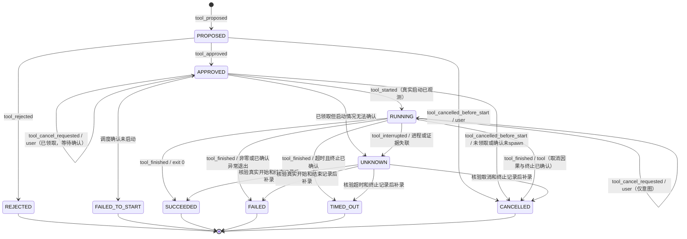
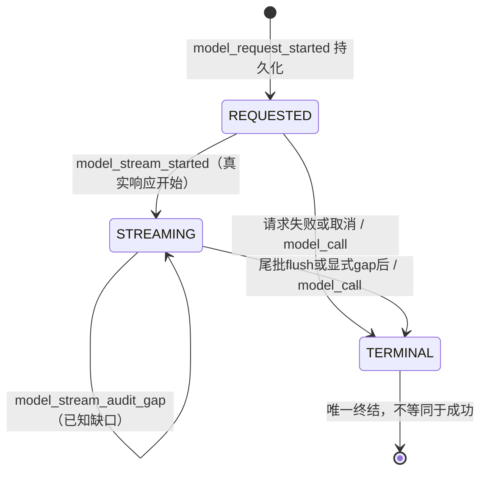

# P1-2 工具生命周期与审计接口设计

版本：0.5，2026-11-07；本次 R5 资源边界基线：50bf43d9be9561e6d8daede8ebb8e720e9ac68a3；本次数值/规范序列化修订基线：6ad319ad147fa94e37bea183745fa91271f14b93；前次 R4 指纹修订基线：89be6021aa9022ca484dc6c663d3409f20437d5d；此前收敛基线：8c4073975bc25c2b50ad2a18ee768ce6547080c8。状态：设计提案，待独立审核；不是已实现能力说明。

本轮只修改设计文档。本文为统一规范正文；[Review 补充文档](P1_TOOL_LIFECYCLE_REVIEW_ADDENDUM.md) 仅保留 R1–R4 的索引与检查记录，不另设覆盖正文的规则。不得改变 PR #1/#2 的代码、执行真实工具或开放模型网络 API。后续实现必须在独立实现分支通过审查；本文的 HTTP 路由、内部方法与数据库对象均为建议，不得在本轮注册或应用。

## 1. 审查基线与结论

审查固定提交，避免用 main 的旧代码代替在审实现：

- P0.1：`ed4850dc17601a9e8177c12c95d1281e072cccd4`。
- P1-1：`778bad7c6db0f4412ce3c55bca0c24b78ad66905`，包含 P0.1 接口。
- 规范：WRITEUP_INTEGRITY_SPEC.md、P1_ARTIFACT_STORAGE.md、MODEL_PROVIDERS.md。

| 已核对对象 | 当前事实 | P1-2 设计决定 |
|---|---|---|
| ToolProposal | proposal_id、可空 call_id、challenge_id、tool_name、arguments、scope、proposed_at；没有持久化状态或模型请求 ID | 增加 request_id、origin、不可变批准摘要；单独存储状态投影 |
| ToolApproval | proposal_id、approving_user、approved、decided_at | 审批身份来自可信会话；关联确定的提案摘要，不能信任客户端提交的用户名 |
| ToolStarted | proposal_id、executable/version、argv、cwd、环境变量名称列表、started_at | 加 execution_id、实际启动凭据、call_id、challenge_id；不能由 Agent 或普通 HTTP 客户端上报 |
| ToolExecutionResult | 开始/完成 event_id、结束时间、exit_code、timed_out、两个输出 artifact_id 与哈希 | 加 outcome、termination_reason、输出完整性和 execution_id；允许真实未知值，禁止补造输出 |
| EventType | 已有 tool_proposed/approved/rejected/started/finished；另有 command_started/finished、model_call | 保留旧类型，不改写历史；新工具路径只用 tool_*；增加取消、调度失败、失联及模型流式事件 |
| events/event_heads | WAL；BEGIN IMMEDIATE；题目内 sequence 唯一；_append_event 在调用者事务追加与更新 head；触发器禁止更新/删除 | 生命周期状态、索引、幂等响应和事件必须同一事务提交；不得用多个 Store.append 拼接状态变更 |
| ArtifactStore | ingest(BinaryIO, filename=...) 返回 IngestedArtifact；blob 先落盘、SHA-256 内容寻址；read_verified 重算哈希 | 捕获原始二进制输出，不经文本编码往返；完成前校验字节与大小 |
| Store.add_artifact | 自有事务，返回 (Artifact, Event 或 None)；同题同哈希去重；新来源事件 actor=user | 保留上传接口；提取内部事务助手支持工具来源和原子完成，不能直接连调两次现有 public 方法后假称全局原子 |
| 002_artifacts.sql | UNIQUE(challenge_id,sha256)、source_event_id UNIQUE、同题来源外键；Artifact 不可改 | 来源是第一次摄入；tool_finished 另作使用关联，不能将多个输出改指同一个 source_event_id |
| ToolCall → proposals() | call_id 已保留，proposal_id 每次新生成 | 调用转换不是幂等持久化；以 request_id + call_id 去重，不能全局按 call_id 去重 |
| recorded_complete | success/ProviderError.code/internal_error/cancelled；finally 写一条 model_call | 保留兼容；尚无“请求已开始”持久记录；审计写入异常可能覆盖原调用异常，需定义失败优先级 |
| stream() | 无独立审计包装；SSE 文本/调用片段累积，遇 DONE 跳出；自然 EOF 也会 yield 最终 response | 缺少 DONE、异常 EOF、截断参数不得成为完整响应；必须加入显式终结判定 |
| DisabledBroker | 空 registry；批准后仍拒绝执行 | 本轮及默认运行继续禁用，设计通过不等于执行许可 |

## 2. 核心不变量与标识

Event 是审计事实来源；状态表是可校验投影，不能替代事件。API 不接受 actor、event_id、sequence、occurred_at 或执行结果等可伪造字段。服务统一生成 UTC 录入时间；实际工具时间另存 captured_started_at/captured_ended_at，不能回填或重排历史 sequence。

所有工具事件使用现有 Event envelope：event_id、challenge_id、sequence、occurred_at、actor、event_type、payload、artifact_ids、event_refs、previous_event_hash、event_hash。工具 payload 公共部分：

```json
{
  "schema_version": 1,
  "proposal_id": "server-uuid",
  "call_id": "provider-call-id-or-null",
  "request_id": "model-request-uuid-or-null",
  "execution_id": "server-uuid-or-null"
}
```

challenge_id、actor、timestamp(occurred_at)、event_id、artifact_ids 由 envelope 保留，不在 payload 重复。关联输出时同时保留 role 和 Artifact ID，不能依赖列表下标判断 stdout/stderr。没有证据时 artifact_ids=[]，不生成假证据 ID。

模型来源：request_id 与 call_id 必须同时非空；人工来源二者均为空并明确 origin=user。request_id 指向同题、完整成功的模型响应；call_id 在一次响应内唯一。proposal_id 始终由工作台生成，后续审批/执行沿它追溯 request_id/call_id。模型重复调用 ID 或不完整参数使整批转换失败，不产生部分提案。模型文本声称“已执行”只能是未验证 agent_message。

提案不可变：绑定 tool_name、registry_version、结构化 arguments、输入 Artifact ID/哈希、scope_snapshot、policy_version、超时/输出限额、环境变量名称 allowlist、sandbox_profile。用现有 canonical 规则生成 proposal_digest。环境变量值和凭证不得进入 argv、提案或批准摘要；工具需要凭证时只能引用安全存储句柄。摘要不是签名。

任何修改（包括作用域缩小、工具版本变化、输入哈希变化）均需新 proposal 和新审批。审批不能授权任意 shell；注册表只接受具名工具和参数 schema。网络默认关闭、禁止扫描/平台攻击/自动提交，XSWCTF 活动容器最多 3 个。工具允许与否需在提案、批准及调度前分别验证；后续策略变严时不得继续沿用旧授权。

## 3. 状态机和异常语义



说明：图中的 APPROVED/RUNNING 自环表达取消意图已记录但状态尚未确认改变，不代表再次批准或启动。同一审批重试返回原事件。PROPOSED 明确允许用户取消，直接转 CANCELLED，与拒绝转 REJECTED 是两种独立语义；不伪造审批或执行。取消的唯一对照矩阵如下，同时约束本节状态图、§4 API 和 §5 payload。

| 状态/动作 | 前置条件 | 事件与结果 |
|---|---|---|
| 提案 | 注册工具、schema、scope 合法；模型来源已完整 | tool_proposed；PROPOSED |
| 批准/拒绝 | 仅 PROPOSED，可信用户，摘要一致 | tool_approved 或 tool_rejected；一条决策 |
| 领取执行 | APPROVED，无既有 execution；功能开关与策略允许 | 仅内部 dispatch claim，尚未声称实际启动；拒绝自动重领 |
| 开始 | 已领取，隔离运行器证明真实启动，关联同一执行 ID | tool_started；RUNNING；审批和提案 event_refs |
| 完成 | 存在匹配 tool_started；捕获进程已退出与输出状态 | tool_finished；终态及开始 event_refs |
| 取消 | 按 §3.1 逐阶段处理；仅可信用户 | PROPOSED/APPROVED 未领取直接取消；已领取只记意图，状态图与 HTTP 均以 §3.1 为准 |
| 超时 | 已启动；运行器 deadline 到达且仍在运行 | tool_timeout_requested；仍 RUNNING，真实终止和可靠输出后才 tool_finished/TIMED_OUT |
| 运行异常 | 能确认退出，保留失败输出 | FAILED，reason=runtime_error/signal 等；exit_code 可空但不得伪造 0 |
| 失联/捕获失败 | 无法确认退出或完整落盘 | tool_interrupted；UNKNOWN；输出可保留已捕获前缀并标 partial，不伪装成功 |

### 3.1 取消状态、事件与 HTTP 的统一矩阵（R1）

所有取消请求仅由可信用户发起，actor=user；运行器确认事件 actor=tool，服务确认“未启动取消”actor=system。HTTP 接收响应不代替执行事实。

| 请求时状态/内部阶段 | 同事务动作与状态 | 事件与 actor | HTTP / 取消响应 |
|---|---|---|---|
| PROPOSED | 直接 CANCELLED，无 execution/decision | tool_cancelled_before_start，user | 200，cancel_status=confirmed |
| APPROVED，未领取 | 直接 CANCELLED，无 execution | tool_cancelled_before_start，user | 200，confirmed |
| APPROVED，已领取、尚无启动许可 | CAS 设置 cancel_requested；阻断后续许可，仍 APPROVED；等运行器确认未 spawn 后 CANCELLED | tool_cancel_requested，user；随后 tool_cancelled_before_start，system | 初次 202，pending；确认后 GET 显示 confirmed |
| APPROVED，启动许可已取得、尚无 started 回执 | 记录意图并要求停止；不立即 CANCELLED；有真实启动回执先记 RUNNING | tool_cancel_requested，user；确认未 spawn 则 tool_cancelled_before_start，system；实际启动则 tool_started，tool，再按真实结果 tool_finished，tool | 202，pending；无法确认则 tool_interrupted，system，UNKNOWN |
| RUNNING | 仍 RUNNING；请求终止并保留真实结果 | tool_cancel_requested，user；取消确实导致终止且输出可靠才 tool_finished，tool，CANCELLED；自然退出则 SUCCEEDED/FAILED；证据不足则 tool_interrupted，system，UNKNOWN | 202，pending |
| UNKNOWN，无已有取消请求 | 拒绝新取消；只能内部恢复核对，不声称可控进程 | 无 | 409 invalid_transition |
| CANCELLED，或已有相同用户的取消意图/取消完成记录 | 返回已有取消操作，不改状态或追加事件 | 无新事件 | 相同键重放首次 200/202；不同键但同用户同资源同请求也重放首次响应 |
| REJECTED、FAILED_TO_START、SUCCEEDED、FAILED、TIMED_OUT 且无已有取消操作 | 不再取消 | 无 | 409 invalid_transition |

优先级：先校验身份/资源与幂等摘要；已有同一取消操作则重放原 HTTP 响应（即使后来已自然结束或 UNKNOWN），查询当前状态使用 GET，不把原 202 改成 200。没有原操作时才按当前状态行判定；不同用户不得复用他人的取消操作，冲突返回 409。幂等键相同但目标/请求不同始终 409。一个提案最多一条有效用户取消意图或直接取消事件（互斥）；运行器确认可以再追加一条 before_start 或 finished，但不能再次追加 user 意图。

CancelView={proposal_id,challenge_id,call_id,execution_id?,cancel_status:pending|confirmed,accepted_state,event_id,artifact_ids:[]}，event_id 指首次接收该取消操作的事件。异步确认不会改写该响应；GET ProposalView/ExecutionView 返回最新事件和状态。PROPOSED/APPROVED 直接取消引用 proposed/approved event，不要求不存在的 execution。

GET 的 ProposalView/ExecutionView 增加 cancellation:{cancel_operation_id,requested_event_id,confirmation_event_id?,status:pending|confirmed|not_effective} 或 null。cancel_status 是首次响应快照，cancellation.status 是当前投影；自然退出而取消未生效为 not_effective，UNKNOWN 为 pending，不把已接收意图说成取消成功。

STARTED 不是“打算启动”。调度前持久 claim（唯一 execution_id、owner、nonce、claimed_at、lease_deadline、dispatch_status=claimed）及私有运行器日志；拿到 OS/容器启动回执后才写 tool_started。启动调用抛错但不能确认“没有启动”时必须 UNKNOWN，不能 FAILED_TO_START。

领取后、启动回执前取消：先追加取消意图，内部 cancel_requested 标志与取消事件同事务提交。运行器 spawn 前须在事务中 CAS 领取一次性启动许可，检查该标志；取消先胜出则许可被拒绝，运行器确认未 spawn 后由 system 记录进入 CANCELLED，使用 tool_cancelled_before_start，无 started/finished。启动许可先胜出则取消只能请求终止；不能立即声称 CANCELLED。失去回执或无法确定是否 spawn 时为 UNKNOWN，禁止重领/重试执行。许可并非已启动事实，也不消除 SQLite 与 OS 间的崩溃窗口。

这是 at-most-once dispatch 设计，不声称跨 SQLite/OS 具备 exactly-once。领取后服务崩溃，重启只检查运行器日志/隔离实例，不重新 spawn。租约过期是失联信号，不是再次执行许可。无法恢复则 UNKNOWN + limitation，用户需明确创建新提案后才能尝试新执行。

恢复时有真实开始回执才能追加 tool_started，再追加真实 tool_finished；occurred_at 使用恢复录入时间，captured_* 标真实观测时间并带 recovered=true。若没有开始回执，不允许生成 tool_finished；UNKNOWN 可保持，不通过推测闭合历史。已完成的终态不可更改；新证据或更正用新 limitation/finding 事件，人工笔记不能改执行结果。

### 3.2 调度失败与终止竞争的统一规则（R2/R3）

tool_dispatch_failed 只适用于已有 claim、无 tool_started、运行器可信确认 confirmed_not_started=true；actor=system，结果唯一为 FAILED_TO_START。claim 之前功能禁用/队列不可用/策略拒绝不创建 execution 或该事件，保持 APPROVED，返回 503 或 422。spawn 异常但无法证明未启动为 UNKNOWN/tool_interrupted；已有 started 的执行异常只能走运行结果，不能 FAILED_TO_START。

outcome 依据同一受信运行器的单调时间、实际退出和终止因果回执派生，不按服务接收事件的先后覆盖：

- deadline 前退出，或终止动作生效前自然退出，按 exit code 为 SUCCEEDED/FAILED；后到的取消/超时意图仍保留。
- deadline 到达时进程仍在运行，超时终止已确认且证据可靠，才 TIMED_OUT。
- 取消被运行器接受、执行终止动作且回执证明取消导致终止，才 CANCELLED。
- 超时与取消都已请求时，以实际生效的终止因果为准；无法区分因果、时间顺序或证据不全为 UNKNOWN，不能任选一个原因。
- timed_out=true 当且仅当最终 outcome=TIMED_OUT；termination_reason=timeout 仅用于该终态。自然非零退出不能仅因曾有取消请求就记 CANCELLED。

完成通过唯一终结事务/CAS 提交，迟到回执只可幂等返回或 409，不改写终态、不新增第二条 tool_finished。

## 4. API 与内部接口契约（建议，当前不开放）

前缀 P=`/api/challenges/{challenge_id}/tool-proposals`。所有写请求需 Idempotency-Key（1–128 ASCII）、可信会话、JSON extra=forbid。请求摘要只用于本地去重，不包含 API Key。幂等键作用域为 challenge+principal+operation+key；request_digest 必须覆盖 HTTP method、规范化路由及其 challenge_id/proposal_id、canonical body。同键同目标和请求返回首次状态码/响应；同键跨目标或异 body 为 409 idempotency_conflict。拒绝请求不追加工具生命周期事件。跨题资源统一 404。

| API / 调用者 | 请求 | 响应 | 对应状态 |
|---|---|---|---|
| POST P / 用户或可信 Agent 编排服务 | ProposalCreate（下述） | 201 ProposalView；重试原响应 | PROPOSED |
| GET P?state=&cursor= / 用户 | 只读过滤、服务端游标 | 200 {items:ProposalView[], next_cursor} | 全部 |
| GET P/{pid} / 用户 | 无 body | 200 ProposalView | 全部 |
| POST P/{pid}/decision / 可信用户 | {decision:approve/reject, proposal_digest, reason_code?} | 200 DecisionView | APPROVED/REJECTED |
| POST P/{pid}/dispatch / 可信用户 | {proposal_digest}，仅排队意图 | 202 ExecutionView；本轮及禁用时 503 execution_disabled，无执行事件 | APPROVED（内部 claim） |
| POST P/{pid}/cancel / 可信用户 | {reason_code:user_cancelled} | CancelView；200 直接未启动取消，202 等确认；重试原响应；非法状态 409，完整矩阵见 §3.1 | PROPOSED/APPROVED/RUNNING；终态或 UNKNOWN 只允许原取消操作重放 |
| GET P/{pid}/execution / 用户 | 无 body | 200 ExecutionView；从未领取则 404 | RUNNING/终态/UNKNOWN |
| 内部 broker.record_started / 隔离运行器 | StartedCapture | ExecutionView | RUNNING |
| 内部 broker.finalize / 隔离运行器 | FinishedCapture + 两个受信输出句柄 | ExecutionView | SUCCEEDED/FAILED/TIMED_OUT/CANCELLED |
| 内部 broker.interrupted / 恢复器 | reason_code + 实际捕获证据 | ExecutionView | UNKNOWN |

内部接口没有 HTTP 路由，普通客户端/Provider 不能构造调用。运行器身份由本地私有通道/持有者 nonce 验证，不是请求体中的 actor 字符串。尚无可信会话时 decision/dispatch/cancel 必须禁用；本地回环可达不等于用户批准。Agent 可以提案但不能批准。

ProposalCreate：{origin:user|model, tool_name, arguments, input_artifact_ids, requested_limits:{timeout_ms,max_output_bytes}, model_origin?:{request_id,call_id}}。scope/registry/policy/actor/timestamps 从服务端解析。模型来源请求必须匹配已保存的结构化调用，不能伪造 request_id 后提交不同参数。

ProposalView：{proposal_id,challenge_id,call_id,request_id,origin,tool_name,arguments,scope_snapshot,registry_version,policy_version,proposal_digest,state,proposed_at,proposed_event_id,decision_event_id?,execution_id?,latest_event_id,artifact_ids}。本地授权详情可见参数；通用日志和公开导出不得记录其完整内容。

DecisionView：{proposal_id,challenge_id,call_id,decision,approving_user_id,decided_at,event_id,artifact_ids:[]}。审批 identity 不是客户端自由文本。

ExecutionView：{execution_id,proposal_id,challenge_id,call_id,state,claimed_at,started_at?,ended_at?,started_event_id?,finished_event_id?,latest_event_id,artifact_ids,termination_reason?,exit_code?,timed_out,output_status}。只有 finished_event_id 非空且匹配 lifecycle 时才能显示“已结束”；UNKNOWN 不展示为完成。

StartedCapture：{execution_id,claim_nonce,actual_executable,executable_version?,argv,cwd,environment_allowlist,captured_started_at,runtime_receipt_ref}。路径和 argv 必须来自实际运行器而不是模型原始文本；无版本信息留空，不能虚构。nonce 不进入事件/导出。

FinishedCapture：{execution_id,captured_ended_at,exit_code?,termination_reason:normal|nonzero_exit|signal|runtime_error|timeout|user_cancelled,termination_confirmed,stdout_capture,stderr_capture}。capture 为受信字节句柄、captured_bytes、complete、truncated、capture_error_code，不能接受客户端填好的 stdout 文本或 SHA-256。结束事件 ID、哈希与结果状态均由服务派生。

错误统一 {error:{code,correlation_id}}，不回显参数/路径/输出/异常正文：400 请求格式；401/403 无可信用户/权限；404 不存在或跨题；409 invalid_transition/already_dispatched/digest_mismatch/idempotency_conflict/evidence_integrity_error；413 output_limit；422 schema/policy 校验；503 execution_disabled/audit_unavailable。业务拒绝不能伪造 tool_started/finished。

重复决策：同键重放原响应；不同键、同决定/同摘要/同用户可返回既有决策且不新增事件；冲突决定 409。dispatch 不同键若已有 execution，返回 409 already_dispatched（可附本题现有 execution_id），不得另起执行。finalize 同捕获摘要重试返回既有结果，不同结果 409。拒绝、终态和 UNKNOWN 不能重新 dispatch。

## 5. 事件 payload 明细

下表所有 payload 都加第 2 节公共关联字段，artifact_ids/event_refs 存 envelope。工具实际启动/完成 actor=tool；用户决策与取消请求 actor=user；调度失败、失联/恢复和领取后的未启动取消确认 actor=system；未领取的直接取消 actor=user；模型提案 actor=agent。timestamp 使用服务端 occurred_at。

| event_type | 附加 payload | artifact_ids / event_refs |
|---|---|---|
| tool_proposed | tool_name、arguments、origin、registry_version、policy_version、scope_snapshot、input_artifact_hashes、limits、proposal_digest | 输入证据 / 完整模型响应终结事件（人工为 []） |
| tool_approved / tool_rejected | approving_user_id、proposal_digest、decision、reason_code | [] / proposed event |
| tool_started | actual_executable、executable_version?、argv、cwd、environment_allowlist（仅名称）、captured_started_at、runtime_instance_id、recovered | 输入证据 / proposed、approved events |
| tool_cancel_requested | reason_code:user_cancelled、requested_at、requesting_user_id、dispatch_stage、cancel_operation_id | [] / approved 或 started；已领取/运行才有，actor=user，最多一条有效意图 |
| tool_timeout_requested | reason_code:deadline_exceeded、requested_at、runtime_monotonic_deadline | [] / started；actor=tool，deadline 到达且仍运行才有 |
| tool_cancelled_before_start | reason_code:user_cancelled、confirmed_not_started:true、cancel_operation_id、requesting_user_id、dispatch_stage | [] / PROPOSED 引用 proposed；APPROVED 引用 approved；已领取再引用 cancel_requested；actor 和 HTTP 严格按 §3.1 |
| tool_dispatch_failed | reason_code、confirmed_not_started:true | [] / approved event；无 stdout 声称 |
| tool_interrupted | reason_code、last_observed_at、process_status:running/exited/unknown、termination_confirmed:true/false/null、evidence_status:partial/missing/failed、capture_status | 已确认前缀证据 / 已存在的 lifecycle events；null 表示未知，不把证据失败误记为进程未退出 |
| tool_output_captured | role、segment_sequence、capture_id、artifact_id、sha256、captured_bytes、complete、truncated、capture_reason | 本次捕获的 Artifact / 已有 started（若有）、首次摄入事件；actor=tool，恢复录入可为 system |
| tool_finished | outcome、termination_reason、captured_ended_at、exit_code?、timed_out、termination_confirmed:true、stdout:{artifact_id,sha256,size,complete,truncated}、stderr 同结构、capture_policy_version、recovered | 去重的 stdout/stderr IDs / started、approval、输出首次摄入事件及取消/超时请求事件 |

tool_cancelled_before_start 包含 PROPOSED 直接取消、APPROVED 未领取直接取消及已领取确认未 spawn 的取消；均无 tool_finished。运行器已启动则必须有真实 tool_started 后走 tool_finished 或 tool_interrupted，不能用 before_start 绕过生命周期。所有执行相关事件使用不可变 proposal 映射校验 challenge_id/call_id/request_id，不能在各阶段自由变更关联。

成功仅指进程 exit 0 且退出/捕获证据已完整持久化，不表示解题或 Flag 正确。输出截断/捕获异常不得标完整；本设计将其置 UNKNOWN（即使已知 exit 0），保留实际 exit_code 并产生 limitation，等待证据恢复；不能靠重新运行补造旧输出。超时/取消已确认终止且两路捕获状态可靠时可终结，结果必须保留失败输出。

## 6. SQLite 变更建议与原子边界

新增 `003_tool_lifecycle.sql`、`004_model_audit.sql`（建议名，不在本轮创建）。不改 001/002，不删除/更新历史 events 或 Artifact。保留 WAL、外键、recursive_triggers 和原 canonical 哈希。

建议表与约束：

| 表 | 主键/唯一键与关键列 | 约束 |
|---|---|---|
| tool_proposals | proposal_id PK；challenge_id、request_id?、call_id?、origin、immutable_body、proposal_digest、proposed_event_id | UNIQUE(challenge_id,proposal_id)；同题 proposed_event 联合 FK；模型 request/call 同时非空；人工同时空；部分唯一索引(challenge_id,request_id,call_id) WHERE request_id IS NOT NULL |
| tool_decisions | proposal_id PK/FK；decision、principal_id、proposal_digest、decision_event_id | 同题联合 FK；每提案至多一条决策；decision CHECK；不可变/不可删除 |
| tool_cancel_operations | proposal_id PK/FK；cancel_operation_id UNIQUE、principal_id、request_digest、accepted_event_id UNIQUE、首次 HTTP/CancelView | 同题 FK；每提案一个 user 取消操作（直接取消/请求意图互斥）；不可变；确认事件经 transitions 关联，不覆写首次响应 |
| tool_executions | execution_id PK；proposal_id UNIQUE、challenge_id、claim_nonce_hash、dispatch_status、claimed_at、lease_deadline | 同题 proposal 联合 FK；每提案至多一个执行；claim nonce 不以明文保存到审计 |
| tool_transitions | transition_id PK；execution_id?、proposal_id、event_id UNIQUE、from_state、to_state | 同题事件/提案/执行联合 FK；每阶段唯一索引防双 start/finish；只追加 |
| tool_state | proposal_id PK；state、revision、execution_id?、latest_event_id | 可变投影；CAS state/revision；只能通过受控事务推进；与 transitions 重放一致 |
| tool_capture_segments | capture_id PK；execution_id、role、segment_sequence、artifact_id、captured_bytes/hash、complete、truncated、capture_event_id | 追加式前缀/恢复版本；UNIQUE(execution_id,role,segment_sequence)；同题 FK；旧前缀不覆盖，新版本可引用更完整 Artifact |
| tool_output_links | (execution_id,role) PK；challenge_id、artifact_id、capture_size/hash、complete、truncated、finished_event_id | 仅最终完成事务写一次；role CHECK(stdout/stderr)；Artifact 和 event 同题联合 FK；允许两 role 指同一 Artifact；不可替换输出证据 |
| request_dedup | (challenge_id,principal_id,operation,idempotency_key) PK；request_digest、http_status、response_metadata、event_id? | 与变更同事务；不得保存敏感原请求；不自动清除已执行操作去重信息 |

为 Artifact 同题 FK 增加 `UNIQUE(challenge_id,artifact_id)` 索引；为 execution/proposal 关联设置对应联合唯一索引。模型来源还需 FK 到 model_requests(challenge_id,request_id)。原 Event JSON 字段不能靠普通 FK 检查：新增 tool_event_links(event_id PK,challenge_id,proposal_id,execution_id?,phase)，同题联合 FK，加 phase+proposal/execution 唯一索引；所有 lifecycle 事件必须同时建立索引。事件 payload 与关系列一致由事务服务验证，集成测试检测直写绕过，不能声称 SQLite 对任意 JSON 自动保证语义。

数据库触发器（建议）：禁止提案、决策、转换、capture segments、输出关联、事件链接的 UPDATE/DELETE；禁止 REPLACE 绕过；领取必须已有 approve 决策且 tool_state=APPROVED；start 必须唯一 claim；finish 必须已有 started link；reject 禁止 execution；state 迁移边触发器阻断非法跳转。投影更新 CAS 匹配 from_state 与 revision（受影响行数必须为 1），与事件插入/头推进同事务。phase 唯一索引仅用于 proposed/decision/start/finish 等一次性阶段；取消采用 §3.1 每提案唯一 user 操作约束及 request_dedup；timeout 请求用其操作幂等键去重，interrupted 按 occurrence_id 唯一，允许不同时间的多条真实失联观察。

输出缺失时不能为满足 NOT NULL 而填假 ID。tool_output_links 仅在最终完成事务两 role 均已持久化、Artifact 大小/哈希匹配且引用同题后同时插入。UNKNOWN 仅保存 tool_capture_segments（可为零、一路或多版本），没有最终输出 links 和 finished_event。恢复选择经验证的完整捕获版本建立最终 links，不修改任何旧前缀。模型终结事件、幂等记录应采用同样一次性约束。

tool_capture_segments.capture_event_id 专门引用 tool_output_captured，不能引用 artifact_added 作为本次捕获事实。新 capture 即使去重复用旧 Artifact，也追加一次独立捕获事件（同一 capture_id 重放除外）。段行与该事件同事务写入；其唯一约束是 execution_id+role+segment_sequence，不能以 proposal+phase 唯一阻止多段。最终事务引用所选 capture_id 与捕获事件；未持久化的 spool 只存在恢复日志，不能宣称是已提交 Artifact。

事务模板：BEGIN IMMEDIATE → 校验当前状态/幂等/审批摘要/策略 → 预生成提案/执行/证据 ID → _append_event 插入事件并推进 event_heads → 插入引用该事件的不可变关联与转换 → 更新 tool_state → 保存去重响应 → COMMIT。先插事件再插有 FK 的关系行，无需依赖延迟外键；事件 JSON 的这些 ID 不形成反向 SQL FK，提交前由服务验证双向一致。内部 _append_event 扩展 event_refs 参数，并由事务服务校验引用归属；公共 append 不授予任意调用者写工具事件的权限。

不能在事务中调用会自行 BEGIN 的 Store.add_artifact/append；拆出 `_add_artifact_in_tx(db,...,actor)` 内部助手，保持 public add_artifact 的原签名、返回和上传 user 来源行为。所有涉及 stdout/stderr 的新 Artifact 行、artifact_added 事件、输出 links、tool_finished 和状态必须在同一完成事务写入。事件发生顺序为新输出 artifact_added（0–2 条）→ tool_finished；全部推进同一 event_heads，无中间可见状态。

## 7. 原始 stdout/stderr 与 P1-1 集成

隔离运行器独占二进制捕获通道；捕获来源绑定 execution_id 与私有 nonce，Agent/Provider 没有获取该通道的接口。stdout、stderr 分开保存，禁止 decode/re-encode、换行转换或在哈希前脱敏。Python 异常文本不冒充 stderr；捕获器自身错误只写 reason_code。

1. 调度前检查明确的本地敏感输出留存策略（raw retention、访问权限、限额、导出规则）。未配置策略拒绝 dispatch；不能执行后再决定是否允许保存秘密。
2. 持续读取两路输出到受限 spool，独立算 SHA-256 与 byte count；必须同时消费，防单一路缓冲阻塞。输出限额包含两路总量，也记录各路大小。
3. 达到输出限额请求终止、继续排空至安全终止边界；若只保留前缀，标 truncated=true/complete=false，哈希仅对应保存前缀，并记 observed_bytes（未知留空）与 captured_bytes，不声称是完整输出。P1-1 单 Artifact 50MB 上限仍需满足。
4. 退出确认后，在与现有上传共享的进程级 artifact_lock 下，将捕获二进制句柄交 ArtifactStore.ingest(stream,filename='stdout.bin'/'stderr.bin')，再 read_verified；校验 hash/size 与捕获计数一致。相同字节复用 blob，不覆盖或重写元数据。
5. 使用上一节事务助手查重与插入。新建 Artifact 的 source_event_id 仍是独立 artifact_added，actor=tool；已存在 Artifact 维持原 source_event_id（可能是 user 上传）。tool_output_links 与 tool_finished 说明本次输出使用关系，不能把去重后的旧来源误读成新执行来源。
6. 两路都是空输出时 SHA-256 相同，只有一个 Artifact 和一个来源事件，但 stdout/stderr role 各有一条关联。tool_finished.artifact_ids 去重，不将两个角色强制成两个不同 ID。
7. SQLite 完成失败整体回滚；真实进程不会因回滚而“未运行”。保留运行器私有日志和捕获 spool 以便恢复，不直接重新执行。文件已落盘而无元数据时可留下 orphan；只在确认无任何引用且无活跃 capture/恢复任务时清理，不能沿用上传的失败即删除逻辑误删恢复所需证据。

锁顺序固定 artifact_lock → SQLite 写事务；上传与工具终结共用协调器，避免与上传去重/清理竞态。延续 P1-1 单进程假设，多 worker 不支持。持有 SQLite 写锁期间禁止联网、等进程退出或写大文件；hash/ingest 在事务前完成，引用计数清理必须在同一协调锁范围。

失败/nonzero/timeout/取消的输出一律同等摄入；无输出也需真实空字节捕获，不能缺失时补空文件。raw 证据只在受控本地存储，不默认回显浏览器/普通日志/公开 Writeup。导出是独立派生视图，记录 redaction_policy_version 和原 Artifact/event 引用；若生成脱敏 Artifact 则是新 digest、新事件、显式派生关系，原证据永不原地脱敏。没有可靠脱敏策略时禁止公开输出正文，仅展示 IDs/状态及缺口。

## 8. 流式模型审计设计（R4 唯一规范）

新增 recorded_stream 管理异步上下文，调用者必须 async with，退出时显式 aclose，不依赖 GC finalizer。这里只设计，不开放 API。每请求生成 request_id，关联 challenge_id、provider_id、model_id、stream_requested、effective_mode、capabilities_snapshot 和实际生效 limits。默认审计不保存请求/响应正文、Key、工具参数或私有推理内容。请求开始先持久化；失败则不发送模型请求。

### 8.1 接收层与持久化层分离

内部接收层每收到一个“内容 chunk”即分配 request 内从 1 开始单调递增的 chunk_sequence；一个协议内容帧包含公开文本或结构化 tool delta 即计一次，同时含两者也只计一次。不按 token、文本长度或 tool call 个数计数。heartbeat、仅 finish_reason/usage 的控制帧、DONE 和无公开内容的帧不占内容序号；私有推理不进入正文/参数审计，也不作为公开内容 chunk。收到内容即计数，不能只统计已交付 UI 或已写库的内容。R5 补充：解析尚未完成就被入口预算中止时，不能猜它一定是完整内容块；按 §8.1.1.f 的下界/unknown_tail 表达。

持久化层只产生 **model_stream_progress** 批事件；**不新增逐 chunk 的 model_stream_chunk 事件或表**。内部 chunk_sequence 不作为数据库行主键。每批仅覆盖一个连续区间，生成一次不可变 batch_id；不以重试生成新 batch_id。

批 payload 字段：batch_id、first_sequence、last_sequence、chunk_count、content_bytes_delta、tool_delta_count、first_received_at、last_received_at，另含公共 request_id/provider_id/model_id 以及 audit_dataset_id、fingerprint_version、key_id、content_fingerprint、batch_digest。两个 tag 的计算以 §8.1.1 为唯一规范。batch_first_sequence 只是 first_sequence 的同义描述，数据库和 JSON 正式字段统一叫 first_sequence，禁止两套字段/计数并存。

资源预算由 §8.1.1.f 给出，独立于下列内容计数；call id 不加入 content_bytes_delta，但其全部投影字节受新预算保护。

公式：1 <= first_sequence <= last_sequence；batch.chunk_count = last_sequence - first_sequence + 1。批次内容序号不得重叠，不得跨 gap 合并。content_bytes_delta 按本批公开文本及 tool function name/argument 字符串片段的 UTF-8 字节数之和计算（不含协议 framing、call id、私有推理）；tool_delta_count 按结构化工具增量项计数，独立于 chunk_count。一帧可以含多个工具增量项。

flush 在达到 max_batch_chunks 或从本批首块起 max_batch_wait_ms（单调时钟）时触发，空批不写。结束/取消/非资源异常前 flush 尾批；资源超限走 §8.1.1.f 的整批拒绝，不 flush 被拒绝批；审计失败立即停止继续消费并关闭上游，限时重试同批，不能无限积压。批数 <= 接收内容块数 <= max_content_chunks，禁止 heartbeat 单独写进度导致无界事件。开始/终结/gap 事件不计入批数。

建议服务端默认/硬上限（待实现配置，非实测性能）：max_batch_chunks=64/256，max_batch_wait_ms=250/1000，max_request_duration_ms=120000/300000，max_content_chunks=8192/65536，max_content_bytes=4MiB/16MiB。各值必须正数且不超过硬上限；客户端只能缩小。达到任一请求限额时关闭上游，response_status=limit_exceeded，complete=false，不生成提案；计数包含触发限额的已收到块，不把它隐藏，内存缓冲仍有硬限制。生效值记录在请求事件，恢复不使用新配置推断旧请求。



### 8.1.1 内容指纹与 batch_digest 的不同语义

旧定义只摘要批元数据，同长度的不同文本可能得到相同摘要，不能用于内容重放校验。新设计区分两层，均使用完整 256-bit HMAC-SHA-256（不截断）：

- content_fingerprint：绑定实际接收的公开内容片段、工具增量字节、片段边界和序号，以及本数据集/请求/批次/区间；不保存正文。
- batch_digest：认证该 content_fingerprint 与全部不可变批元数据的组合，作为内部重试比较与元数据绑定校验值。它不是裸 SHA-256 元数据摘要，也不是可从数据库单独重建的内容证明。

HMAC 使用标准构造（[RFC 2104](https://www.rfc-editor.org/rfc/rfc2104)），本设计具体选 SHA-256；不使用 MD5/SHA-1。指纹降低持有数据库但不持有密钥者对低熵内容做离线猜测的能力；它仍是敏感本地审计信息，不默认公开导出。不将 HMAC 描述为能抵御持有审计密钥或机器完全控制权者的伪造。

精确定义（以下是字节协议规范，不是实现代码）：

1. J(x)=UTF-8(ctf-cjson-int-v1(x))，严格遵循下文 §8.1.1.b–d 的封闭字段类型、完整序列化和时间规则。字段校验在 J 之前；不能由 JSON 库默认数值/转义行为决定签名字节。此新批协议不替换既有 Event 的 canonical/hash。
2. F(b)=U64BE(len(b)) || b；U64BE 为 8 字节无符号大端长度。所有拼接项有长度前缀，防止不同片段边界得到相同消息。
3. 定义不可变 context C={fingerprint_version:"stream-content-v1", key_id, audit_dataset_id, challenge_id, request_id, batch_id, first_sequence, last_sequence, chunk_count}。audit_dataset_id 是数据目录创建时生成并持久化的随机 UUID，不从路径推导。原有批大小与序号校验不变。
4. 对区间内每个 i，R_i=J({chunk_sequence:i, choices:[...]})。choices 保持接收数组顺序；每项包括 choice_index、实际存在的 content 字符串，以及按接收顺序的 tool_deltas。每个工具增量保存实际存在的 index、id、type 和 function.name/function.arguments 字符串片段；不将 arguments JSON 解析后再序列化以代替原片段。缺失字段省略，显式 null 保留，二者不同。公开 content 与工具参数的实际字符串 UTF-8 字节都进入计算；同一帧有两类内容都覆盖。字段类型与允许 null 的范围由 stream-content-v1 schema 固定，未知公开 delta 字段拒绝/版本升级，不能静默丢弃后还宣称完整。
5. content_fingerprint = lowercase_hex(HMAC-SHA256(K[key_id], F(ASCII("CTF/model-stream/content/v1")) || F(J(C)) || F(R_first) || ... || F(R_last)))。
6. M 恰为 §8.1.1.b 穷举的 16 个字段，涵盖原批 payload 的身份、时间戳、计数/区间与 content_fingerprint，不包含 batch_digest 自身或后生成的 Event envelope，避免循环。未知字段不能因“全部元数据”自动加入 HMAC，扩展需新版本。
7. batch_digest = lowercase_hex(HMAC-SHA256(K[key_id], F(ASCII("CTF/model-stream/batch/v1")) || F(J(M))))。不同 domain 字符串分隔内容和元数据认证；两个输出均为 64 个小写十六进制字符。比较使用常量时间比较，不用前缀/截断匹配。

这里保护的是**协议解析后、未改写的公开内容/工具增量投影字节与顺序**，不是 TCP/TLS/SSE 原始 wire 字节；JSON escape 等不同但解码值相同的传输形式视为同一公开内容。不包含私有推理、heartbeat、finish 控制帧，也不证明其内容完整；协议终结与 finish_reason 仍单独校验。增加/删除内容块、改变 chunk 边界或任一工具增量、call id、序号或上下文，均会改变指纹（以密码算法碰撞概率为限）。统计 content_bytes_delta 的口径不变；即使计数字节数相同，指纹仍覆盖实际字节。

受信接收层在有界内存中持有本批 R_i，冻结原始 context、元数据和 batch_id 后计算两层 HMAC；仅持久化标识、元数据及两个 tag，不写 R_i、正文或独立逐块明文哈希。重试沿用冻结的接收时间/字段，不能用重试时间替换原时间。只有受信接收层可生成指纹，不接受客户端/Provider 提交的“已计算 tag”作为实际内容验证。提交成功或有界重试结束后清除内容缓冲；不将中间 HMAC 状态/正文写磁盘。若同一进程中仍有真实候选内容，必须重算 content_fingerprint，再算 batch_digest，不能只比较候选计数或复用旧 tag。

#### 8.1.1.a 既有契约核对与适用范围

已核对 P1-1 固定提交 `778bad7c6db0f4412ce3c55bca0c24b78ad66905`（含 P0.1）：models.py 的 Event.sequence 是 ge=1 的 int；Artifact.size 是 ge=0 的 int；时间字段为 str，now() 使用 datetime.now(timezone.utc).isoformat()；store.canonical 使用 Python json.dumps(sort_keys=True,separators=(',',':'),ensure_ascii=False,allow_nan=False)。providers.py 现有 ToolCall.arguments 是 dict，而 stream 累积的 function.arguments 是未解析的字符串片段。现有模型未为 choice/tool index 或本节新增批字段设定跨语言数值边界。

以下规则只冻结**新 stream-content-v1 的 C、R_i 和 M**，不改变旧 Event.sequence、Artifact.size、ToolCall.arguments 或既有事件的字符串/哈希。批内 chunk_count 为正整数；§8.2 的 terminal.chunk_count/received_chunk_count 仍允许零或按原恢复语义为 null，不能把批限制套到终结统计。§8.1 的运行限额另行适用，协议数值范围不是扩大限额的许可。尚未实现的 v1 草稿现在才冻结字节形式；若已有自行实现的宽松草稿，须按旧版本标记，不得用本规范重签历史或静默解释成新字节。

#### 8.1.1.b C、R_i、M 的封闭字段与数值类型

所有本表字符串同时受 §8.1.1.f.1 的逐字段 UTF-8 byte 上限约束；数组、累计计数和编码规模同时受 f.2–f.3 的硬预算约束。SAFE_MAX 不是内存/计算资源上限。

统一整数上界 SAFE_MAX=9007199254740991（2^53−1），索引上界 INDEX_MAX=2147483647（2^31−1）。JSON 输入整数必须是无小数点、无指数的十进制整数 token；禁止 1.0、1e0、NaN、Infinity、-Infinity、溢出、负零和字符串数字自动转换。bool 不是整数（尤其 Python 的 bool 不得按 int 接受）。负数不满足下列字段范围。解析时须在丢失 token 信息之前检查；不能依赖会把 1.0/1e0 与 1 合并的普通 JSON 解析器或宽松 schema coercion。

跨语言接收原 JSON 时需保留/检查原始 token 与重复键；JSON.parse 后再仅用“值为整数”判断不足以拒绝源 token 1.0。内部构造必须走明确的整数类型构造契约并校验范围，不能先以浮点数或字符串保存再强制转换。不得把浮点数四舍五入后签名。整数加法/区间长度/字节计数使用可验证的精确整数算术，运算超界即拒绝。

| 对象与字段（穷举） | 必需性/类型与范围 | 原义与校验 |
|---|---|---|
| C.fingerprint_version；M.fingerprint_version | 必需字符串，精确为 stream-content-v1 | 绑定本次冻结的序列化和投影规则 |
| C/M.audit_dataset_id、challenge_id、request_id、batch_id | 必需字符串，服务端 UUID 的小写 8-4-4-4-12 十六进制标准形式 | 保留原数据集/题目/请求/批次身份；不得在重试时换值 |
| C.key_id；M.key_id | 必需非空字符串，不允许 null；字节不正规化 | 保留原不透明密钥 ID，不是密钥本身 |
| C/M.first_sequence、last_sequence、chunk_count | 必需严格正整数，1..SAFE_MAX | last>=first，chunk_count=last-first+1；再校验批/请求生效限额 |
| R_i.chunk_sequence | 必需严格正整数，1..SAFE_MAX | 必须按 first..last 恰一次连续出现 |
| R_i.choices | 必需非空数组 | 保持接收顺序，不能排序；元素仅允许下述 choice 对象 |
| choice.choice_index | 必需严格整数，0..INDEX_MAX | 对应原 choice.index，零合法；不擅自改成从 1 开始 |
| choice.content | 可缺失；出现时为字符串或显式 null | 空串、null、缺失各不同；实际内容不改写 |
| choice.tool_deltas | 可缺失；出现时为数组，允许 []，不允许 null | 元素为下述 tool 对象；保持原接收顺序 |
| tool.index | 必需严格整数，0..INDEX_MAX | 对应原工具增量 index，零合法；不按 call_id 排序 |
| tool.id | 可缺失；出现时为字符串，不允许 null | 保留增量 call id 字符串（可为空片段）；完整调用的非空检查仍在流终结阶段 |
| tool.type | 可缺失；出现时为字符串 function，不允许 null | 未支持类型拒绝，不静默丢弃 |
| tool.function | 可缺失；出现时为对象，不允许 null | 对象只允许下述两个可缺失字段 |
| tool.function.name、tool.function.arguments | 可缺失；出现时为字符串，不允许 null | 原始片段；例如 arguments 字符串中的 1.0、1e0 仍为正文，不能解析成外层数字或改写 |
| M.provider_id、model_id | 必需非空字符串，不允许 null | 保持 Provider 配置的标识，不 trim、不改大小写 |
| M.content_bytes_delta、tool_delta_count | 必需严格非负整数，0..SAFE_MAX | 按 §8.1 原计数口径，精确累计后校验限额；零合法 |
| M.first_received_at、last_received_at | 必需字符串，不允许 null | 唯一时间格式见下文，不用浮点 epoch |
| M.content_fingerprint | 必需字符串，64 个小写 ASCII 十六进制字符 | 32 字节完整内容 HMAC 的 hex；不是可替换的任意字符串 |

C **恰有**上表中 9 个字段：fingerprint_version、key_id、audit_dataset_id、challenge_id、request_id、batch_id、first_sequence、last_sequence、chunk_count。

M **恰有** 16 个字段：C 的这 9 个字段加 provider_id、model_id、content_bytes_delta、tool_delta_count、first_received_at、last_received_at、content_fingerprint。不含 batch_digest 自身和 Event envelope，不因“全部元数据”措辞而自动纳入未来新增字段。新增签名字段需新版本。M 与 C 的共同字段逐值一致。

R_i 恰含 chunk_sequence/choices；choice、tool、function 仅允许表列字段。仅 choice.content 可显式 null，其余可缺失字段如出现必须满足其类型。缺失字段不自动补 null/空数组/空字符串；需要保留 absence，不能由 DTO 默认值消除差别。未知字段拒绝/版本升级；已知私有推理/控制帧按 §8.1 的排除规则处理，不纳入本投影。

#### 8.1.1.c Canonical JSON 的完整字节规则

本协议定义 **ctf-cjson-int-v1 整数受限 profile**，由 fingerprint_version=stream-content-v1 隐含绑定，不宣称是通用 JSON Canonicalization 标准。所有实现必须先通过上表严格类型检查，再执行如下序列化；不能仅声称“使用某 JSON 库默认设置”。

1. 文本编码为严格 UTF-8，无 BOM，无文末换行；F 的 len 是这些 UTF-8 **字节**数，不是字符数/UTF-16 code unit 数。输入如有 BOM 拒绝。F 的长度用精确无符号整数编码为 8 字节大端；实际长度受运行限额约束，不能截断或取模。
2. 对象键为 Unicode scalar 字符串，按解码后 scalar value 的数值序列作词典序升序（前缀相同则较短者先），不用 locale、UTF-16 code unit、转义后字符串或 UTF-8 库默认比较替代。当前封闭 schema 的键均为 ASCII；数组严格保持原顺序。
3. 每个字符串以双引号包围。精确转义：U+0022 用 `\"`，U+005C 用 `\\`；U+0008/0009/000A/000C/000D 分别用 `\b`/`\t`/`\n`/`\f`/`\r`。其他 U+0000..001F 用小写六字符 `\u00xx`（小写 hex）。不得用等价长转义替代上述短转义。
4. 其余所有合法 Unicode scalar 按 UTF-8 原样输出，包括 `/`、U+007F、中文、U+2028/U+2029 和非 BMP 字符；不得转义为 `\/`、`\u4e2d`、surrogate escape 或 HTML-safe 形式，不额外转义 `<`/`>`/`&`。不执行 NFC/NFD、trim、换行归一化或大小写折叠；因此预组合字符与分解字符通常是不同输入。
5. 拒绝孤立 surrogate、非法 UTF-8、无效 surrogate 对；合法 JSON surrogate pair 输入解码成对应 scalar 后直接输出 UTF-8，不能保留两个 surrogate。禁用 replacement 解码和静默修复。字面 U+FFFD 若本来就是输入 scalar 则按字节保留，区别于解码器补造它。
6. 对象用 `{}`、数组用 `[]`、成员间用 `,`、键值间用 `:`；分隔符前后均无空格、缩进、换行。字符串内空白必须保留/按第 3 点转义，不能删除。
7. 整数唯一输出为无符号最短十进制 ASCII：零只写 `0`，正数不写前导零/加号/小数点/指数。所有协议数值字段非负；负零拒绝，不把它规范为零。JSON 原输入的 `01`、`+1` 本身也非法。null（仅允许字段处）输出 `null`；bool 在本封闭 schema 没有合法位置，不能作为计数或索引。
8. 重复对象键在原始 JSON **任何层级**先行拒绝；按解码后的键比较，所以 `content` 与 `\u0063ontent` 是重复键。必须在转成 dict/map 丢弃重复项前判定；禁止 first-wins/last-wins。合法源对象键顺序不影响 J，合法等价转义不影响解码后的 J。

在本 profile 的合法输入域内，Python 的现有 sort_keys=True、separators=(',',':')、ensure_ascii=False、allow_nan=False 与上述输出形式一致；**这些参数本身不代替严格输入校验**，例如 Python 默认解析重复键、整数/布尔关系、JS 对小数 token 的折叠均需另外处理。本规则不修改 store.canonical，也不重算任何 P0/P1-1 事件哈希。

#### 8.1.1.d 唯一 UTC 时间戳及兼容边界

M.first_received_at / last_received_at 唯一形式为 `YYYY-MM-DDTHH:MM:SS.ffffff+00:00`：年份四位 0001..9999，公历真实日期，24 小时制，ASCII 数字、大写 T，秒 00..59，**固定六位微秒**（零为 `.000000`），固定后缀 `+00:00`。总长 32 个 ASCII 字节；不允许省略小数秒、1/3/9 位小数、Z、-00:00、非零偏移、空格或闰秒 `:60`。年月日和时间必须语义有效，不能只用正则放行。时间作为字符串进入 J，无额外数值字段。

新接收层从可信 datetime/时钟值转换为 UTC、以微秒精度生成一次上述字符串后冻结；原生时钟精度高于微秒时对**该瞬间的 UTC 微秒轴向下取整**（不四舍五入），不能由不同语言采用不同截断方式。字符串输入到 HMAC 校验层时必须已经符合唯一形式；不把 Z/偏移/缺省小数静默改写后再验 MAC。重试保留原串，不使用重试时间。超时先后仍使用运行器单调时钟，不以墙上时间排序决定因果。

既有 now().isoformat() 生成 UTC `+00:00`，但微秒为零时可能省略 `.000000`；这不是历史数据损坏。保留所有历史 Event.occurred_at/Artifact.ingested_at 等原始字符串及其哈希，不升级为强制六位格式。新 M 的固定精度是在现有 UTC/ISO8601 约定上收紧**新协议字段**，并不将该收紧追溯应用到旧 Event。Event envelope 不在 M 内；不把旧 occurred_at 直接塞进 M 充当接收时间，也不将回溯录入时间替代实际接收时间。

#### 8.1.1.e 跨语言 Known-Answer Test（KAT）设计，尚未运行

KAT 必须先冻结向量文件，再分别由 Python 和至少一种非 Python 实现验证，禁止测试运行时用被测实现生成“期望值”。fixture 完整包含：version、固定测试 key 的 hex、C、按序 R_i、M 非 tag 字段、期望 J(C)/R_i/J(M) 的完整 UTF-8 hex、每个 F 项的长度前缀/拼接消息 hex、期望 content_fingerprint 和 batch_digest 的完整 64 位 hex、非法向量的固定拒绝码。两套独立参考实现一致并经复核后才能冻结这些 expected 值；运行进程/locale/JSON 库可变，expected 不可变。

本轮只定义设计，**不实现/运行 HMAC，不计算或虚构期望 MAC hex**；实际 MAC、完整 framing hex 的 golden 文件待实现阶段独立生成冻结，未冻结之前不能宣称已有可执行 KAT 或 KAT 通过。以下固定输入与可直接读出的序列化期望用于定义该 golden 文件，不是已通过的测试报告。

公开合成测试 key（固定字节，不是随机生成的真实审计密钥；禁止用于生产）：

```text
000102030405060708090a0b0c0d0e0f101112131415161718191a1b1c1d1e1f
```

固定基准向量 V1（下列 JSON 为输入展示，排版空白不属于 canonical bytes）：

```json
{
  "C": {
    "fingerprint_version": "stream-content-v1",
    "key_id": "synthetic-kat-key-v1",
    "audit_dataset_id": "00000000-0000-0000-0000-000000000001",
    "challenge_id": "00000000-0000-0000-0000-000000000002",
    "request_id": "00000000-0000-0000-0000-000000000003",
    "batch_id": "00000000-0000-0000-0000-000000000004",
    "first_sequence": 1,
    "last_sequence": 1,
    "chunk_count": 1
  },
  "records": [{"chunk_sequence": 1, "choices": [{"choice_index": 0, "content": "中A"}]}],
  "M_extra": {
    "provider_id": "synthetic",
    "model_id": "synthetic-model",
    "content_bytes_delta": 4,
    "tool_delta_count": 0,
    "first_received_at": "2026-11-07T00:00:00.000000+00:00",
    "last_received_at": "2026-11-07T00:00:00.000000+00:00"
  }
}
```

M 由 C 的九字段加 M_extra 六字段，再加本向量 golden content_fingerprint 组成，恰为 16 字段。KAT fixture 应存储展开后的 M，不能让被测实现自行补未知字段或在运行时重写 expected。

V1 的固定预期 J(R_1) 为下行 UTF-8 内容（行末换行不属于字节）：

```text
{"choices":[{"choice_index":0,"content":"中A"}],"chunk_sequence":1}
```

其中 `中A` 的 UTF-8 hex 必须为 `e4b8ad41`；输入键顺序打乱或把中写成合法 JSON escape 后，仍得到上行字节。完整 canonical/framing/HMAC expected 必须按前述 golden 冻结流程补齐，不以“不同/相同”关系替代应有的具体输出值。

固定工具投影向量 V2：沿用 V1 的 key/C/M 时间，将 R_1 替换为下行，M.content_bytes_delta=10（name 的 1 字节加 arguments 的 9 字节）、tool_delta_count=1；M.content_fingerprint 随本向量重新冻结。arguments 内的 1.0 是字符串正文，合法且必须原样进入 MAC：

```json
{"chunk_sequence":1,"choices":[{"choice_index":0,"tool_deltas":[{"index":0,"id":"call-A","type":"function","function":{"name":"f","arguments":"{\"n\":1.0}"}}]}]}
```

附加固定转义输入 V3：沿用 V1，仅将 content 替换为以下 JSON 字符串值；其实际 UTF-8 长度为 18，故 M.content_bytes_delta=18、tool_delta_count=0。其余关联值不变，两个 tag 独立冻结。

```json
"\"\\\u0000\b\t\n\f\r\u2028\u2029\ud83d\ude00"
```

拒绝码固定设计：非法 JSON 词法、NaN/Infinity/-Infinity 或非法 Unicode 为 invalid_json；解码后重复键为 duplicate_key；小数/指数 token、字符串/bool/null 冒充整数为 integer_type；整数负零为 noncanonical_integer；超界或不满足正/非负字段为 range_error；不合法时间串统一 timestamp_format；C/M 对应字段不一致为 context_mismatch。实现前冻结的 negative 向量应逐个对应唯一预期码，不能接受一组候选码。多种错误同时出现的向量不用于判定错误优先级，除非另行冻结了优先顺序。

| KAT | 固定输入/变体 | 预期输出设计要求（待冻结/验证） |
|---|---|---|
| K01 同输入不同库 | V1，Python 与第二语言、不同 locale | 完整 J/F 消息 hex 与两个 golden MAC 全部逐字节相同 |
| K02 数值类型/范围 | V1 每个整数逐项替换为 1.0、1e0、"1"、true、-0、负数、SAFE_MAX+1；索引替换为 INDEX_MAX+1；解析输入 NaN/Infinity/-Infinity | 按上述逐项固定拒绝码，HMAC 前拒绝；不能自动转换。零只对非负字段合法；正整数字段的零拒绝 |
| K03 缺失/null | V2 保持工具内容，分别缺失 choice.content 与显式 content:null（工具与计数不变） | 固定不同 J 与不同 content_fingerprint；两组具体 MAC hex 必须各自冻结。null 放到必需整数/字符串或 tool 字段则拒绝 |
| K04 Unicode/转义 | V1 中文+英文；V3 特殊字符；另固定 content 为 U+00E9 与 U+0065 U+0301 的两个向量（对应 bytes_delta 为 2 与 3） | scalar、短转义/小写 hex 与 UTF-8 一致；U+1F600 为 f09f9880；孤立 surrogate/非法 UTF-8 拒绝；两种规范化形式保留不同字节 |
| K05 键序 | V1 对 C/M 与 R_i 对象做固定逆序，数组不动 | canonical 与 golden MAC 相同；数组次序/分块变化另有不同具体 MAC |
| K06 重复键 | V1 JSON 文本在 choice 中同时出现 content 和 \u0063ontent | duplicate_key；不得 last-wins；嵌套 function 对象同样覆盖 |
| K07 同长度不同正文 | V1 中A→文A，长度均为 4，其他元数据不变 | 两个不同的固定 content_fingerprint，继而不同 batch_digest；重放冲突 |
| K08 上下文绑定 | V1 batch_id 最后一段 000000000004→000000000005，C/M 同步 | 两个不同的固定 MAC；只改 C 或只改 M 先 context_mismatch |
| K09 进程确定性 | V1 固定 key/输入在两个全新进程 | 与同一 golden 两 MAC 相同；禁止随机 key、当前时间或环境 locale 进入向量 |
| K10 时间唯一性 | V1 接收时间分别替换为无小数、.000、Z、+08:00、-00:00、秒60、非法日期、九位小数 | timestamp_format；正确六位 +00:00 保持 golden；不把旧 Event 的合法无小数写法当历史损坏 |
| K11 边界/无强转 | 对字段级 validator 固定测试 1、SAFE_MAX、0、INDEX_MAX（按各自范围）；V2 arguments 的字符串数字保持原状 | 合法边界唯一十进制 bytes；再受批/运行限额校验；字符串参数不触发外层数字转换 |

K04 的 V3 在 golden 文件中必须显式列出上述全部 code point/输入 bytes 与预期完整 canonical hex，不能只写“含特殊字符”。K05 数组/分块对照也须有完整固定记录。每条 negative 向量只引入一个所测错误，使用上述固定预期码，不能在测试运行时任意接受任一错误。


#### 8.1.1.f R5：HMAC 输入资源边界（所有上限同时生效）

本节只补齐 stream-content-v1 资源预算，不改变 §8.1 的 content_bytes_delta 定义、Canonical 字节、两层 HMAC 域或 C/M 的 9/16 字段。资源字段不能自动加入 C/M；批事件与终结的资源统计是独立诊断元数据，受 Event 哈希覆盖，不冒称已进入 batch_digest。

所有大小均以**解码后 Unicode scalar 的严格 UTF-8 实际字节数**校验，另计算 Canonical 转义后的投影字节。MiB=1048576 bytes，KiB=1024 bytes。SAFE_MAX 仅是整数表示上限，不能作为资源上限。服务端允许降低下述可配置预算，不允许提高硬上限；固定字面量/UUID/时间格式不能被配置改变。降低预算导致必需身份字段也无法容纳时，配置即无效，不以截断修复。实际生效 limits 必须在 model_request_started 固定并随恢复沿用，客户端不能扩大。

##### f.1 全部字符串的 UTF-8 限额

max_single_string_utf8_bytes 默认/硬上限均为 **262144**；每个字段再受以下更小的上限或固定格式约束。两个条件取交集，不是按字符数限制。

| C/R_i/M 中的字符串（穷举） | UTF-8 bytes 硬上限 / 固定长度 | 说明 |
|---|---|---|
| C/M.fingerprint_version | 固定 17 | 仅 stream-content-v1 |
| C/M.audit_dataset_id、challenge_id、request_id、batch_id | 固定 36 | 仍为既定小写 UUID 格式，不改为任意字符串 |
| C/M.key_id | 128 | 非空不透明 ID；不是 secret，不能因换行/转义多分配预算 |
| M.provider_id | 128 | 非空；模型通信前预检配置，不能信任 Provider 扩展字段来覆盖 |
| M.model_id | 256 | 非空；不 trim 或截断 |
| M.first_received_at、last_received_at | 固定 32 | 保持 §8.1.1.d 的六位微秒 +00:00 |
| M.content_fingerprint；事件中的 batch_digest | 固定 64 | 64 个小写 ASCII hex；不能接受任意长 tag |
| choice.content | 262144 | 可以空串/null/缺失；null/缺失没有字符串 bytes，但仍有投影开销 |
| tool.id | 256 | 每片段及最终累积 call id 都不得超过 256；不计入 content_bytes_delta，但计入投影预算 |
| tool.type | 固定 8 | 如存在仅 function |
| tool.function.name | 256 | 每片段及最终累积工具名都不超过 256 |
| tool.function.arguments | 262144 | 每片段及每个调用累积的原始参数字符串都不超过 262144，不允许碎片绕过 |
| 所有对象 property name | 32 | 实际仍只能使用封闭 schema 的固定 ASCII 字段名；未知键立即拒绝，不先缓冲其值 |

f.1 中可变字段的默认上限就是所列硬上限；降低后的 max_single_string_utf8_bytes 也作用于累积 call id/name/arguments，不只作用于单个帧。已结束/未结束调用的累计字节均计请求预算，不能在参数解析后重置计数；每个不同工具 index 的累积槽位又受请求 tool_delta_count 上限约束。重复发送空字段/空工具增量仍消耗结构/条目预算。

HMAC 的固定 domain 字面量分别是 27 bytes 的 CTF/model-stream/content/v1 与 25 bytes 的 CTF/model-stream/batch/v1，不接受外部替换。C/M/R_i 中没有其他允许的字符串入口；未知公开字段走 schema 拒绝。字符串内的 NUL、引号和反斜杠等可能扩展成更长 Canonical 转义，不能用“原 UTF-8 合规”代替投影预算校验。

##### f.2 数组、记录与请求硬上限

| limits 字段 | 默认 | 硬上限 | 统计范围 |
|---|---:|---:|---|
| max_choices_per_frame | 1 | 1 | 任何带 choices 的源协议帧的全部元素；空 choices 控制帧仍可为空，与现有仅支持单一选择的行为一致 |
| max_tool_deltas_per_frame | 16 | 16 | 全部 choices 中 tool_deltas 元素总数，包含空增量，不按 distinct index 去重 |
| max_tool_delta_count | 4096 | 4096 | 每请求所有已接收内容帧的增量项累计；重复 index 也累计 |
| max_batch_chunks | 64 | 256 | 每批 R_i 条数，沿用现有限额；空批不计算 HMAC |
| max_projected_record_bytes | 1048576 | 1048576 | 单个 R_i 的完整 Canonical 字节数（含 JSON 结构/转义） |
| max_projected_batch_bytes | 2097152 | 2097152 | 下文 P_batch，含两 HMAC 消息的全部 framing 与元数据 |
| max_projected_request_bytes | 16777216 | 33554432 | 下文 P_request，按每批开销重复累计 |
| max_sse_event_bytes | 1048576 | 1048576 | 单个 SSE event block 的响应 body 字节，含结束空行；未完成尾部实时计入 |
| max_upstream_response_body_bytes | 33554432 | 67108864 | 单次 Provider HTTP response body 累计字节；headers/transfer framing 不计，具体见下文 |
| max_upstream_read_chunk_bytes | 32768 | 32768 | 单次传输读取块硬限制；不得将超限块整体追加到应用缓冲 |

R_i 嵌套深度硬上限 8（含 object/array 容器，root 深度 1），投影各对象键数硬上限 16；现有封闭 R_i schema 深度不超过 6，C/M 分别 9/16 键，不能扩展任意深对象以绕过字段表。tool.function.arguments 是字符串，不递归解析其 JSON 正文来增加投影结构。每批最多 256 条规范化记录、单记录最多 1048576 bytes，且受更紧的 2097152 bytes 批总量约束，不允许先分配 256 个最大记录后才检查总量。tool.index/choice_index 是标识，不可据其数值预分配相应长度的数组；累积器用受条目预算限制的映射。整数 token 也须增量限长：SAFE_MAX 范围最多 16 个十进制数字，索引最多 10 个；超长或增量值已超界即拒绝，不先构造任意精度大整数再比较。

所有进入投影的上游响应流还必须有**解析前入口护栏**，否则即使投影有界也可能先被 JSON/SSE 缓冲耗尽资源：max_sse_event_bytes 默认/硬上限 1048576；max_upstream_response_body_bytes 默认 33554432、硬上限 67108864；单次上游读取最多 32768 bytes。

`max_upstream_response_body_bytes` 只计本次 Provider HTTP 响应的 body octets：从 HTTP 客户端交给响应流读取器的 body 字节开始计数，HTTP status line、响应 headers 不计；HTTP transfer framing（例如 chunked 编码分块长度/分隔符）已由 HTTP 客户端移除，不计；为避免压缩解码放大绕过，流式请求必须发送 Accept-Encoding: identity，并拒绝非 identity 的 Content-Encoding，不对压缩体做自动解压。该 body 预算对该次请求收到的响应体全程累计，包含 SSE 字段、JSON 内容、CRLF/LF、空白、注释/heartbeat、DONE、未知/重复字段以及不进入 HMAC 投影的内容；非 2xx 响应体如被读取也计入。

`max_sse_event_bytes` 单独限制每个 SSE event block 的原始 body 字节：从该 block 第一个字节起，计至结束该 event 的空行分隔符（包含该分隔符）；event 内的字段名、冒号、空格、data、注释、行结束符均计入。连续注释/heartbeat 行按其所在 event block 计入；仅有尚未形成完整 event 的尾部也受同一上限约束，不能等空行到达后才检查。响应 body 总预算与单 event 预算同时生效。

重定向不自动跟随；收到 3xx 时按协议/Provider 错误处理，不消费重定向目标。超限不会触发自动重试或重连；显式发起的新上游调用必须创建新 request_id，并独立应用其预算，不能续接或分摊原请求预算。源 JSON 也限制容器深度 8、每对象键数 16，使用相同 root=1 定义；不在未知字段里构建任意深对象。SSE 结束后也不能自动无限消费。解码器必须逐 token 校验深度、键、数组数量及字符串长度，不能先 json.loads 一个无界帧再检查；仅有 httpx timeout 不满足本契约。允许至多一个固定 32768-byte 传输读取块，不允许将超限块整体追加到应用缓冲。入口预算与投影预算是不同计数，不改变公开内容统计或私有推理排除规则。

选择依据：标识符预留 128/256 bytes，避免不计入内容统计的 ID 无限增长；1 choice 与单选择协议一致；16 增量/帧、4096 增量/请求限制对象/空项放大；256KiB 单字符串允许较长合成脚本参数，同时每调用累积受限；1MiB 记录、2MiB 批、16MiB 默认/32MiB 硬请求投影约束内存和 MAC 工作量。入口 1MiB 帧/64MiB 上游响应体再封住解析前负担。这些是保守设计预算，未做真实 Provider 性能或兼容性实测。各约束**同时生效**，达到某个字段上限并不保证其带转义的整个帧/批也能通过。

##### f.3 独立投影统计与精确计费公式

令 L(x)=len(实际将进入 HMAC 的 bytes)，D_c/D_b 为两固定 domain；n 是本批记录数。沿用 F 的 8-byte 长度前缀，定义：

```text
P_batch = (8+27) + (8+L(J(C)))
          + SUM_i(8+L(R_i))
          + (8+25) + (8+L(J(M)))
P_request = SUM(此前已提交批的 P_batch) + 当前候选批的 P_batch
```

即包含两条 HMAC 输入消息的全部字节，C/M 中重复的身份字段也重复收费，不能因共享指针去重；不计 HMAC 内部固定 pad 或密钥 bytes。max_projected_record_bytes 约束 L(R_i)，max_projected_batch_bytes/max_projected_request_bytes 约束上式。字节数不按 text 长度、对象数或 SAFE_MAX 粗估，F 长度前缀/键/标点/转义/时间/id/tag 都计入。

检查必须**先于完整记录/批缓冲、Canonical 输出和 HMAC**：增量解码每个 scalar 时，累计原 UTF-8 字节与按 §8.1.1.c 转义规则的精确输出长度；读取数组项时立即计数；用带溢出检查的整数维护当前记录和候选批预算。C/M 体积小且字段封闭，采用 size-only 计算器预留完整结构长度。更新 last_sequence/chunk_count/计数/接收时间时重新计算受影响的 C/M 十进制和固定时间长度，不能只预留首次长度。

M.content_fingerprint 总是 64 个 hex 字节，预算阶段可用“长度为 64、不会 JSON 扩展的 hex 槽”计算精确 J(M) 长度，**不计算假 tag、不把占位符送入 HMAC/持久化**。只有所有预算通过，才能冻结本批、计算真实 tag 并提交。单个 chunk 也必须先通过 record、batch、request 三层预算。正常按 chunk/time 阈值 flush 不变，但不允许在发现候选批已超预算后先提交其前缀、换 batch_id 再继续消费来掩盖超限。

进度事件/批 row 可附加 resource_usage={projected_batch_bytes,projected_records_bytes}，作为受信接收层的派生诊断字段；不加入 C/M 的 9/16 字段、不能让客户端提供或靠这些自报数值跳过 size-only 校验。重放重新计算投影用量并核对原值，不重复计请求已提交预算。resource_usage 由 Event 哈希覆盖，HMAC 的 M 仍以封闭字段表为准。

终结新增资源诊断：projected_committed_bytes（已提交批 P_batch 之和）、projected_observed_lower_bound（已提交加当前实际计到的投影下界）、projected_count_complete（是否能给出完整候选长度）、limit_code、effective_limits。超限导致未读完字段/帧时只能报下界和 false，不能把剩余未知字节填零。tool_delta_count 的接收总数亦保持已有已知/null+下界规则，不把未完成解析的数据猜成完整项。content_bytes_delta/received_content_bytes 的原统计口径不变，call id 仍不加入它们。

##### f.4 超限的状态转换、原子性与重试

| 时点/条件 | 动作与审计结果 | 完整性与状态 |
|---|---|---|
| Provider/model/key_id 等配置字段预检不合规，尚未创建请求审计 | 拒绝配置/调用，不联网；仅返回安全 limit_code/correlation_id，不写含超长标识的 model_request_started | 无请求即无伪造 terminal；不是成功模型调用 |
| REQUESTED/STREAMING 中发现任一字符串、数组、累计增量或投影/入口预算超限 | 立即停止消费并关闭上游；丢弃整个当前未提交批（包括其合法前缀），不 flush 该批，不截断内容后签名 | response_status=limit_exceeded、complete=false、audit_complete=false；protocol_complete 只按实际已观测终结证明记录（通常 false，不篡改已观测事实）；不能产生可执行提案 |
| 已有完成分类和 chunk_sequence 的超限候选或被丢弃前缀 | 给未持久化的已知接收序号区间写 model_stream_audit_gap；计入 missing_ranges，gap.reason_code=limit_exceeded，带 limit_code | received_chunk_count 包括已分类的超限块；不将该区间伪造为 model_stream_progress |
| 入口/字符串解析中途终止，无法确认整个帧是否应计为内容块 | 只保留已证明下界；unknown_tail 从下一未确定序号起，extent_known=false；不编造超限帧的完整内容/数量 | received_chunk_count/chunk_count=null（若确实存在未分类尾部）；已知 missing_ranges 与未知尾部可同时存在 |
| 收尾审计本身不可写 | 返回/报告 audit_write_failed，恢复仍按已有记录追加 interrupted/gap；不能谎称 terminal/gap 已提交 | 历史批不变，不返回 success，不生成新批 |

limit_code 固定分类：string_utf8_bytes、choices_per_frame、tool_deltas_per_frame、tool_deltas_per_request、projected_record_bytes、projected_batch_bytes、projected_request_bytes、sse_event_bytes、upstream_response_body_bytes、projection_structure。事件仅存码/计数/服务端限额，不能记录 offending 值/正文。类型/词法错误仍用既有 invalid_json/integer_type 等拒绝；资源界限先触发时以已知 limit_code 安全结束，不继续读完内容去探测其他错误。

超限收尾事务将已知 gap/未知尾部记录、唯一 model_call、终结投影和 event_heads 一起提交；不包含超限批的 progress、tag、内容 Artifact 或模型结构化调用。保留此前**已完整提交**的合法批作为部分审计，不回滚/重写它们；“无部分成功”指没有当前超限批/截断批被写成成功，不能误解为删除真实历史。此路径覆盖 §8.1/§8.2/§8.4 的一般尾批 flush：资源拒绝一律丢弃当前批，不借 finally flush 将其落库。

同一 request 在 limit_exceeded 后终结，不允许继续接收、重新分批或自动重连模型。同批只有在内容/结构/投影均合法时才可按原 batch_id/tag 重放；超限候选无有效 tag/进度回执，重试仍拒绝，不能以新的 batch_id 或截断字节获取幂等成功。已提交旧批的只读 receipt_only 查询仍允许，不产生新计数。仅终结/gap 的数据库收尾重试允许使用相同幂等 ID，结果一次性；用户以后显式创建新 request 是独立调用，不冒充原流恢复，本轮不实现或触发它。

##### f.5 S07-R5 验收矩阵（设计清单，未运行）

以下按 hard limit 举例；降低预算后的同样边界也要覆盖。B−1/B/B+1 指**精确 Canonical/framing 长度**；仅调正文字符数不能代替字节量。

| 编号 | 固定合成场景/边界 | 预期要求 |
|---|---|---|
| R5-01 | tool.id 256-byte ASCII 与 257-byte ASCII；分片累积总长 257 | 256 仍受其他预算；257 string_utf8_bytes；不计算拒绝批的 HMAC，不落 progress |
| R5-02 | provider_id 128/129、model_id 256/257、key_id 128/129 bytes | 超长在配置预检拒绝，无联网/含超长值的请求审计；边界不被字符计数放行 |
| R5-03 | tool.id=85 个“中”+“A”（256 bytes），再加“B”（257 bytes） | 前者字段边界合法；后者超一个 UTF-8 byte 即拒绝；不能按 86/87 个字符误判 |
| R5-04 | choice.content/function.arguments 262144/262145 bytes；name 256/257；转义控制字符 | 字段及累积槽位均检查；即使 raw UTF-8 合规，Canonical 扩展超 record/batch 也拒绝 |
| R5-05 | 单帧 choices 1/2（含空 choice）；tool_deltas 16/17（含空项） | choices_per_frame/tool_deltas_per_frame；不能先截数组或只统计含文本项 |
| R5-06 | 多帧累计 4096/4097 tool delta，重复同 index/空字段 | 重复项也累计；4097 tool_deltas_per_request，不因 content_bytes_delta≈0 绕过 |
| R5-07 | R_i Canonical 1048576/1048577 bytes；最大深度/键数与未知键 | record/structure 预算在完整树和 Canonical 输出前检查；未知键仍拒绝 |
| R5-08 | P_batch=2097151/2097152/2097153，含 C/M/全部 F 前缀与固定 domain | B 合法受其他限额；B+1 projected_batch_bytes；不先 flush 前缀再绕过 |
| R5-09 | 多批 P_request=33554431/33554432/33554433；默认预算另测 16777216 | 重复 C/M/framing 开销累计；超限候选批整批丢弃，旧已提交批保留，无重复收费 |
| R5-10 | 非正文 ID/JSON 空白/heartbeat/排除字段撑满 1MiB SSE event block 或 64MiB 上游响应体；另验证 HTTP headers/transfer framing 不计、Content-Encoding 非 identity 拒绝、3xx 不跟随 | 解析前入口拒绝/关闭上游；未知帧用 unknown_tail，不编造完整块数 |
| R5-11 | 任一限额触发后检查 Artifact/progress/调用提案/terminal/gap | 当前拒绝批无 Artifact/tag/progress/自动提案；唯一 limit_exceeded terminal、complete=false；已知 gap/未知尾部准确 |
| R5-12 | 超限候选同 ID/新 ID 重试、截断重试、收尾事务应答丢失 | 内容重试不成功、不恢复同流；只允许同幂等收尾/旧回执查询，无双 terminal 或重复计数 |

边界样例生成需先固定合法投影并精确调整可变字段，再独立计算 expected Canonical/framing 长度以得到 B±1；若某组字段先触发另一更小限额，必须重新构造样例或降低所测目标预算以隔离边界，不能提高任何硬上限，也不能把早先错误当作目标限额已测试。所有关系/状态目前都是待实现要求，未执行 HMAC、Provider、数据库或工具测试。


### 8.1.2 HMAC 密钥生命周期与失败策略

审计密钥与 Provider API Key 完全独立：K 为专用 CSPRNG 生成的 32 个随机字节，key_id 为随机不透明 ID。首次配置必须先将 K 持久化到 OS 安全密钥存储/密封 keyring，验证可读后才激活；不得每次进程启动重新生成同 key_id 的 K。Windows 目标采用当前用户作用域 OS 密封保护（如 DPAPI），密封文件放 Git 忽略的本地安全目录并限制 ACL；其他平台须提供等价受控 backend，否则该审计路径失败关闭，不降级为明文配置、API Key 或无密钥 SHA。

SQLite 的 audit_key_versions 只保存 key_id、算法/版本、非敏感 keystore_locator、created_at、状态与激活记录；secret 不入 DB、Event、日志、报告、Git 或通用导出。audit_dataset_id 和 keyring 属于数据目录恢复依赖；数据库和密封 keyring 应有受权限控制、分离于公开产物的备份，跨用户/机器恢复需经授权的安全密钥恢复程序，不保证复制 DPAPI 文件就能解密。

新请求在 model_request_started 固定 fingerprint_version/key_id/audit_dataset_id，所有批沿用同一版本，不允许单请求中途换 key。轮换先安全持久化新密钥，再激活给新请求；旧密钥转 draining（不再分配给新请求，仅允许已绑定在途请求写入），在途请求全部收尾后转 verify-only 供历史校验。状态“退役”不等于销毁；保留期间必须可恢复。确需撤销/销毁时，受影响在途请求停止，历史 tag 标为 revoked/unverifiable 的**当前验证结果**，不回写历史事件、旧 tag 或终结状态；不得用新 key 重签旧批而假称历史仍可验证。无删除期限的不可变审计意味着旧 key 也需长期保留；删除/撤销是显式降低历史可验证性的管理操作。

服务重启按 key_id 从安全存储加载相同 K，验证 dataset 绑定和 key 可用性。缺失/损坏/权限不可用/已撤销则返回明确 key_unavailable/key_revoked，禁止该请求的新批写入或“校验通过”声明；不生成替代 key、不回落到只比较元数据。新增请求也须可持久恢复的 active key，否则 audit_unavailable。密钥内存只在审计组件内使用，不与模型通信模块共享。


### 8.2 事件、累计统计和缺口

所有模型事件 actor=system，timestamp 使用 Event.occurred_at，artifact_ids 默认 []；event_refs 关联请求开始、已持久化进度或 gap 事件。批元数据不证明真实工具执行。

| 阶段 | event_type 与附加 payload | 判定 |
|---|---|---|
| 请求开始 | model_request_started：requested_at、effective_mode、limits、capabilities_snapshot、audit_dataset_id、fingerprint_version、key_id | I/O 前同事务落盘 |
| 响应开始 | model_stream_started：received_at、HTTP status class、protocol | 不代表收到内容或完整响应 |
| 批进度 | model_stream_progress：§8.1 的批 payload | 每 batch 一事件，区间连续、无正文，含两层 HMAC tag；事件与批 row 同字段，不在日志/默认导出暴露 tag |
| 审计缺口 | model_stream_audit_gap：gap_id、reason_code、first_sequence、last_sequence?、extent_known、detected_at | 已知缺口闭区间；未知尾部 last_sequence=null、extent_known=false |
| 唯一终结 | model_call：response_status、complete、protocol_complete、audit_complete、finish_reason?、requested_at、ended_at、partial_received、recovered、下述累计统计 | 成功必须协议与审计双完整 |

所有 stream 终结（成功/失败/取消/恢复）使用同一组累计字段：

statistics_scope=stream；terminal 同时记录 audit_dataset_id/fingerprint_version/key_id、fingerprinted_batch_count（本次提交时已由受信接收层计算并提交内容 tag 的批数）、content_verification_scope=receiver_computed_at_ingest。此数不代表重启后重新读取正文验证。缺 key/指纹计算失败不能提交新的成功批，收尾为审计失败/缺口；不能降级为元数据去重。buffered 降级使用 §8.4 的 not_applicable，不能混用统计。

audit_complete=true 还要求 fingerprinted_batch_count=persisted_batch_count，每个批的两 tag/版本/key 绑定在摄入提交时已校验；只因覆盖区间完整而未校验内容指纹，不得标审计完整。当前历史回执验证结果与终结时状态分开返回，不回填历史 content_reverified。

- received_chunk_count：实际已接收的内容块总数，正常有界收尾时为整数。terminal.chunk_count 明确为它的兼容别名，必须同值；**不是批数或已持久化数**。崩溃无法恢复接收总数时二者均为 null，不能以持久化数替代。
- received_chunk_count_lower_bound：能够证明的已接收总数下界；已知时等于 received_chunk_count，未知时不少于已持久化最大 last_sequence。
- persisted_chunk_count：成功提交批区间的并集大小；不重叠时等于 SUM(batch.chunk_count)。persisted_batch_count 是批行数量，二者不能混用。
- persisted_ranges：按序归并的闭区间覆盖，例如 [[1,64],[66,80]]；这是从实际批记录计算的视图，不会吞并缺号。
- missing_ranges：已知已接收但没有持久化进度的闭区间；例如接收 80 块、覆盖如上则 [[65,65]]。没有证据不能断言缺失块的内容。
- unknown_tail：null 或 {first_sequence, last_sequence:null, reason_code}。若崩溃只知覆盖至 64、之后接收数量未知，则 unknown_tail 从 65 起；不是声称 65 确已收到。gap 事件明确 extent_known=false。
- received_content_bytes、received_tool_delta_count：按接收层同口径累计，恢复不知则 null；persisted_content_bytes、persisted_tool_delta_count：仅对已提交批累加。即使数值相同也需分别命名。
- tool_call_count：完整校验的最终工具调用数量；未完成的响应为 null，不用工具片段数推断。audit_gap_event_ids 引用已提交 gap，gap 状态不可省略。

完整性示例：接收 80、覆盖 1–64 和 66–80，为 received=80、persisted=79、batch_count=2、missing=[[65,65]]、audit_complete=false。没有内容的合法流：received=persisted=0、ranges=[]，只有协议完整证明才可能 complete。收到 3 块后取消且全部 flush：audit_complete=true 但 protocol_complete=false、complete=false，不能把审计完整当响应完整。

发现批间缺号时不得以 next first_sequence 推断缺号已持久化；在同事务写 gap 记录和 model_stream_audit_gap。已知范围取已观测序号证据；未知丢失尾部只记录 unknown_tail。gap 不能用虚构 chunk 补齐。进度批按序提交，遇缺号可提交后续真实批但必须保留 gap；审计存储故障停止消费，不以“后续可能写入”推断完整。

成功终结前 flush 合法尾批（R5 资源拒绝例外：当前批不提交，写 gap/limit_exceeded），计算覆盖必须恰为 [1,received_chunk_count]（0 对应空集），无 missing_ranges/unknown_tail，才 audit_complete=true。protocol_complete=true 还要求协议终结和可接受 finish_reason、完整参数校验；complete = protocol_complete AND audit_complete。协议已完整而审计缺失时一般 response_status=audit_incomplete；R5 预算拒绝则明确 response_status=limit_exceeded，不返回可执行完整 response；协议失败维持 ProviderError.code/connection_interrupted/cancelled/internal_error/incomplete/limit_exceeded 等准确原因，同时独立记录 audit_complete=false。

gap 一旦提交就保留不可变；本设计不在同一请求里事后补齐该范围再提升成功。需恢复时只追加恢复说明/终结（如尚无终结），不得改旧终态或推断未观测内容。SQLite 全不可用时连 gap 也可能写不成，立即报告 audit_write_failed，不能声称 gap 已持久化；恢复根据已有 REQUESTED/批记录追加 interrupted 与未知尾部。

### 8.3 SQLite 唯一设计与批幂等

以下为唯一的新流式审计 schema 建议，撤销原草稿逐 chunk 主键：

| 表 | 主键和字段 | 约束 |
|---|---|---|
| model_requests | request_id PK；challenge_id、provider_id、model_id、requested_at、effective_mode、limits、audit_dataset_id、fingerprint_version、key_id、start_event_id UNIQUE | UNIQUE(challenge_id,request_id)；开始事件同题 FK；不可变 |
| model_stream_progress | batch_id PK；challenge_id、request_id、first_sequence、last_sequence、chunk_count、content_bytes_delta、tool_delta_count、first_received_at、last_received_at、audit_dataset_id、fingerprint_version、key_id、content_fingerprint、batch_digest、resource_usage、event_id UNIQUE | UNIQUE(request_id,first_sequence)；CHECK first>=1、last>=first、chunk_count=last-first+1、计数非负；同题 request/event FK；与 request 的 dataset/version/key 一致；两 tag 均为 64 位小写 hex；可存 f.3 resource_usage，不能作为 C/M 新字段或信任客户端统计；不可变 |
| model_stream_gaps | gap_id PK；challenge_id、request_id、first_sequence、last_sequence?、extent_known、reason_code、event_id UNIQUE | UNIQUE(request_id,first_sequence)；已知区间 last>=first；未知尾部 last IS NULL；同题 request/event FK；不可变 |
| model_terminals | request_id PK；challenge_id、terminal_event_id UNIQUE、status、complete、protocol_complete、audit_complete、累计字段 | 同题 request/event FK；所有状态至多一行终结；不可变 |
| model_state | request_id PK；revision、phase、last_committed_sequence、observed_lower_bound | 可变投影；CAS，与相关事件/关系行同事务；不能代表未观测的上界 |
| audit_datasets | audit_dataset_id PK、created_at | 本数据目录仅一条随机 UUID 身份记录，首次与审计初始化持久化；恢复沿用原 ID，不按路径重生成；request.dataset 外键引用 |
| audit_key_versions | key_id PK；algorithm=HMAC-SHA256、fingerprint_version、keystore_locator、created_at | 仅非秘密清单；密钥生命周期见 §8.1.2，状态/轮换保留管理记录；key_id 不可绑定另一 secret；request.key_id 外键引用 |

新批入库前强制使用 §8.1.1.b–d 的 strict integer、唯一 UTC 字符串和封闭字段验证，并先执行 f 的字符串/结构/精确投影预算；不得先完成缓冲/HMAC/SQL 写入再检查资源。SQLite 列/范围约束须与 SAFE_MAX/INDEX_MAX 对齐。INTEGER affinity 或 Pydantic 默认 coercion 不能替代源 token 检查（1.0/字符串数字入库后可能已失去原表示），不得先强转后校验。历史 Event/Artifact schema 不因新协议限制被重建或改写。

批事件、批行、model_state 和 event_heads 同一 BEGIN IMMEDIATE 事务；先插 Event 再引用它。overlap 需 INSERT 触发器/同事务查询阻断：同请求存在 old.first <= new.last AND old.last >= new.first 即冲突，不只依赖 UNIQUE(first_sequence)。不能向已声明 gap 的区间补插批。终结前按实际批/缺口行重新校验累计量，之后禁止新批/gap。request 结束后的恢复说明作为 limitation，不插第二终结或篡改已冻结覆盖。

gap 不得与既有批或其他 gap 重叠（未知尾部按无界上端检查），不同 gap_id 的重复范围拒绝，重试必须使用原 gap_id。terminal 约束 chunk_count IS received_chunk_count（允许两者同为 null），已知 received 不得小于持久化最大 last_sequence；persisted_chunk_count 等于区间并集大小；complete=true 必须同时 protocol_complete/audit_complete=true，response_status=success 仅允许 complete=true。这些跨行累计校验需同事务服务/触发器实现，当前只规定设计，不声称 SQL 已验证。

批幂等以 §8.1.1 的 content_fingerprint 与 batch_digest 共同验证，撤销“只比较元数据摘要即可验证内容重放”的旧定义。schema 保持 batch_id 唯一主键及 UNIQUE(request_id,first_sequence)，不引入逐 chunk 表；SQL 约束只能检查关系/格式，HMAC 验证需由持有受信 key 的服务在事务写入前完成。gap_id 仍按原规则幂等；terminal 每 request 唯一。

同批候选写入流程：从可信内部接收层获得候选实际投影字节与原冻结元数据 → 加载固定 key_id → 重算 content_fingerprint/batch_digest → 验证已有 row 和 Event 绑定 → BEGIN IMMEDIATE 内查重/约束/提交。已存在同 batch_id 时，仅上下文、两 tag 及全部元数据均一致才返回原 event_id；原计数不变。任何实际内容、工具参数、边界、次序或 metadata 不同，即使计数/长度相同也 409 batch_replay_conflict。不同 batch_id 同 first/重叠仍拒绝，不能靠重新签名绕过。

重启后的两种操作必须分开：

- **仅查提交回执**：从 SQLite 读原 row 和 Event，使用恢复的旧 K 对存储的 M 重算 batch_digest，检查事件哈希和 dataset/request/key 关联。可以确认 metadata_binding_valid 并返回 receipt_only；由于 R_i 未保存，不能重算原 content_fingerprint，必须标 content_reverified=false。查回执不接收候选新内容，不称为“重放内容相同”。
- **带真实候选内容重放**：受信接收层确有原始候选 R_i 时，按原版本/context 重算两 tag，与原 row 常量时间比较；相同只返回回执，不追加事件或统计。不能把已存 content_fingerprint 复制进新候选来通过校验。若调用者只有旧 metadata/tag 而无候选字节，则拒绝候选写入（replay_content_unavailable），只能使用只读回执查询。

若崩溃丢失未提交批正文：本设计默认不落正文，无法恢复该批内容，不能从 tag/计数重建。按已有审计覆盖记录 gap/unknown_tail；不得重发模型请求冒充同一响应，亦不得将提交回执查询算作新批验证。已提交原批可以恢复回执；无法恢复原 key 则明确 key_unavailable/key_revoked，不声称认证成功。

| 幂等/恢复场景 | 必须验证 | 结果（设计要求） |
|---|---|---|
| 同 batch_id、相同实际内容与原冻结元数据 | 受信层重算两 tag，context/版本/key 都一致 | 原 event_id，无重复事件/计数 |
| 同 batch_id、内容不同但长度/数量/时间等元数据相同 | content_fingerprint 重算不一致 | 409 batch_replay_conflict；零写入 |
| tool argument/call id、chunk 边界/顺序变化 | R_i/序号与长度前缀全覆盖 | 409，不用仅 text_bytes 相等作为依据 |
| 内容相同但 metadata、request_id、batch_id 或区间被替换 | context/content tag 或 M/batch tag 不一致 | 409；跨题依旧 404，不泄露原批 |
| 新 batch_id 占用旧 first/重叠区间 | 唯一/重叠约束，与 tag 验证并用 | 拒绝，不新增计数 |
| 重启、key 已恢复、有真实候选字节 | 按固定旧版本/key 重算并比对两 tag | 同内容幂等，异内容 409 |
| 重启、只有已提交回执 | 仅 M/batch_digest 与 Event 绑定检查 | receipt_only，content_reverified=false，无写入 |
| 重启、未提交缓冲丢失 | 无法重算内容，不接受复制 tag | gap/unknown_tail；禁止补造成功 |
| key 丢失/撤销/版本不支持 | 明确校验不可用 | key_unavailable/key_revoked/unsupported_fingerprint_version；不成功、不降级 |

同 row 的 HMAC/事件绑定不一致属于 audit_integrity_error，不能按普通幂等命中返回可信回执。历史终结事件不因当前 key 不可用被改写；当前检查结果另行返回 unverifiable/invalid，保留历史录入事实。

### 8.4 协议终结、错误与工具边界

Chat Completions SSE 必须观察 [DONE] 且已看到支持的 stop/tool_calls 等 finish_reason；只有 DONE、无 finish_reason 为 invalid_response；length/content_filter 等为 incomplete。正常 TCP EOF 不能自动成功，缺终结帧为 connection_interrupted。其他协议由 Adapter 提供显式等价证明，不硬套 SSE DONE。

工具片段按 choice/index 累积，最终 call_id 非空唯一、注册工具、完整 JSON object 与参数 schema 均通过。只有 complete=true 最终响应才可在另一事务转换提案，并按 request_id/call_id 去重。私有推理、片段和模型文本不产生 started/finished。

默认不存请求/响应正文；自动持久化模型提案需用户明确授权保存最终结构化调用到受限本地模型结果表/Artifact（source_kind=model_output，不是 stdout）。未授权则只能人工新提案 origin=user，不伪称有原模型调用证据。

buffered 降级沿用同一请求审计协调器，但无 stream_started/progress，不生成假的 chunk_sequence；stream 专用累计字段统一 null，statistics_scope=not_applicable。真实 stream 的统计字段才按 §8.2，避免把未启用流式误计为“0 块完整流”。recorded_complete 不嵌套生成双 model_call。

取消/消费端提前退出须有界 flush 合法尾批（若资源上限已触发则按 R5 丢弃当前批、记录 limit_exceeded，不能改记 cancelled 掩盖已知预算拒绝）、关闭 HTTP、记录对应终结状态并保持原 CancelledError 实例。ProviderError 用其 code，其他 Exception 为 internal_error。原调用异常与审计异常并存时原异常优先，另报不含敏感文本的 audit_write_failed；正常响应遇审计失败不返回已审计成功。请求审计终结先于对调用者暴露最终完整响应。崩溃恢复总数未知必须使用 null/下界/unknown_tail，不制造终结证明。

## 9. 测试用例清单（待后续实现，非已通过报告）

全部使用合成字节、FakeRunner、MockTransport 和临时数据库；真实工具默认禁用。不用比赛题目附件、真实目标或 Flag。

| ID | 用例/故障注入 | 必须断言 |
|---|---|---|
| L01 | 用户/完整模型各提案 | 标识、摘要、同题来源；准确一条 proposed |
| L02 | approve/reject；Agent 冒充用户 | 合法单决策；伪身份拒绝 |
| L03 | 未批准/拒绝后 dispatch | 无 claim、start、finish，无真实执行 |
| L04 | 并发重复 dispatch、不同幂等键 | 至多一个 claim/运行器调度；第二个不执行 |
| L05 | 同键重试/异 body/重启重放 | 原响应、409、无新生命周期事件 |
| L06 | 未开始 finish/双 start/双 finish | DB 和服务均阻断；相同完成重放原结果 |
| L07 | exit0/nonzero/runtime_error/signal | outcome 正确；失败输出不丢；不改 solve 状态 |
| L08 | timeout 后进程尚活/已停止 | 前者 UNKNOWN 或待终止，后者 TIMED_OUT，不能提前成功 |
| L09 | 取消与启动/结束同时发生 | 唯一终结；先提交终结后取消为冲突或幂等返回，无双 finished |
| L09b | claim 后、spawn 许可前后并发取消 | 取消先胜出禁止 spawn；许可先胜出等待实际终止；无回执 UNKNOWN |
| L09c | 同题不同 proposal 使用同幂等键与相同 body | request_digest 含目标资源，409，不返回另一提案响应 |
| L10 | claim 后崩溃、spawn 后 start 入库前崩溃 | 不重启执行；UNKNOWN；回执恢复或可见缺口 |
| L11 | start 后崩溃/捕获器断连 | interrupted；不补造 exit/stdout |
| L12 | scope/tool/input/hash/limits 改变 | 旧摘要审批失效，必须新提案 |
| L13 | 同 call_id 不同 request/同请求重复 call_id | 前者可区分，后者拒绝；转换重试不新增 |
| L14 | 跨题 artifact/proposal/event | 404/约束失败，零部分提交 |
| A13 | 二进制、非 UTF8、CRLF、NUL、空输出 | 保存字节=捕获字节=SHA256；无编码往返 |
| A14 | 两路相同/等同旧附件/跨题相同 | 正确 dedup；source 不改，两 role 都关联本次 finish |
| A15 | 输出超限、捕获失败、缺一路 | prefix 明示、不补空，不声称完整或成功 |
| A16 | blob 篡改、大小不符、DB 完成失败 | 不提交 finished；保留恢复证据与失败缺口 |
| A16b | UNKNOWN 前缀保存后恢复完整输出 | 追加 capture 版本；不更新旧证据；最终 links 仅写一次 |
| A16c | 已知退出但输出保存失败 | process_status=exited、termination_confirmed=true；evidence_status=failed，不能误记仍在运行 |
| A17 | 完成事务中途 SQL 故障 | Artifact/事件/head/state/幂等全部回滚 |
| A18 | 上传并发同 digest + 工具完成失败 | 共享证据不误删；锁顺序无死锁 |
| A19 | 敏感合成 sentinel | 默认日志/错误/导出无泄漏；raw 哈希不因脱敏改变 |
| S01 | 正常 SSE、多批次、批量上限/250ms 刷新、尾批 flush、DONE/finish_reason | 只有 model_stream_progress 批事件；连续区间及 batch_id 唯一；terminal received=persisted=chunk_count；complete 需协议与审计都完整 |
| S02 | 首帧前 ProviderError/RuntimeError/取消 | received_chunk_count=0、persisted=0、ranges=[]；一次正确失败终结，无 success；异常实例原样 |
| S03 | 中途 timeout/断连/EOF 无 DONE | flush 已知尾批；累计接收/持久覆盖及 gap 准确；complete=false，不产生提案 |
| S04 | DONE 无 finish_reason、length、截断 arguments；时长/chunk/字节上限边界 | incomplete/invalid_response 或 limit_exceeded；即使覆盖全也不 complete；关闭上游，无提案 |
| S05 | tool delta 分片跨批、重复 ID、多 choice、heartbeat/finish 控制帧 | chunk 计数按内容帧一次，非按 token/工具数；控制帧不占号；完整且无审计缺口才可转提案 |
| S06 | async with 提前 break/aclose、重复 cancel、取消时尾批 flush | 关闭 HTTP；批重放无重复计数；一次 cancelled terminal；flush 失败显式 gap |
| S07 | 批应答丢失；同长度不同内容、工具参数、call id、边界/顺序变化；伪造/复制 tag；metadata/context 篡改；重启带候选或仅回执；key 轮换/丢失/撤销；重叠/缺号及写库失败；§8.1.1.e K01–K11 跨语言向量；§8.1.1.f.5 R5-01–R5-12 资源边界 | 按 §8.3 验证矩阵重算两 HMAC；同批仅真实内容一致幂等；异内容零写入；receipt_only 不当内容重验；未提交丢失显式 gap；固定旧 key 可恢复验证，不可恢复不降级；严格拒绝数值强转/重复键/非规范时间；同有效输入跨库/跨进程 bytes/MAC 一致，KAT golden 待冻结未运行；超长 ID/UTF-8 边界、choices/tool 数量、累计 delta、record/batch/request 投影与入口预算超限立即拒绝，不落当前批/Artifact/自动提案，显式 gap/limit_exceeded；唯一终结 |
| S08 | buffered 降级、complete 嵌套与空流 | 不伪造 progress/chunk 序号；stream 统计 not_applicable；无双 model_call；真正空流按协议证明与零内容统计判定 |
| C01 | 001/002 升级、旧 call_id=null、历史事件 | 哈希不变、下载/去重/原测试仍通过 |
| C02 | SQL UPDATE/DELETE/REPLACE、状态/JSON 错配 | 触发器/业务验证拒绝；重放检测不一致 |
| C03 | W07/W08 联动、模型声称成功但无运行记录 | 模型输出不是操作事实；证据缺口不补造 |
| C04 | registry 为空、execution_enabled=false、容器上限 | 无执行；禁止 scan/自动 submit；计数仅未来隔离管理器授权 |

## 10. 兼容性、风险和待审核决定

P0.1 call_id 可空继续可读；新增 request_id 只要求新模型来源提案，旧记录标 legacy/unlinked，绝不猜测关联。旧 ToolStarted/Result 保留读取 DTO；新版本使用 ToolLifecycleV1 payload 与扩展结果，不能给旧记录补造 execution_id/输出。command_* 只显示历史类型，不自动认定为 broker 记录。solve/writeup 状态不与工具 exit code 联动。

草稿兼容：本轮未发布迁移；旧草稿的 model_stream_chunk 持久化事件和 (request_id,chunk_sequence) 主键不再作为实现契约。若有人自行实现过旧草稿，必须另行设计显式迁移并保留旧事件类型可读，不能重写历史为批次或与新表同时收新数据。

P1-1 public add_artifact/ingest/下载/去重契约不变。新增内部事务助手是后续实现修改点，需单独审核；当前 branch 不修改源代码。migration 003/004 只添加表/索引/新记录约束，旧数据不回填生命周期，事件哈希链 canonical 不变；升级失败回滚并停止，不静默部分迁移。

必须经独立审核的决定：

1. 采用 at-most-once dispatch + UNKNOWN，接受崩溃后需人工复核的可用性代价；不承诺 exactly-once。
2. 允许原始敏感输出仅在明确的本地留存策略下保存；默认公开导出只含安全元数据，脱敏模块未完成前禁止正文公开。
3. 建立可信本地用户审批机制后才允许 decision/dispatch；现有无认证回环服务不能安全地证明批准身份。
4. stdout/stderr 来源事件与执行引用分离，保持 P1-1 的同题内容去重；是否接受未完成执行的恢复 spool 留存时限需定策略。
5. 流式审计已统一为 §8 的有界批次；逐 chunk 持久化与旧主键方案均撤销。批大小/等待/请求限额须按服务器配置验证，不因批次而省略缺口。
6. 提案参数/argv/cwd/目标本身也可能敏感，必须本地存储与日志隔离；是否将其进一步加密留给本地密钥管理方案，不能以 base64 当加密。
7. 完整流式协议兼容：不同提供商 finish_reason/终结信号能力需显式声明；不支持时降级或拒绝，不能猜成功。
8. 原始输出内容寻址不证明运行器可信；私有通道认证、隔离日志与 capture provenance 是后续安全边界。拥有本机文件系统权限者仍可重写全链，需外部检查点才能强化。
9. P1-1 的单进程锁、只读 best-effort 和 TOCTOU 限制仍在。后续隔离执行不可仅依赖路径 resolve；多进程/远程运行器属于另一轮设计。

审核完成后再将明确边界的实现任务下发 DeepSeek：先做契约/迁移/合成运行器/审计测试，保持 DisabledBroker 默认；真实工具接入、sandbox 和网络策略另开任务。本轮不下发或启动实现任务。

## 11. 独立设计复核记录

独立审查代理进行了只读复核，未修改代码或调用真实模型/工具。首次发现并在本文修正：UNKNOWN 前缀与最终输出不可变关联冲突；进程终止状态与证据状态混淆；claim 后启动前取消竞态；幂等摘要未绑定目标；事件 FK 插入顺序；重复中断不能套用一次性 phase 唯一约束。已补充 L09b/L09c/A16b/A16c 验收点。

二次复核结论：上述六项在设计层闭合，无阻止提交设计 PR 的剩余 blocker。其非阻塞建议也已采纳：定义 tool_output_captured，明确 capture_event_id 关联，保证复用同内容 Artifact 时仍保留本次捕获来源。

该复核是架构文档审核，不是实现验收或运行安全批准；仍需用户指定审核人确认后再下发实现任务。


