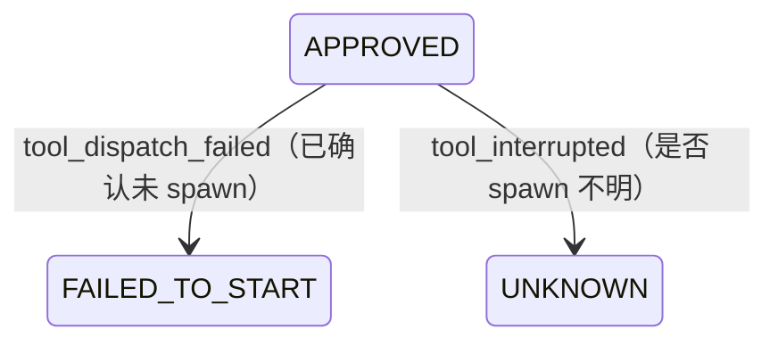

# P1-2 设计复核补充：R1–R4 契约澄清

版本：0.1，2026-11-07。适用基线：P1-2 工具生命周期设计文档（同分支）。

本文是 P1-2 设计提案的规范性补充。若本文与 `P1_TOOL_LIFECYCLE_DESIGN.md` 中相应表述存在歧义，以本文为准。本文不代表实现已完成或测试已运行。

## R1. 提案取消语义

用户可在尚未开始执行时取消提案，覆盖 PROPOSED 与 APPROVED 两种状态：

| 当前状态 | 操作 | 结果 | 事件 |
|---|---|---|---|
| PROPOSED | 用户取消 | CANCELLED | `tool_cancelled_before_start`，actor=user |
| APPROVED，尚未领取 | 用户取消 | CANCELLED | `tool_cancelled_before_start`，actor=user |
| APPROVED，已领取但尚未取得启动许可 | 用户取消先于启动许可 CAS 成功 | 设置取消意图；运行器确认未 spawn 后转 CANCELLED | `tool_cancel_requested`，随后 `tool_cancelled_before_start` |
| APPROVED，启动许可已取得或进程已启动 | 用户取消 | 不立即改变为 CANCELLED；等待运行器确认终止 | `tool_cancel_requested`，随后按实际终止事实记录 `tool_finished` 或 `tool_interrupted` |
| RUNNING | 用户取消 | 保持 RUNNING，直至确认终止；无法确认则 UNKNOWN | `tool_cancel_requested`，随后 `tool_finished` 或 `tool_interrupted` |
| REJECTED、FAILED_TO_START、CANCELLED 或其他终态 | 再次取消 | 幂等返回原终态或 409，不新增生命周期事件 | 无 |

取消是用户意图，不是进程已停止的证据。未领取的 PROPOSED/APPROVED 可直接终结；已领取的执行必须经过运行器确认未 spawn 或确认终止。API `POST .../{proposal_id}/cancel` 的 200 仅用于已确定的未执行取消；仍需运行器确认时返回 202。不得因取消请求直接生成 `tool_finished`。

## R2. 调度失败与 FAILED_TO_START 的映射

`tool_dispatch_failed` 只用于已经持久化 dispatch claim、但运行器能够提供可信证据证明进程从未 spawn 的情形。其唯一状态映射为：

- 前置状态：内部 dispatch 已 claim，尚无 `tool_started`；
- 必要证据：运行器确认 `confirmed_not_started=true`，并关联 execution_id/claim；
- 结果状态：`FAILED_TO_START`；
- 事件：追加一条 `tool_dispatch_failed`，引用对应 `tool_approved` 及 claim/dispatch 记录；
- 后续：该 execution 不得重试；需要重试时创建新 proposal 并重新审批。

如果失败发生在 claim 之前（例如队列不可用、功能开关关闭或策略拒绝），不创建 execution，不追加 `tool_dispatch_failed`，proposal 保持 APPROVED，API 返回可重试的服务错误或策略拒绝。

如果 spawn 调用返回异常，但无法证明进程未启动，必须进入 UNKNOWN 并记录 `tool_interrupted`；不得映射为 FAILED_TO_START。若已存在 `tool_started`，也不得使用 `tool_dispatch_failed`。

状态机应明确包含：

## R3. 超时、取消与自然退出的竞争规则

请求事件表达意图，运行器回执表达进程事实。最终 outcome 必须由受信运行器的单调时钟时间戳、进程退出回执和终止原因派生，不能按服务收到事件的先后顺序简单覆盖。

1. **自然退出先于超时/取消生效点**：如果运行器证明进程在 deadline 前已退出，或在取消请求被运行器接受并发出终止动作前已自然退出，则按真实 exit code 记录 SUCCEEDED/FAILED。后到的 timeout/cancel 请求不得改写结果。
2. **超时先发生**：若运行器单调时钟证明 deadline 已到而进程仍运行，记录超时请求；只有确认进程随后终止，才记录 TIMED_OUT。若无法确认终止，保持 UNKNOWN/待确认，不得提前标记 TIMED_OUT。
3. **取消先被运行器接受**：若运行器已接受取消并执行终止动作，且回执证明该动作导致进程终止，记录 CANCELLED。仅有用户请求、没有终止因果回执，不足以标记 CANCELLED。
4. **自然退出与终止动作竞态**：若进程在终止动作实际生效前自行退出，按实际 exit code 记录 SUCCEEDED/FAILED；取消请求仍保留为审计事实，但不改变 outcome。
5. **证据不足**：退出时间、deadline 顺序或终止因果无法确认时记录 UNKNOWN，并保留已知 exit_code/请求事件；不得同时设置互相矛盾的 `timed_out`、`termination_reason` 与 `outcome`。

字段约束：`timed_out=true` 当且仅当最终状态为 TIMED_OUT；`termination_reason=timeout` 也仅用于该状态。CANCELLED 必须有已确认的取消终止回执。自然非零退出即使发生在取消请求之后，也仍为 FAILED，而不是 CANCELLED。所有竞争结果通过唯一终结事务/CAS 决出；重复或迟到的终结回执只能幂等返回或 409，不能追加第二个 `tool_finished`。

## R4. 流式审计的有界写入策略

流式审计不得逐 token/逐 chunk 写一条 SQLite 事件。采用**有界批次元数据**，不记录 chunk 正文、工具参数或私有推理内容：

- 每个请求生成单调递增的 `chunk_sequence`；heartbeat 不计入内容 chunk。
- 按连续序号批量记录元数据；每批至少包含 `first_sequence`、`last_sequence`、`chunk_count`、`content_bytes_delta`、`tool_delta_count`、`first_received_at`、`last_received_at`。批次不得跨越序号缺口；发现缺口必须显式记录 gap/limitation。
- 批次刷新同时受“最大批量 chunk 数”和“最大等待时间”约束；请求终结、取消或异常时必须 flush 最后一批（若审计存储不可用则记录 audit gap，不能伪称已持久化）。
- 设置可配置的请求最长持续时间、最大内容 chunk 数和最大累计内容字节数。任一上限触发后停止继续消费内容并关闭上游连接，终结状态为明确的 `incomplete/limit_exceeded`，不得生成可执行 ToolProposal。
- 上述限额必须由服务端配置并在 `capabilities_snapshot` / 请求审计元数据中记录实际生效值；客户端不能扩大限额。默认值由实现配置给出，必须有硬上限与边界测试，不能无限制或仅依赖客户端超时。
- `model_stream_progress` 应以 request_id + batch_first_sequence（或等价 batch_id）唯一；保留每批覆盖的连续序号区间。批次事件和进度投影同一事务提交。恢复时不得补写未观测 chunk；缺失区间作为审计缺口保留。
- 测试至少覆盖：达到批量 chunk 上限、达到 flush 时间、请求时长上限、累计字节上限、最后一批 flush、序号缺口、取消时 flush、写库失败与重启恢复。验证事件数量受配置上限约束，且完整性判断不会因批量记录而把缺失 chunk 当成完整流。

批量记录只压缩审计元数据，不改变 SSE 协议完整性判定：仍必须观察协议终结信号及可接受 finish_reason，才能将响应标记为 complete。

## 验收边界

R1–R4 是后续实现必须遵守的契约。对应测试未实现、未运行前，不得在 PR 描述或报告中写成已通过。当前仍保持 DisabledBroker 默认关闭，不开放真实工具执行或模型网络 API。
