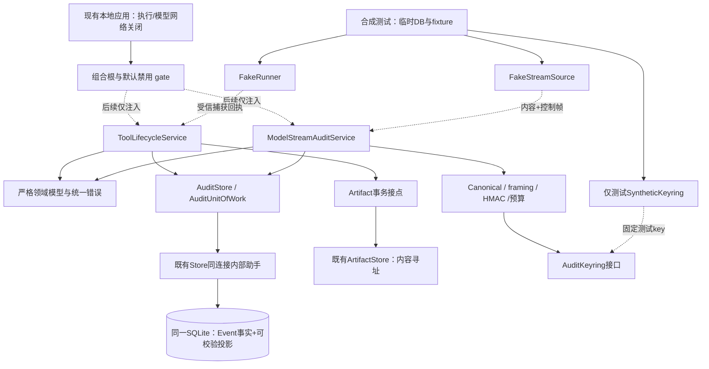

# 文件级实施方案与模块依赖

状态：待ChatGPT审查；所有 backend 路径都是在G01整合通过后的计划文件，不在本轮创建。

## 1. 模块图

服务依赖协议与AuditStore，不依赖FastAPI、不持有shell/网络客户端。Provider只通信；输出工具调用转换成提案，不产生实际started/finished。FakeRunner和测试key不进入应用组合根默认注册表。

## 2. 文件清单（拟议）

| 文件 | 责任/公开边界 | 所属任务 |
|---|---|---|
| backend/app/audit/contracts.py | ToolState、versioned payload、ProposalOrigin、Execution/Capture/ModelAudit DTO；strict整数/UTC/资源字段，不改旧Event含义 | A01 |
| backend/app/audit/errors.py | AuditError(code,correlation_id)、Conflict/Transition/Integrity/KeyUnavailable；不回显秘密/原始异常正文 | A01 |
| backend/app/audit/ports.py | AuditKeyring、KeyHandle、AuditedStreamSource、RunnerReceiptVerifier、Clock协议；无I/O默认实现 | A01/A04 |
| backend/app/audit/store.py | AuditStore与AuditUnitOfWork，统一SQLite连接与BEGIN IMMEDIATE，事件/关系/状态/dedup原子写 | A02 |
| backend/app/audit/tool_lifecycle.py | ToolLifecycleService，提案/决策/取消、claim与回执状态验证；不spawn | A05 |
| backend/app/audit/model_stream.py | ModelStreamAuditService，request/progress/gap/terminal协调；只消费注入观察源 | A07 |
| backend/app/audit/stream_codec.py | 生产待审Canonical/严格解析/framing，R5 size-only计费和固定KAT对应；不import参考runner | A08 |
| backend/app/audit/keyring.py | 默认DisabledAuditKeyring，解析version/key_id→不透明KeyHandle；无真实密钥生成/OS持久化 | A04 |
| backend/tests/fakes/runner.py | FakeRunner固定bytes/回执；失败、超时、失联与取消竞态，绝不subprocess/socket | A06 |
| backend/tests/fakes/stream.py | FakeStreamSource提供内容及明确终结/断连/取消；不碰真实Provider | A07 |
| backend/tests/fakes/keyring.py | 固定synthetic key的内存测试实现，不作为运行配置 | A04 |
| backend/tests/test_audit_transactions.py | 故障注入、并发、rollback、hash/投影一致 | A02/A03 |
| backend/tests/test_tool_lifecycle.py | 状态机、资源绑定幂等、actor、取消竞态、FakeRunner测试 | A05/A06 |
| backend/tests/test_stream_audit.py | 逐块编号/连续区间批/gap/唯一terminal、预算/取消/审计失败 | A07 |
| backend/tests/test_stream_codec_kat.py | 读取冻结fixture，生产模块与参考一致；expected只读 | A08 |
| backend/app/migrations/003_tool_lifecycle.sql | 前置审计身份表+工具生命周期表/约束；当前仅提议，不创建 | A03 |
| backend/app/migrations/004_model_audit.sql | 流进度/gap/terminal/state及依赖完整后的guard | A03 |

未来兼容接点仅在审核后变更：backend/app/store.py 提取 `_add_artifact_in_tx` 与扩展 `_append_event(event_refs=...)`；backend/app/models.py保留旧类型并追加新EventType；main.py只做禁用状态的依赖装配，不开放工具/模型网络路由。providers.py后续增加受控观察接点，legacy complete/stream调用签名保持可用，缺观察能力默认拒绝审计升级。以上修改本轮均未进行。

## 3. 核心接口草案（签名是审查对象，不是已实现代码）

| 接口 | 操作 | 不变量 |
|---|---|---|
| AuditStore | atomic(challenge_id) -> AuditUnitOfWork；read/replay/verify | 与既有Store用同DB，不另建“影子事件库” |
| AuditUnitOfWork | get_challenge、get_state、get_dedup、append_event、insert/update projection、record_dedup | 每次业务操作一个连接/一次BEGIN；不调用public Store.append/add_artifact |
| ToolLifecycleService | propose(ProposalCreate,principal,idempotency)、decide(pid,digest,decision,principal,key)、cancel(pid,principal,key) | 请求摘要含method/规范route/cid/pid/body；身份非客户端自由文本 |
| ToolLifecycleService（内部） | claim/record_started/finalize/interrupted | 每提案唯一execution；没有真实可信回执不能记真实开始/结束；本轮不开放HTTP |
| ModelStreamAuditService | open_request(config_snapshot,limits)、observe(event)、flush、close/terminal | I/O前有request审计；只读观察源，不调用模型；一次terminal |
| AuditKeyring | resolve(dataset_id,key_id,version)->KeyHandle | 不返回可序列化raw key；默认disabled/key_unavailable，不自动创建secret |
| KeyHandle | sign/verify固定domain framing；key_id/version只读 | 禁止repr/log泄密，固定testkey仅测试；真正OS backend另行任务 |
| AuditedStreamSource | async观察事件：response_started/content_delta/protocol_end/error/disconnect | 原chunk、控制帧、finish_reason与入口字节可观测；普通StreamChunk不足以替代 |
| FakeRunner | 按固定场景产生SyntheticReceipt和bytes句柄 | 只在tests/fakes；不执行用户argv、不访问网络/宿主程序 |

AuditStore同步短事务可由服务的有界写入协调器串行提交；单请求最多一批在提交中，不为流数据引入无界队列。不能在SQLite写锁内等待模型、进程、blob写入或大内容hash。取消遇写入在途时以已提交DB状态/唯一约束为准，不因async task取消而重新调度。

## 4. 原子生命周期

提案/审批/取消模板：BEGIN IMMEDIATE → 同连接校验challenge/当前state/资源绑定dedup/摘要/身份 → 追加Event并推进head → 写不可变关系/转换 → CAS投影revision → 保存首次响应 → COMMIT。任何步骤失败整体rollback；同键异目标或异payload=409；同键同请求只返回原响应。

claim只是持久领取，不是tool_started。FakeRunner测试模拟回执，但不写真实用户题库；只在临时测试DB中标注synthetic challenge上下文。真实runner没有实现与注册之前，claim/dispatch的应用入口disabled，不能因为内部方法存在就对外放行。

输出完成（后续A09/P1-2B）遵循artifact_lock→blob ingest/verify→同一AuditUnitOfWork完成两路Artifact元数据、新artifact_added、tool_output_captured、输出links、tool_finished、state/head/dedup。去重只复用既有Artifact/source_event，不改成每次执行的新来源；空stdout/stderr可同ID但role分离。DB失败保留恢复证据，不重跑工具。

## 5. 模型与错误边界

旧stream在EOF也yield最终response，且上层拿不到DONE/finish_reason，所以在真正观察协议实现前，只用FakeStreamSource。ModelStreamAuditService不信任“迭代器正常结束”=完整；模型ToolCall只有成功完整终结+可追溯request_id/call_id后可提案。

内部接收层chunk逐号，持久层唯一batch_id和连续序号区间；完整投影/P_batch/P_request预算在构造对象/Canonical/HMAC前检查。R5资源超限整批拒绝，不finally flush拒绝批。audit_complete与protocol_complete独立，缺口/未知尾部必须可见；receipt_only不声称content重新验过。

领域错误返回安全code/correlation_id，不附请求、stdout、API Key或原异常内容。原调用失败+审计失败同时出现时保留原异常向上抛出，另报安全audit_write_failed；普通成功响应遇审计失败不能宣称已审计成功。数据库损毁时不保证能写gap，依赖已开始记录恢复，不能造事件。
