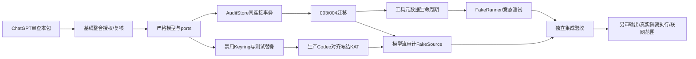

# P1-2A 任务拆分与验收 gate

本轮交付止于六份审查文档。下列任务尚未交付代码，也未向DeepSeek发送；ChatGPT审查后每项独立分支/PR实施，禁止合并未经审查的协议改动。Codex负责边界/集成，DeepSeek负责审核后的具体模块，ChatGPT负责独立验收。

## 1. 依赖顺序

## 2. 可下发任务卡

| ID/建议负责人 | 前置 | 文件与明确产物 | 最小验收 | 禁止/边界 |
|---|---|---|---|---|
| A00 Codex集成 | ChatGPT批准整合方案 | 在实施分支整合审核后的P1-1（已含P0.1）固定版本，复核现有docs/KAT与001/002 | backend/frontend可用；既有全部测试/构建回归；提交完整diff与无未提交修改证据 | 不改PR #1/#2/#3源分支，不重复复制Event/Store，不自动合并他人PR |
| A01 DeepSeek，Codex审核契约 | A00 | contracts.py/errors.py/ports.py；versioned DTO、状态/来源/错误；Clock/KeyHandle/RunnerReceiptVerifier/StreamSource Protocol | strict类型拒绝bool/float/coercion；保留call_id/request_id/execution_id关联；旧Event/Artifact可读；没有I/O副作用 | 不改旧hash/历史数据/冻结KAT；未列错误优先级先报告 |
| A02 DeepSeek，Codex集成 | A01 | AuditStore/AuditUnitOfWork；内部tx助手提取方案；event_refs默认兼容 | BEGIN内任何注入失败均rollback Event/head/state/dedup；并发sequence与CAS；重放投影一致 | 不串联public Store方法，不另建事件库；没有审批/工具网络API |
| A03 DeepSeek，ChatGPT审核迁移 | A02及MIGRATION_PLAN职责批准 | 003/004与schema complete gate；FK/index/触发器 | 001→002→003→004历史字节不变；中途故障/重启/REPLACE/跨题/双terminal阻断 | 不编辑001/002，不生成key、不自动回填legacy执行、不支持静默降级 |
| A04 DeepSeek | A01 | DisabledAuditKeyring与tests内SyntheticKeyring；不透明handle | 默认key_unavailable；仅显式测试注入固定synthetic key；repr/log无secret；版本/dataset绑定 | 不实现真实OS keyring，不随机生成实际审计key，不读API Key |
| A05 DeepSeek | A03 | ToolLifecycleService的propose/decide/cancel、内部claim/receipt状态骨架 | 原子提案/决策/取消、同键异pid冲突、拒绝不claim、每提案唯一execution；PROPOSED取消与各stage actor/HTTP DTO符合§3.1 | 应用默认execution=false；接口存在不等于可对外执行；没有shell或HTTP工具路由 |
| A06 DeepSeek | A05 | FakeRunner/FakeClock/可信测试principal、合成状态机集成测试 | 未批准拒绝、claim/spawn许可取消竞争、无start不得finish、异常/timeout/UNKNOWN不伪造，重复消息不重复事件 | FakeRunner只在tests临时DB；不注册生产、不从模型文本构造stdout、不执行argv |
| A08 DeepSeek | A04 | stream_codec.py，严格词法/Canonical/framing/预算，按固定fixture验收 | 现有195条只读expected通过；结构预检前于对象构建；单字节UTF8/数组/record/batch/request边界；无正文审计泄漏 | 不import参考runner代替生产实现；不重算expected/篡改V1；未指定组合错误另审 |
| A07 DeepSeek | A03+A08 | ModelStreamAuditService及FakeStreamSource；纯内存内容处理+原子批审计 | 请求开始/响应开始/批/gap/唯一terminal；DONE/finish证明；cancel/disconnect/limit收尾；receipt_only与内容重验区分；key不可用不降级 | 不调用真实Provider；legacy StreamChunk.response不足则拒绝完整升级；无网络API |
| A09 Codex集成，ChatGPT验收 | A06+A07 | 组合根只装配默认disabled；全部回归与缺口报告 | P0/P1-1与KAT/新测试分别报告；health关闭标志；无真实调用；状态投影可重放 | 不靠demo当验收；真实工具/联网需下一阶段独立授权 |

A08列在A07前置，不按数字顺序盲目并行。迁移与Store助手互相评审后才能分工，禁止两个人分别实现各自事务owner。任务卡是一次可审的模块范围，不是要求DeepSeek一轮完成全系统。

## 3. 输出证据与后续阶段

当前P1-2A只在FakeRunner/临时DB证明服务协议与事务；真实stdout/stderr持久化集成另设P1-2B任务：经审查的受信捕获句柄→现有ArtifactStore原始bytes→同连接Artifact/来源/捕获/完成事务、共享锁/失败恢复/空输出去重。Fake输出测试也必须显式是合成场景，不能导入用户题库作真实事实。

真实runner、OS/容器隔离、生产凭证、安全审批会话、真实Provider观察接口接入、网络授权与重定向限制均不因本包通过自动开启。XSWCTF最多3活动容器配置保留；容器计数/启动机制不在此轮运行。不会扫描平台、提交Flag或接入比赛附件。

## 4. ChatGPT本轮审查问题（有具体提案，尚未执行）

- 是否接受G01的“先整合P1-1固定版本（已含P0.1）”前置，不在docs/KAT分支另造同名基础模块？
- 是否批准AuditUnitOfWork作为单一事务owner，public Store/Artifact语义冻结、只提取内部助手与扩展event_refs？
- 是否接受003前置身份表/004完成stream表的依赖安排与schema complete启动gate？
- 是否接受生产keyring默认禁用、测试key仅注入，以及旧Provider未满足观察契约时不提供完整审计升级？
- 是否接受A01–A09范围和P1-2B分界，并保留所有真实执行/网络关闭？

审查后再按批准项逐个下发；不要求用户现在提供凭证，也不在审查等待期间实现业务逻辑。
